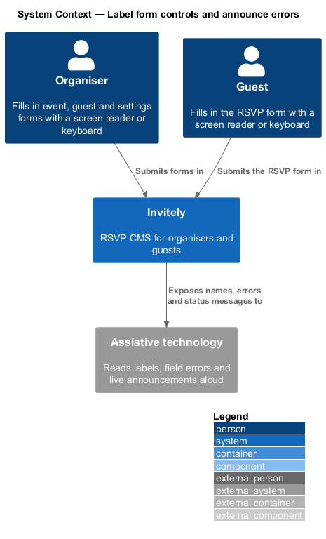
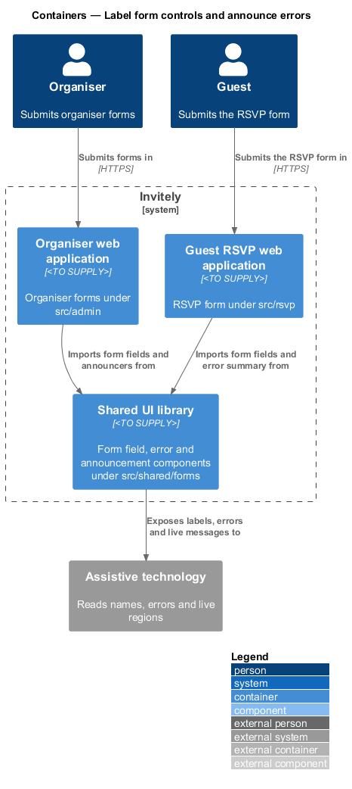
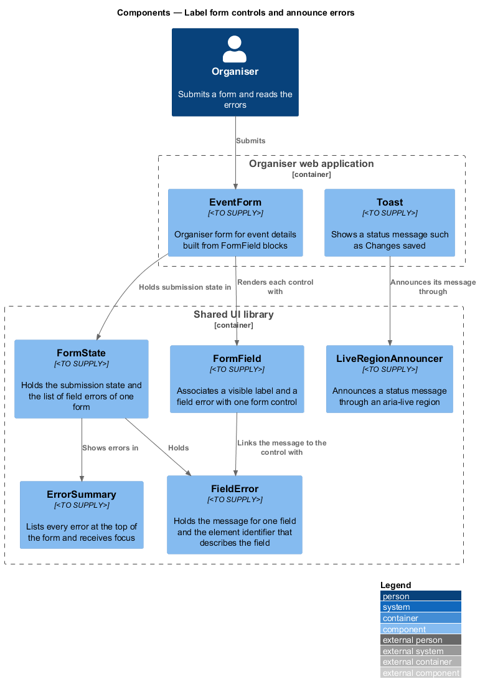
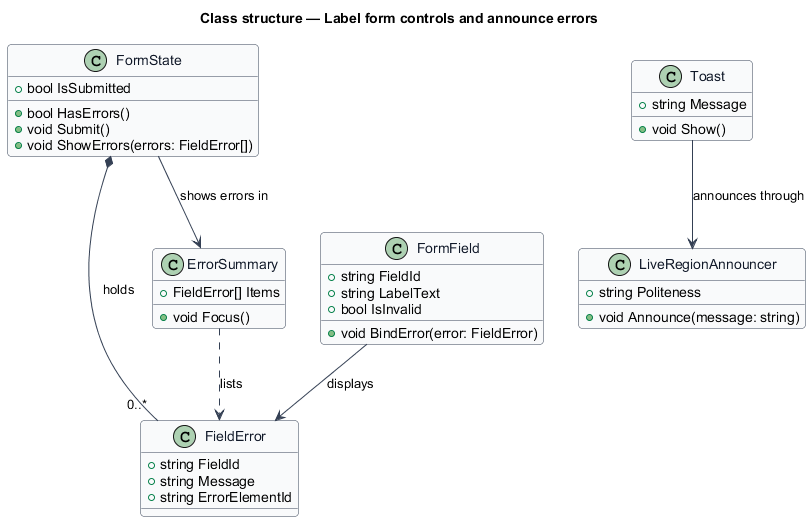
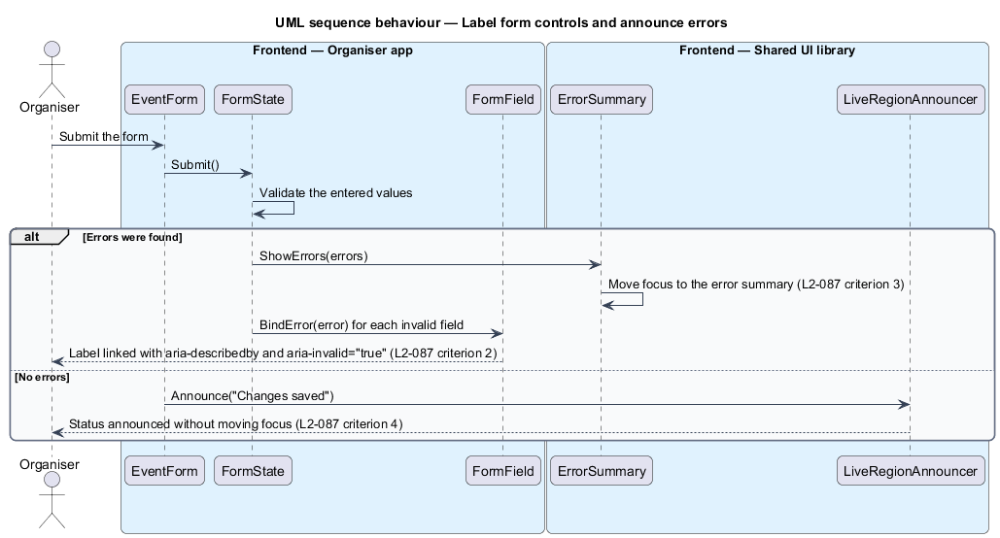

# Label form controls and announce errors

## Overview

An **accessible name** is the text that assistive technology reads for a form control. A **field error** is the message that explains why one field is invalid. An **error summary** is a list of every field error at the top of a form. A **live region** is an area of the page whose content assistive technology announces when it changes, without moving focus.

L1-015 requires labelled form controls and announced errors on every screen. L2-087 turns that into four rules. Every form control shall have a visible label associated through a label element or `aria-labelledby`. A field error shall be linked to its field with `aria-describedby`, and the field shall have `aria-invalid="true"`. When a form is submitted with errors, an error summary shall list each error and shall receive focus. A toast or status message shall be announced through an `aria-live` region without moving focus.

The feature defines the shared form parts in `src/shared/forms`. The organiser forms and the guest RSVP form use these parts, so every form exposes its errors in the same way. The toast component that announces status messages is shared with the organiser application in `src/shared/ui/toast`. This feature covers only how the client presents the errors.

## Description

- `FormState` — holds the submission state of one form and the list of its `FieldError` records. `Submit` validates the entered values and `ShowErrors` presents the result.
- `FormField` — shared wrapper in `src/shared/forms/field` that renders a visible label, binds the control to the label, and links a `FieldError` to the control with `aria-describedby`. It sets `aria-invalid="true"` on an invalid control.
- `FieldError` — message for one field. It holds the `FieldId` of the field, the message text and the `ErrorElementId` that the control describes.
- `ErrorSummary` — list of every error of a form in `src/shared/forms/summary`. It receives focus when the errors appear.
- `LiveRegionAnnouncer` — announcer in `src/shared/ui/announce` that writes a message into an `aria-live` region. Its `Politeness` value is `<TO SUPPLY>` because L2-087 does not state it.
- `Toast` — status component in `src/shared/ui/toast` that calls `LiveRegionAnnouncer` each time it shows a message.
- `EventForm` — example organiser form in `src/admin/events` built from `FormField` blocks.

## Requirements

The feature realizes the following level-2 (L2) requirement. The requirement refines a level-1 (L1) requirement, cited by identifier.

| L2 ID | Refines (L1) | Requirement |
|-------|--------------|-------------|
| `L2-087` | `L1-015` | Form controls must have names and errors must be announced. |

## Diagrams

### System context

Organisers and guests submit forms in Invitely, and assistive technology reads the labels, the field errors and the live announcements.

### Containers

The organiser and guest web applications import the form fields, the error summary and the announcer from the shared UI library. The shared library exposes the labels and messages to assistive technology.

### Components

`FormState` holds the `FieldError` records of a form, and `ErrorSummary` shows them at the top of the form. `FormField` links each error to its control, and `Toast` announces status messages through `LiveRegionAnnouncer`.

### Class structure

`FormState` composes zero or more `FieldError` records. `FormField` displays a `FieldError`, `ErrorSummary` lists the same records, and `Toast` announces its message through the announcer.

### Behaviour — submit a form with errors

When the organiser submits a form with invalid values, the state shows the error summary and focuses it, and each invalid field is linked to its message. When the submission succeeds, the status message is announced without moving focus.

