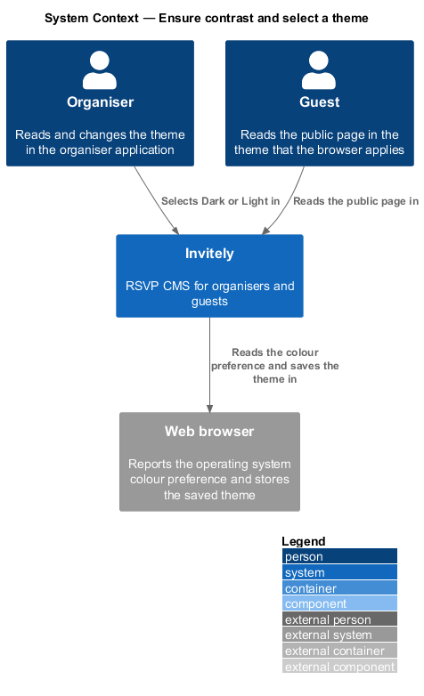
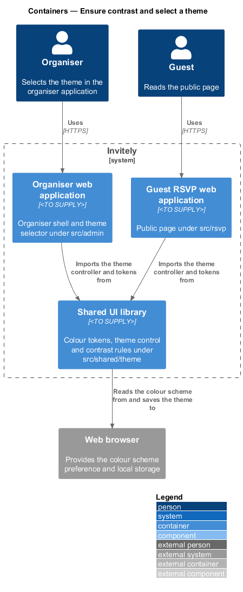
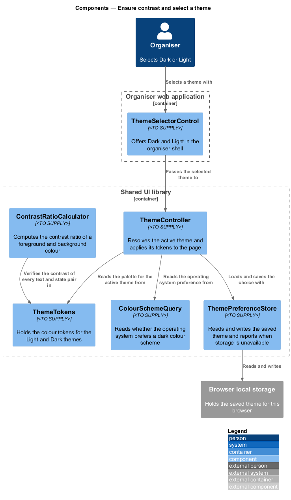
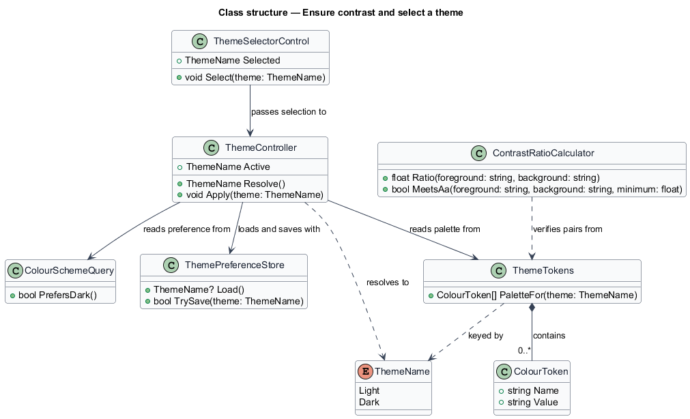
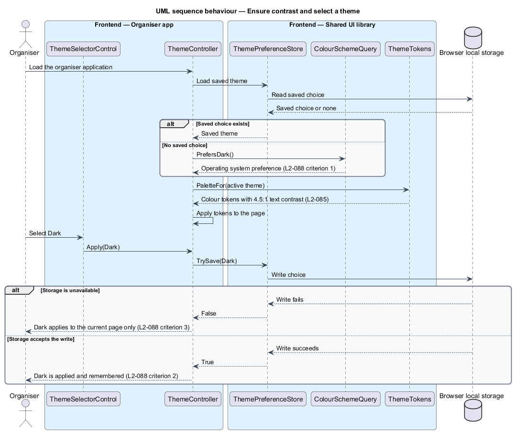

# Ensure contrast and select a theme

## Overview

**Contrast ratio** is the measured difference in relative luminance between a foreground colour and its background, expressed as a value from 1:1 to 21:1. A **theme** is a named set of colour values that the whole interface uses, and this feature provides two themes, Light and Dark. A **colour token** is a named colour value, such as the body text colour, that components refer to instead of a literal colour.

L1-015 requires every screen to meet WCAG 2.2 Level AA in both themes. L2-085 sets the contrast thresholds: 4.5:1 for body text and for the Success, Warning and Danger status colours used with text, and 3:1 for borders, focus rings and icons that convey state. L2-088 requires that the Light or Dark theme is applied from the operating system preference when no choice is saved, and that an organiser's choice is remembered in the browser.

The feature defines the colour tokens for each theme, the controller that resolves and applies the active theme, the store that remembers the choice, and a calculator that verifies every colour pair against the thresholds. The shared parts live in `src/shared/theme`. The organiser theme control lives in the organiser shell in `src/admin/shell`.

## Description

- `ThemeTokens` — set of colour tokens in `src/shared/theme`, one palette per theme. Each palette holds the text, background, border, focus ring and status colours.
- `ColourToken` — one named colour value in a palette.
- `ThemeName` — enumeration of `Light` and `Dark`.
- `ThemeController` — resolves the active theme and applies its palette to the page. It uses the saved choice first, then the operating system preference, and then falls back to `Light` when neither is available.
- `ColourSchemeQuery` — reads whether the operating system prefers a dark colour scheme.
- `ThemePreferenceStore` — reads and writes the saved theme in the browser. `TrySave` returns `false` when storage is unavailable, so the controller applies the theme for the current page only and shows no error.
- `ThemeSelectorControl` — control in `src/admin/shell` that offers Dark and Light and passes the selection to the controller.
- `ContrastRatioCalculator` — computes the contrast ratio of two colours and reports whether a pair meets a minimum. The acceptance tests for L2-085 use it to check every pair in `ThemeTokens` for both themes.

The fallback theme when the operating system reports no colour preference is `<TO SUPPLY>`, because L2-088 names only the dark preference.

## Requirements

The feature realizes the following level-2 (L2) requirements. Each L2 requirement refines the level-1 (L1) requirement cited in its row.

| L2 ID | Refines (L1) | Requirement |
|-------|--------------|-------------|
| `L2-085` | `L1-015` | Text and interface colours must be readable in both themes. |
| `L2-088` | `L1-015` | Light and dark themes must be available and remembered. |

## Diagrams

### System context

Organisers select a theme in Invitely, guests read the public page in the theme that applies to their browser, and the browser supplies the colour preference and stores the saved choice.

### Containers

The organiser and guest web applications both import the theme controller and the tokens from the shared UI library. The shared library reads the colour scheme and saves the theme in the browser.

### Components

`ThemeController` reads the palette from `ThemeTokens`, the preference from `ColourSchemeQuery` and the saved choice from `ThemePreferenceStore`. `ContrastRatioCalculator` checks the palette, and it is not part of the page at run time.

### Class structure

`ThemeTokens` contains `ColourToken` records keyed by `ThemeName`. `ThemeController` resolves a `ThemeName` from the store and the query, and `ThemeSelectorControl` passes the organiser's selection to the controller.

### Behaviour — apply and remember a theme

On page load the controller uses the saved choice, or the operating system preference when no choice is saved. When the organiser selects a theme, the controller saves it, and it applies the theme for the current page only when storage is unavailable.

