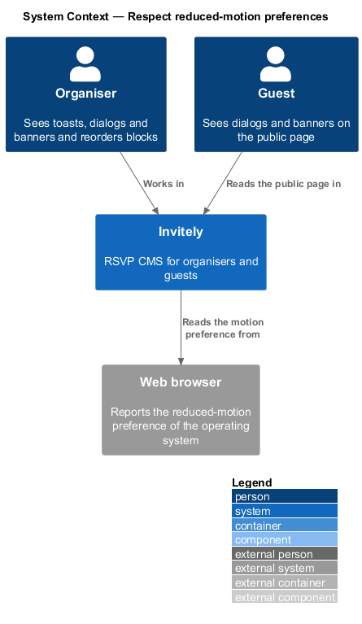
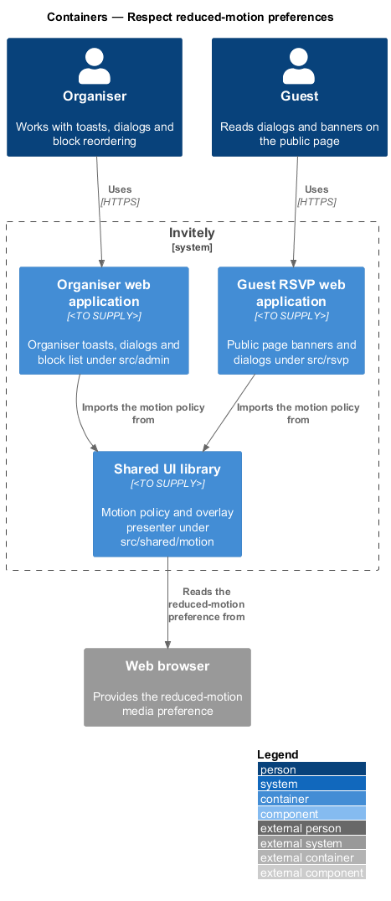
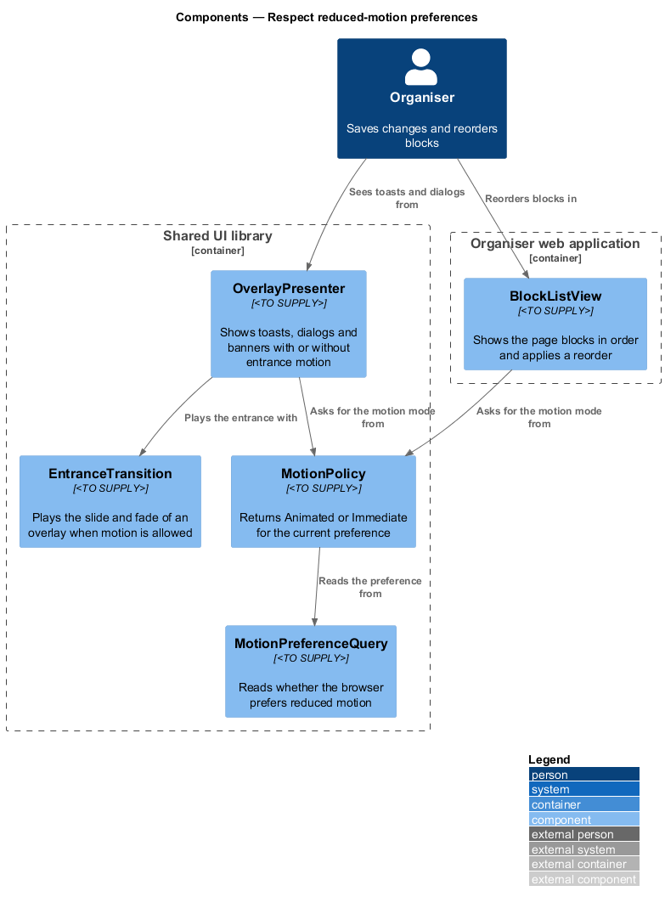
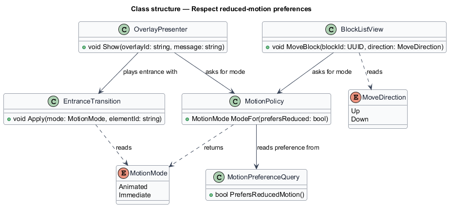
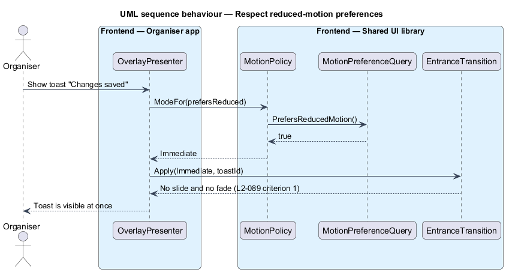

# Respect reduced-motion preferences

## Overview

**Reduced motion** is an operating-system setting that asks applications to limit animation, such as slides and fades, because motion can cause discomfort for some people. The browser exposes this setting as the `prefers-reduced-motion` media preference. An **entrance transition** is the slide or fade that plays when a toast, dialog or banner appears. A **block reorder** is the change of position of a content block on the organiser's page draft.

L1-015 requires every screen to respect reduced-motion preferences. L2-089 sets two rules. When the preference is set, a toast, dialog or banner shall appear without a slide or fade. When the preference is set, a block list reorder shall take effect immediately with no animation.

The feature defines one decision point, `MotionPolicy`, that returns the motion mode from the preference. Every overlay and every reorder asks the policy before it animates, so the rule is applied in one place. The shared parts live in `src/shared/motion`. The block list that reorders blocks is organiser-only and lives in `src/admin/page-builder`.

## Description

- `MotionPreferenceQuery` — reader in `src/shared/motion` that reports whether the browser prefers reduced motion.
- `MotionPolicy` — maps the preference to a `MotionMode`. It returns `Immediate` when reduced motion is preferred and `Animated` otherwise.
- `MotionMode` — enumeration of `Animated` and `Immediate`.
- `EntranceTransition` — plays the slide and fade of an overlay when the mode is `Animated`, and applies no motion when the mode is `Immediate`.
- `OverlayPresenter` — shows toasts, dialogs and banners. It asks `MotionPolicy` for the mode and passes it to `EntranceTransition`.
- `BlockListView` — organiser component in `src/admin/page-builder` that shows the blocks in order. `MoveBlock` asks `MotionPolicy` for the mode and applies the new position without animation when the mode is `Immediate`.
- `MoveDirection` — enumeration of `Up` and `Down`, the two keyboard-operable reorder actions of L2-013.

The duration of the animated entrance for each overlay is `<TO SUPPLY>`, because no requirement states it.

## Requirements

The feature realizes the following level-2 (L2) requirement. The requirement refines a level-1 (L1) requirement, cited by identifier.

| L2 ID | Refines (L1) | Requirement |
|-------|--------------|-------------|
| `L2-089` | `L1-015` | Motion must respect user preferences. |

## Diagrams

### System context

Organisers and guests use Invitely, and the browser reports whether the operating system asks for reduced motion.

### Containers

The organiser and guest web applications import the motion policy from the shared UI library. The shared library reads the preference from the browser.

### Components

`OverlayPresenter` and `BlockListView` both ask `MotionPolicy` for the mode, and the policy reads the preference from `MotionPreferenceQuery`. `EntranceTransition` plays the overlay entrance only in the animated mode.

### Class structure

`MotionPolicy` returns a `MotionMode`. `OverlayPresenter` uses `EntranceTransition` for its entrance, and `BlockListView` reads a `MoveDirection` for each reorder.

### Behaviour — show a toast with reduced motion

When the preference is set, the presenter receives the `Immediate` mode from the policy and shows the toast without a slide or fade.

