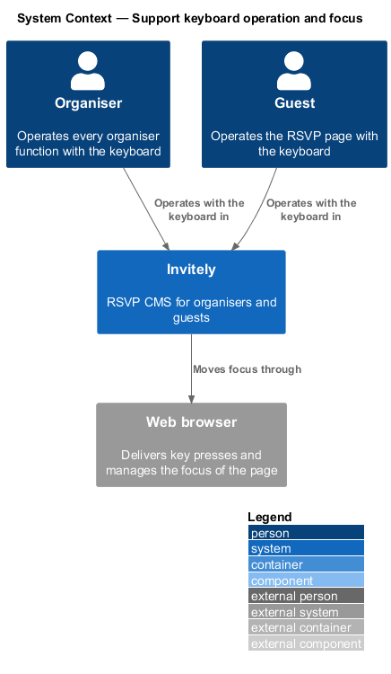
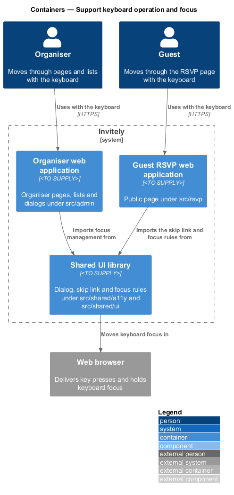
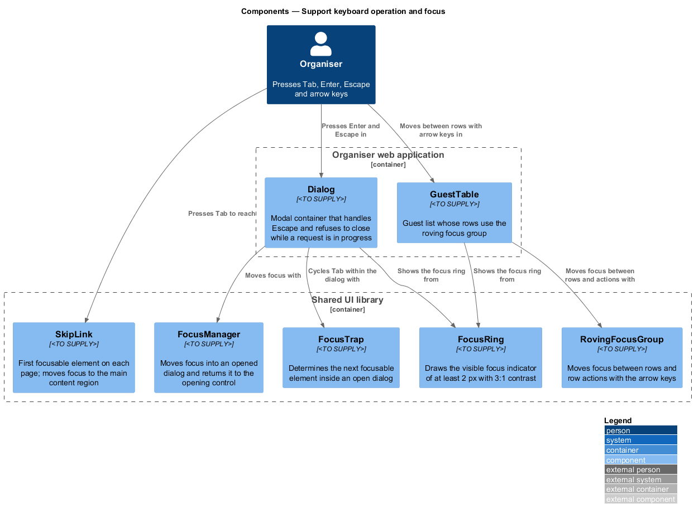
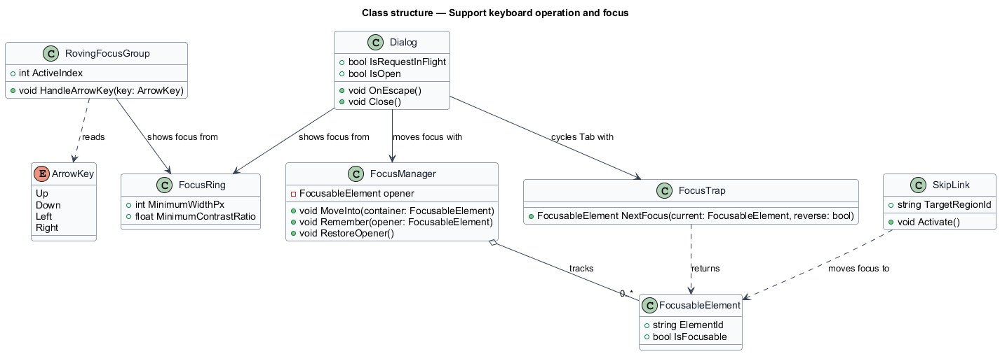
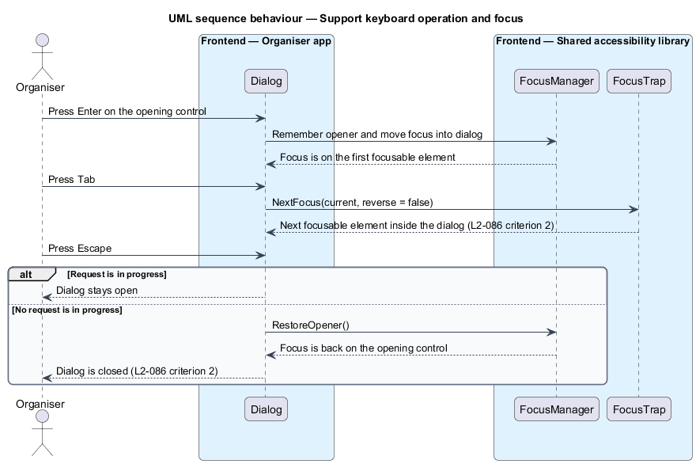

# Support keyboard operation and focus

## Overview

**Keyboard operation** is the use of a page through the Tab, Enter, Escape and arrow keys alone. **Focus** is the element of the page that receives the next key press, and a **focus ring** is the visible indicator drawn around the focused element. A **skip link** is the first focusable element on a page, which moves focus past the navigation to the main content.

L1-015 requires full keyboard operation with visible focus on every screen. L2-086 turns that into four rules: a skip link is the first focusable element on any page; focus moves into an opened dialog, Tab cycles within it, and Escape closes it unless a request is in progress, returning focus to the opening control; every focusable control shows a focus ring of at least 2 px with 3:1 contrast; and focus moves between list rows and row actions in a logical order with the arrow keys.

The feature defines the shared focus parts in `src/shared/a11y`, which the organiser and guest web applications both use. The dialog component is shared with [adapt-dialogs](../../responsive-design/adapt-dialogs/README.md), and the focus ring colour comes from the tokens defined in [ensure-contrast-and-themes](../ensure-contrast-and-themes/README.md).

## Description

- `SkipLink` — first focusable element in `src/shared/a11y/skip-link`. It moves focus to the main content region identified by `TargetRegionId`.
- `FocusManager` — records the control that opened a dialog, moves focus into the dialog, and restores focus to the opener when the dialog closes.
- `FocusTrap` — returns the next focusable element inside an open dialog for a forward or reverse Tab, so that focus cycles within the dialog.
- `FocusableElement` — reference to one focusable control, identified by its element identifier.
- `Dialog` — shared modal in `src/shared/ui/dialog`. Its `OnEscape` method closes the dialog only when `IsRequestInFlight` is false, so a delete in progress cannot be dismissed.
- `RovingFocusGroup` — keeps one active index for a list of rows and their actions, and moves that index on each `ArrowKey` press. It is used by `GuestTable` in `src/admin/guests`.
- `ArrowKey` — enumeration of `Up`, `Down`, `Left` and `Right`.
- `FocusRing` — shared focus indicator in `src/shared/ui/focus`. Its `MinimumWidthPx` is 2 and its `MinimumContrastRatio` is 3.0 against the adjacent colour.

The order of row actions inside `RovingFocusGroup` for a row that has many actions is `<TO SUPPLY>`, because L2-086 requires only a logical order.

## Requirements

The feature realizes the following level-2 (L2) requirement. The requirement refines a level-1 (L1) requirement, cited by identifier.

| L2 ID | Refines (L1) | Requirement |
|-------|--------------|-------------|
| `L2-086` | `L1-015` | Every function must be available from the keyboard. |

## Diagrams

### System context

Organisers and guests operate Invitely with the keyboard, and the browser delivers the key presses and holds the focus.

### Containers

The organiser and guest web applications import the focus rules and the skip link from the shared UI library. The shared library moves keyboard focus inside the browser.

### Components

`Dialog` moves focus through `FocusManager` and cycles Tab through `FocusTrap`. `RovingFocusGroup` handles the arrow keys for list rows. Both dialogs and rows use `FocusRing` for the visible indicator.

### Class structure

`Dialog` depends on `FocusManager` and `FocusTrap`. `FocusManager` tracks `FocusableElement` records, and `RovingFocusGroup` reads an `ArrowKey` to change its active index.

### Behaviour — keyboard use of a dialog

The organiser opens a dialog from the keyboard, Tab moves focus through the dialog, and Escape closes it and returns focus to the opener unless a request is in progress.

