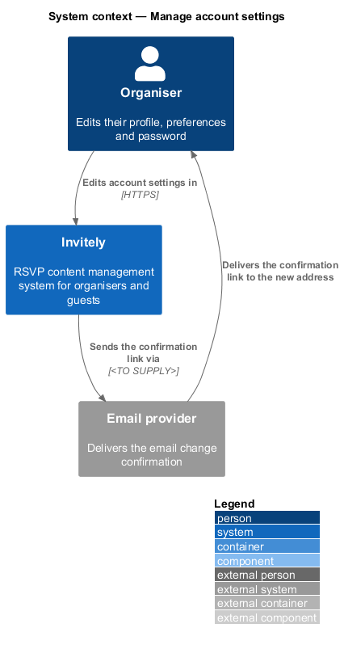
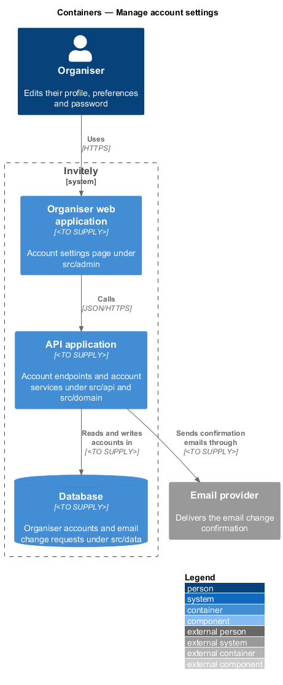
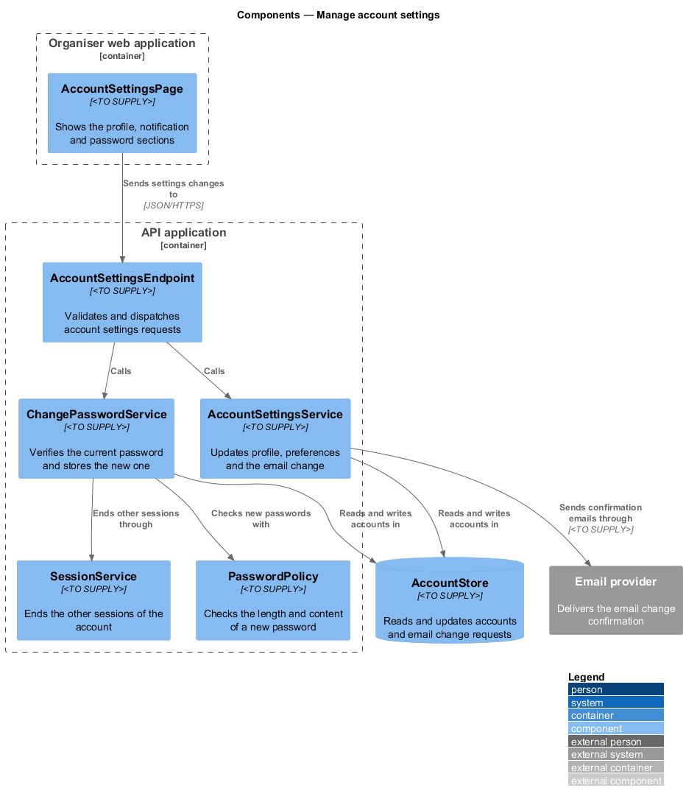
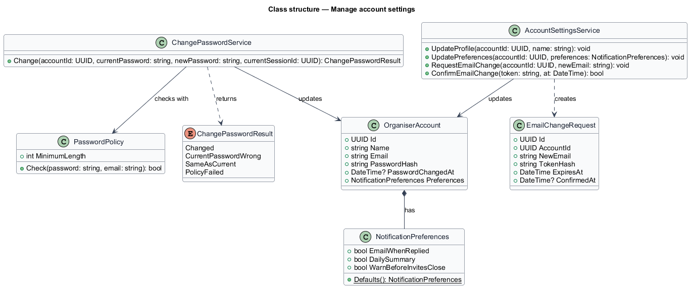
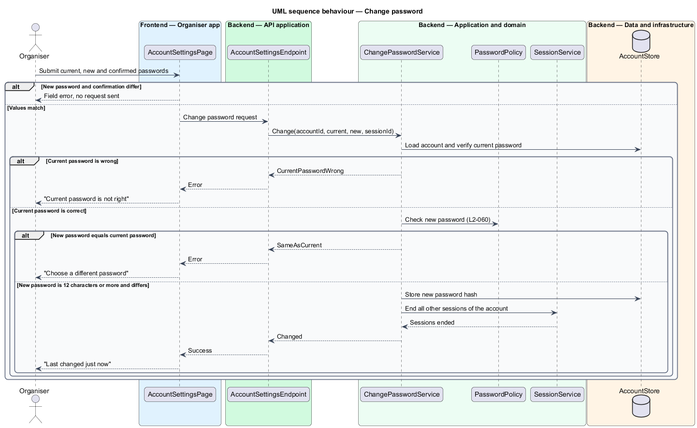
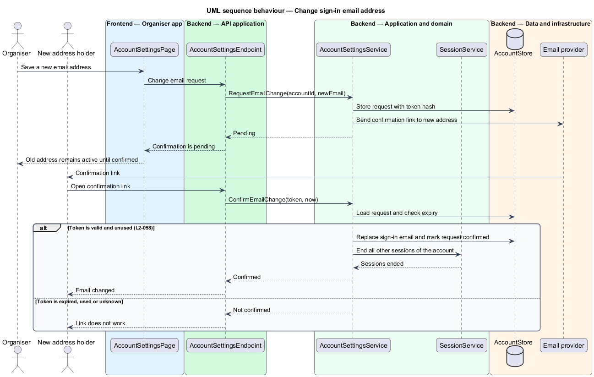

# Manage account settings

## Overview

The *account settings* are the details an organiser controls about their own account, separate from any event. They hold the profile (name), the notification preferences, the sign-in email address and the password. Event-level settings belong to the events subsystem.

Three kinds of change need care. A change of sign-in email is confirmed by the new address before it takes effect. A password change needs the current password. Both a password change and an email change end the other sessions of the account, so that another device loses access.

- **notification preferences** — set of three choices that control which account emails the organiser receives
- **email change request** — pending request to replace the sign-in email, which takes effect only when its confirmation link is opened

## Description

The feature is a vertical slice that runs from the account settings page to the account store.

- **`AccountSettingsPage`** — page component in the organiser web application under `src/admin`. It has three sections, Profile, Notifications and Password, and it shows the save toast and the "Last changed just now" status.
- **`AccountSettingsEndpoint`** — HTTP endpoint under `src/api`. It dispatches each settings request to the settings service or the password service.
- **`AccountSettingsService`** — domain service that updates the profile and the notification preferences, creates an email change request, and confirms the request when its link is opened.
- **`ChangePasswordService`** — domain service that verifies the current password, applies the password policy, stores the new hash and ends the other sessions of the account.
- **`PasswordPolicy`** — domain component shared with the Reset a forgotten password feature. It requires at least 12 characters and rejects a password identical to the email address.
- **`OrganiserAccount`** — domain entity holding the name, sign-in email, password hash, password change time and notification preferences of one organiser.
- **`NotificationPreferences`** — value object with three flags: `EmailWhenReplied`, `DailySummary` and `WarnBeforeInvitesClose`. `Defaults()` returns `true`, `false` and `true` in that order, as set for each new account.
- **`EmailChangeRequest`** — domain entity holding the new address, the token hash, the expiry time and the confirmation time of one pending change.
- **`ChangePasswordResult`** — enumeration of the outcomes of a password change: `Changed`, `CurrentPasswordWrong`, `SameAsCurrent` and `PolicyFailed`.
- **`SessionService`** — the session component of the Manage organiser sessions feature. It ends every session of the account except the current one.
- **`AccountStore`** — persistence component under `src/data` that reads and updates `OrganiserAccount` and `EmailChangeRequest` records. `<TO SUPPLY>` for the storage technology.

## Requirements

The feature realizes the following level-2 (L2) requirements. Each L2 requirement refines a level-1 (L1) requirement, cited by identifier.

| L2 ID | Refines (L1) | Requirement |
|-------|--------------|-------------|
| `L2-058` | `L1-010` | Organisers must keep their profile current. Changing the sign-in email needs confirmation. |
| `L2-059` | `L1-010` | Organisers must control which emails they receive. |
| `L2-060` | `L1-010` | Organisers must change their password by providing the current one. |

## Diagrams

### System context

The organiser edits account settings in Invitely. A change of sign-in email sends a confirmation link through an external email provider to the new address.

### Containers

The account settings page in the organiser web application calls the API application. The API application reads and writes accounts in the database and sends confirmation emails through the email provider.

### Components

`AccountSettingsEndpoint` dispatches profile and preference changes to `AccountSettingsService` and password changes to `ChangePasswordService`. The password service uses `PasswordPolicy` and ends other sessions through `SessionService`.

### Class structure

`OrganiserAccount` holds a `NotificationPreferences` value. `AccountSettingsService` creates `EmailChangeRequest` records, and `ChangePasswordService` returns a `ChangePasswordResult`.

### Behaviour — change password

The password service checks the current password first (L2-060), then rejects a new password equal to the current one. A successful change stores the new hash and ends the other sessions of the account.

### Behaviour — change sign-in email address

The old address stays active until the confirmation link is opened (L2-058). Opening a valid link replaces the sign-in email and ends the other sessions of the account.

