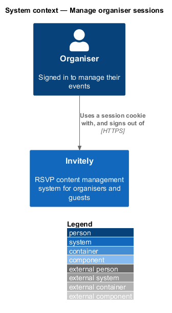
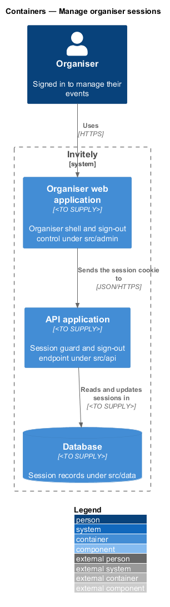
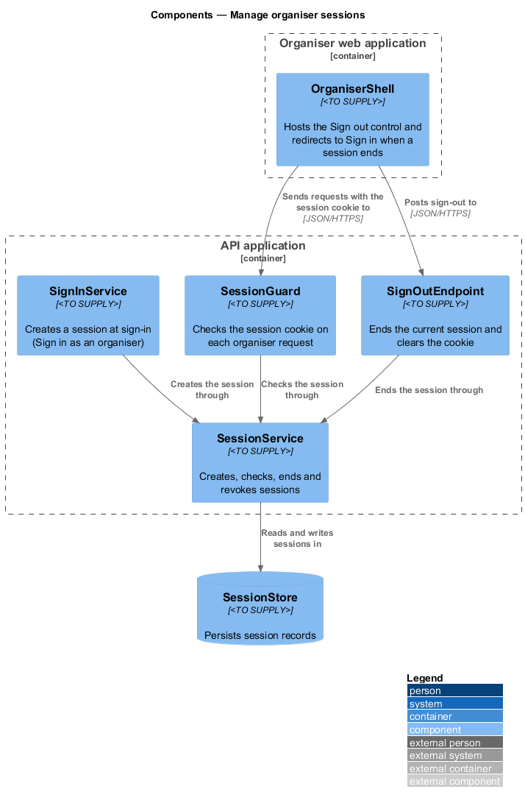
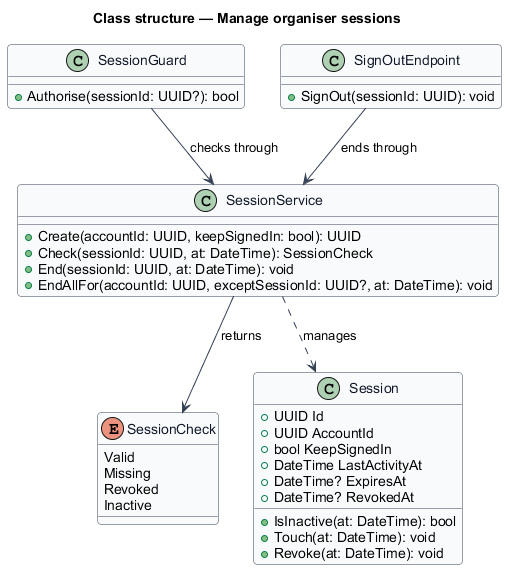
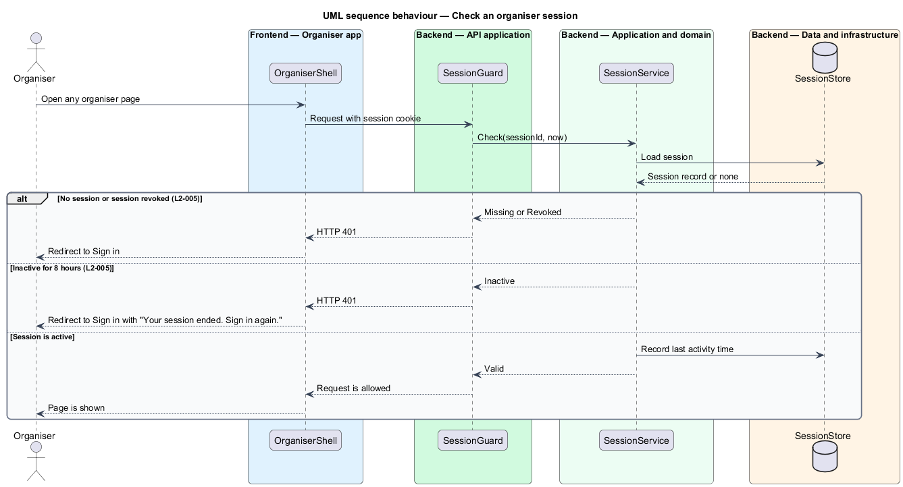
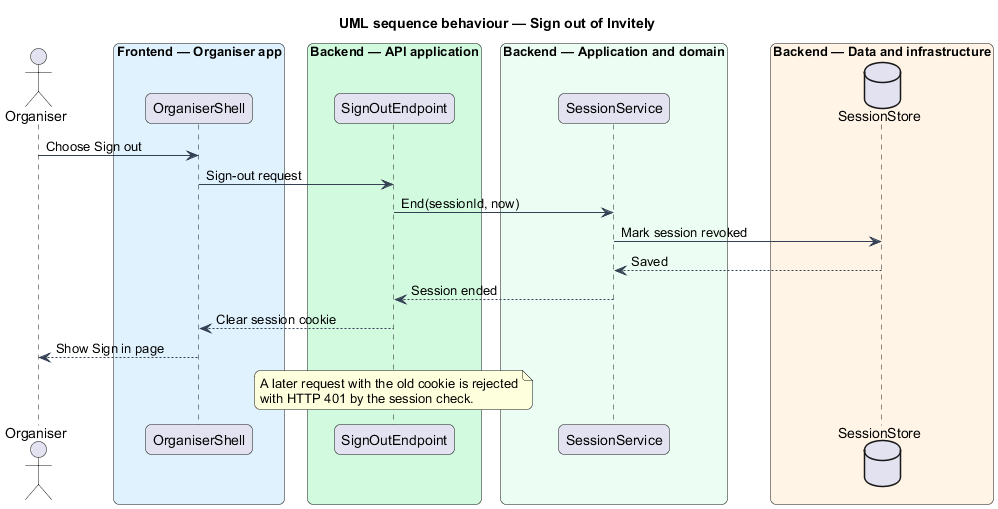

# Manage organiser sessions

## Overview

A *session* is the server-side record that links a signed-in browser to one organiser account. The browser holds only a session cookie that identifies the session. The server decides on every request whether that session is still valid, so ending a session on the server ends access immediately, whatever the browser holds.

Sessions are created at sign-in. This feature governs how long they last and how they end. Three rules apply. A session ends after 8 hours without activity. A session ends when the organiser signs out. A session ends when the account's password is changed or reset from another device.

- **inactivity limit** — period without a request after which a session is no longer valid, set to 8 hours
- **revoked session** — session whose record has been ended by sign-out or by a password change, and which no request can use again

The sign-in feature creates sessions, and the password reset and account settings features end the other sessions of an account. Both are described in their own features.

## Description

The feature is a vertical slice that runs from the organiser shell to the session store.

- **`OrganiserShell`** — component in the organiser web application under `src/admin`. It hosts the Sign out control and redirects to Sign in with the message "Your session ended. Sign in again." when the API returns 401.
- **`SessionGuard`** — component under `src/api` that runs before each organiser request. It reads the session cookie and asks `SessionService` whether the session is valid. It returns HTTP 401 when the session is not valid.
- **`SignOutEndpoint`** — HTTP endpoint under `src/api` that ends the current session and clears the session cookie.
- **`SessionService`** — domain service that creates, checks, ends and revokes sessions. It sets the expiry from the `KeepSignedIn` choice: 30 days when the choice is set, and the browser session otherwise.
- **`SessionCheck`** — enumeration of the results of a check: `Valid`, `Missing`, `Revoked` and `Inactive`.
- **`Session`** — domain entity holding the account identifier, the sign-in choice, the last activity time, the expiry time and the revocation time. `IsInactive` compares the last activity time with the 8 hour limit.
- **`SignInService`** — the sign-in component of the Sign in as an organiser feature. It calls `SessionService.Create` after a successful sign-in.
- **`SessionStore`** — persistence component under `src/data` that reads and writes `Session` records. `<TO SUPPLY>` for the storage technology.

## Requirements

The feature realizes the following level-2 (L2) requirement. The requirement refines a level-1 (L1) requirement, cited by identifier.

| L2 ID | Refines (L1) | Requirement |
|-------|--------------|-------------|
| `L2-005` | `L1-001` | Sessions must end after inactivity and must be ended when the organiser signs out. |

## Diagrams

### System context

The organiser holds a session cookie while signed in. The system alone decides whether the session is valid, so no external system takes part.

### Containers

The organiser web application sends the session cookie with each request to the API application. The API application reads and updates session records in the database.

### Components

`SessionGuard` and `SignOutEndpoint` both use `SessionService`. `SignInService` creates sessions through the same service, and `SessionService` persists them in `SessionStore`.

### Class structure

`SessionService` manages `Session` records and returns a `SessionCheck`. `SessionGuard` and `SignOutEndpoint` depend on the service and do not hold session state themselves.

### Behaviour — check a session on each request

Each organiser request passes through `SessionGuard`. An inactive or revoked session yields HTTP 401, and the shell redirects the organiser to Sign in. An active session has its last activity time recorded before the request proceeds.

### Behaviour — sign out

The shell posts the sign-out request, and `SessionService` marks the session revoked. The response clears the cookie. A later request that reuses the old cookie fails the session check.

