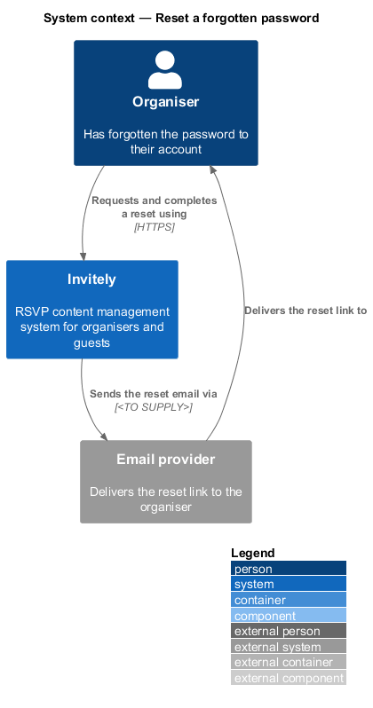
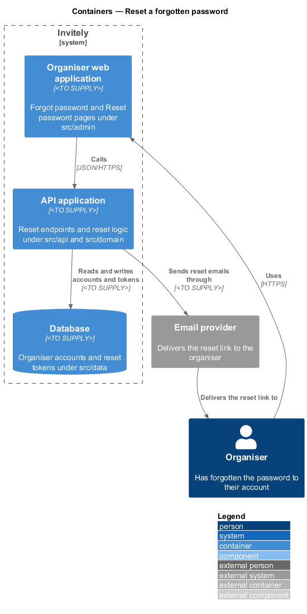
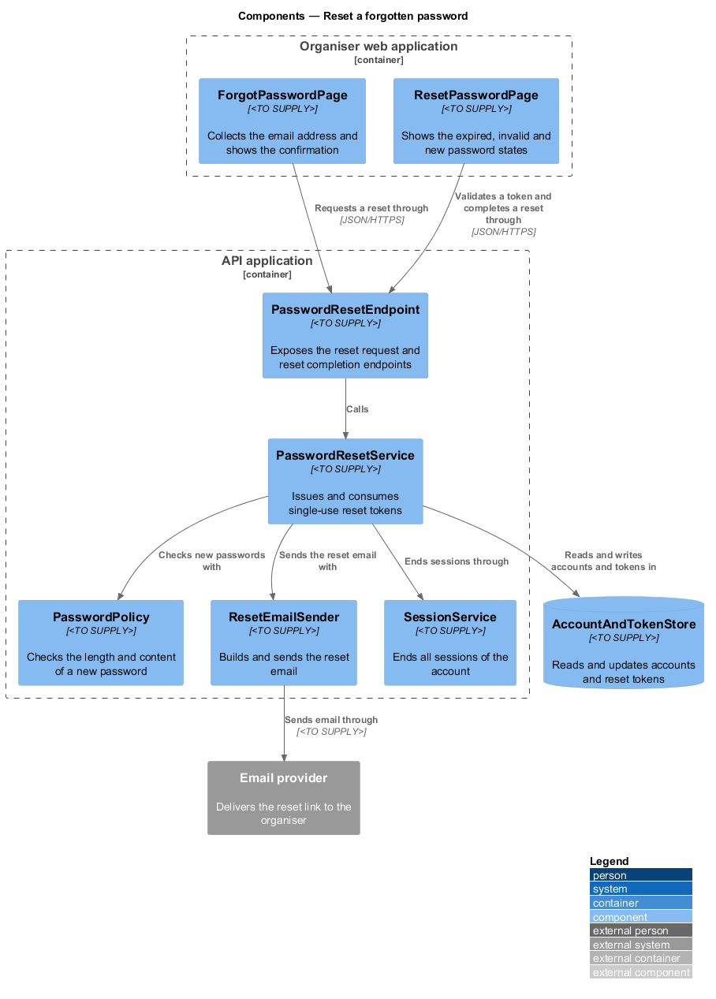
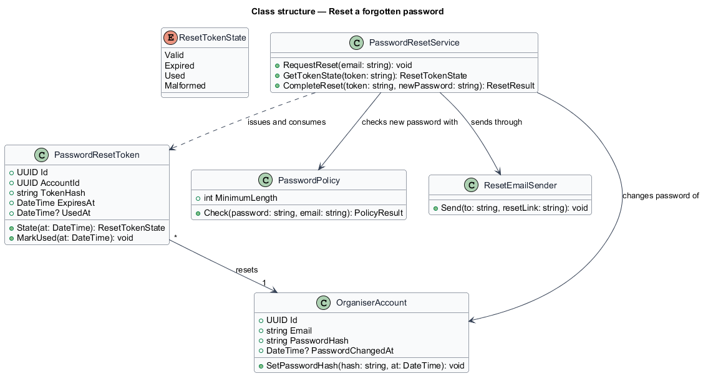
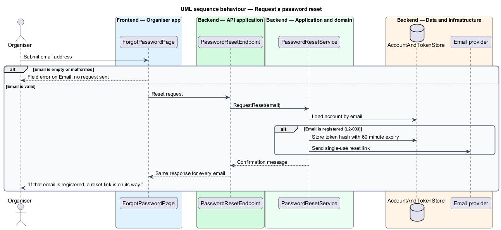
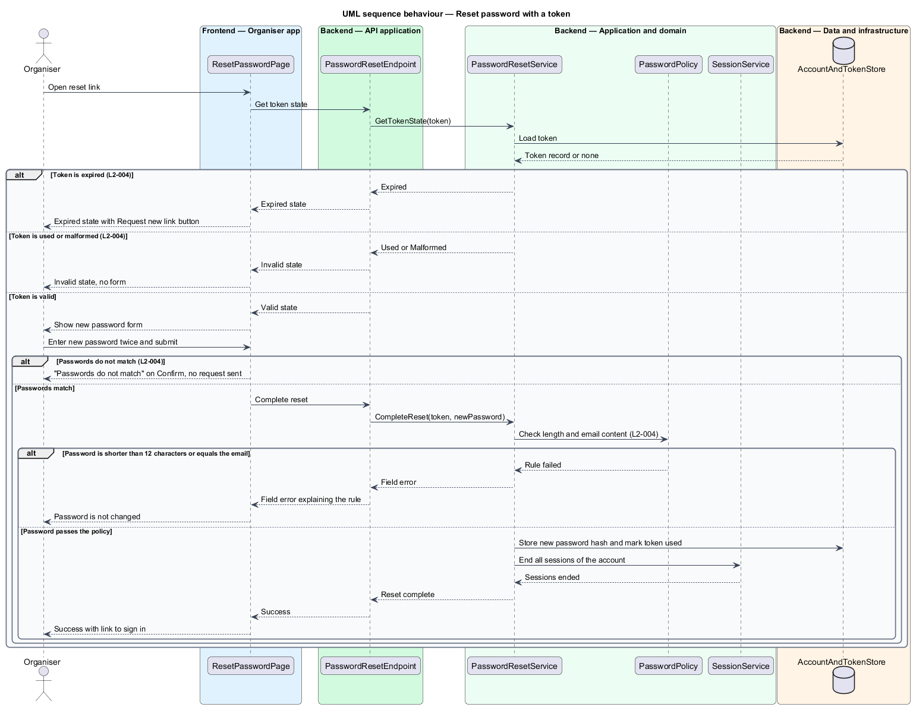

# Reset a forgotten password

## Overview

An *organiser* is a signed-in user who owns events. An organiser who has forgotten their password cannot sign in, so the sign-in page offers a reset. The reset is a two-step flow. First the organiser asks for a link by email. Then the organiser opens the link and sets a new password.

The flow is built to avoid account discovery. The Forgot password page returns the same confirmation for every email address, so a visitor cannot learn from the page whether an account exists.

- **reset token** — random, single-use value sent in a reset link. Each token expires after 60 minutes.

This feature covers the request page, the reset email, the token lifecycle, the reset page states and the password change itself. Ending existing sessions after the change is delegated to the Manage organiser sessions feature.

## Description

The feature is a vertical slice that runs from the Forgot password and Reset password pages to the account store and the email provider.

- **`ForgotPasswordPage`** — page component in the organiser web application under `src/admin`. It collects the email address, validates its format, and shows the confirmation message.
- **`ResetPasswordPage`** — page component under `src/admin`. It shows the expired, invalid and new password states, and it checks that the two password fields match before it sends a request.
- **`PasswordResetEndpoint`** — HTTP endpoint under `src/api`. It exposes a request endpoint, which accepts an email address, and a token endpoint, which returns the token state and completes a reset.
- **`PasswordResetService`** — domain service that issues reset tokens, reads their state, and completes a reset by setting the new password hash and marking the token used.
- **`PasswordPolicy`** — domain component that checks a new password. It requires at least 12 characters and rejects a password identical to the email address. The change password flow in the Manage account settings feature uses the same component.
- **`ResetEmailSender`** — domain component that builds the reset email with the single-use link and hands it to the email provider.
- **`PasswordResetToken`** — domain entity holding the stored token hash, the owning account, the expiry time and the time it was used. Its `State` method returns a `ResetTokenState`.
- **`ResetTokenState`** — enumeration of the states a token may hold when a page opens it: `Valid`, `Expired`, `Used` and `Malformed`.
- **`AccountAndTokenStore`** — persistence component under `src/data` that reads and updates `OrganiserAccount` and `PasswordResetToken` records. `<TO SUPPLY>` for the storage technology.
- **`SessionService`** — the session component of the Manage organiser sessions feature. This feature calls it to end all sessions of the account after a successful reset.

## Requirements

The feature realizes the following level-2 (L2) requirements. Each L2 requirement refines a level-1 (L1) requirement, cited by identifier.

| L2 ID | Refines (L1) | Requirement |
|-------|--------------|-------------|
| `L2-003` | `L1-001` | An organiser who has forgotten their password must be able to request a reset link without the system revealing whether the email is registered. |
| `L2-004` | `L1-001` | An organiser must set a new password from a reset link. |

## Diagrams

### System context

The organiser asks for and completes a reset in Invitely. Invitely sends the reset link through an external email provider.

### Containers

The organiser web application calls the API application for both steps. The API application stores tokens and accounts in the database and sends the reset email through the email provider.

### Components

`PasswordResetEndpoint` delegates to `PasswordResetService`. The service uses `PasswordPolicy` before it accepts a new password, and calls `SessionService` after a successful reset.

### Class structure

`PasswordResetService` issues and consumes `PasswordResetToken` records. Each token belongs to one `OrganiserAccount`. The service uses `PasswordPolicy` and `ResetEmailSender`.

### Behaviour — request a reset

The request always returns the same confirmation, and an email is sent only for a registered address (L2-003).

### Behaviour — reset password with a token

The reset page first reads the token state (L2-004) and shows the expired or invalid state where it applies. A valid token shows the form. The service applies the password policy before it stores the new hash, marks the token used and ends all sessions of the account.

