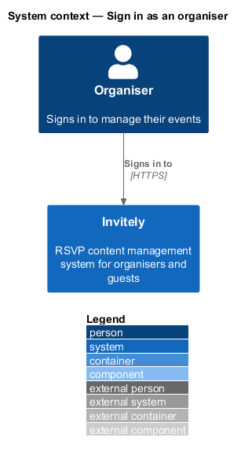
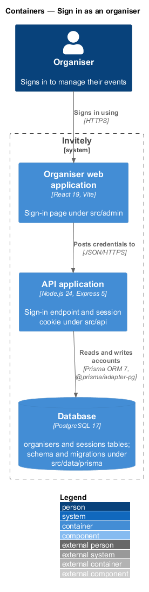
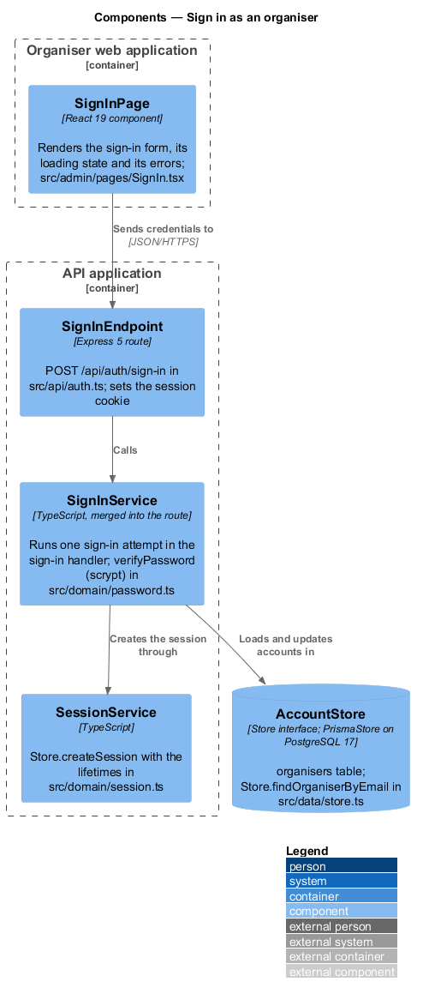
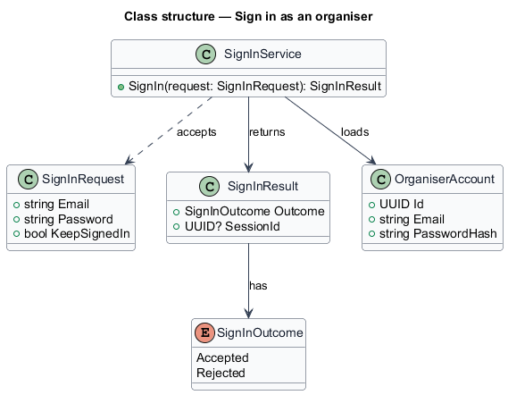
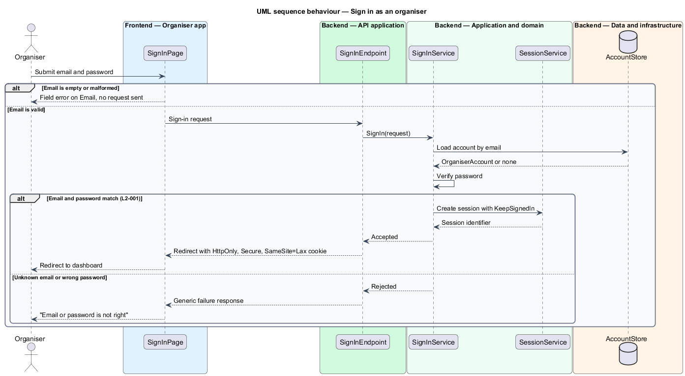

# Sign in as an organiser

## Overview

Invitely is a content management system for running event RSVPs. An *organiser* is a signed-in user who owns events and manages their guests, invitations and replies. Guests never sign in; they reach the public pages through personal links or invitation codes.

Sign-in is the entry point to the organiser web application. An organiser signs in with an email address and a password. When the credentials match a registered account, the system creates a **session** and sets a session cookie in the browser.

- **session** — server-side record that links a signed-in browser to one organiser account for a limited time
This feature covers the sign-in form and the credential check. Session lifetime and sign-out are described in the Manage organiser sessions feature. Password reset is described in the Reset a forgotten password feature. Both are referenced here where a sign-in depends on them.

## Description

The feature is a vertical slice that runs from the sign-in page to the account store.

- **`SignInPage`** — page component in the organiser web application under `src/admin`. It renders the Email and Password fields, the Keep me signed in option, the loading state and the error messages.
- **`SignInEndpoint`** — HTTP endpoint under `src/api`. It passes the credentials to the sign-in service and sets the session cookie with the `HttpOnly`, `Secure` and `SameSite=Lax` attributes on success.
- **`SignInService`** — domain service that runs one sign-in attempt. It loads the account, verifies the password, and asks the session service to create a session on a match.
- **`OrganiserAccount`** — domain entity holding the email address and password hash of one organiser.
- **`SignInOutcome`** — enumeration of the results of an attempt: `Accepted` and `Rejected`.
- **`AccountStore`** — persistence component under `src/data` that reads and updates `OrganiserAccount` records. It is realised by the `Store` interface, whose `findOrganiserByEmail`, `findOrganiserById` and `setPassword` methods read and update the `organisers` table. Each row holds the unique email address, the scrypt password hash, `password_version` and `password_changed_at`.
- **`SessionService`** — the session component described in the Manage organiser sessions feature. This feature calls it with the `KeepSignedIn` flag to choose the session lifetime.

The organiser app (`src/admin`) and the guest app (`src/rsvp`) are React 19 applications built with Vite. The API application runs on Node.js 24 with Express 5 and exchanges JSON over HTTPS.

The code places each design component as follows.

| Design component | Where it lives |
|------------------|----------------|
| `SignInPage` | `SignInPage` in `src/admin/pages/SignIn.tsx` |
| `SignInEndpoint` | `POST /api/auth/sign-in` in `authRoutes`, `src/api/auth.ts`; the cookie is `sid` |
| `SignInService` | Merged into the `POST /api/auth/sign-in` handler; `verifyPassword` in `src/domain/password.ts` checks the scrypt hash |
| `OrganiserAccount` | `OrganiserRecord` in `src/data/store.ts`; `Organiser` model in `src/data/prisma/schema.prisma` |
| `SignInOutcome` | No separate type; the handler answers 200 with a redirect, or 401 with "Email or password is not right" |
| `AccountStore` | `organisers` table through the `Store` interface |
| `SessionService` | `Store.createSession`, with `REMEMBER_MS` (30 days) in `src/domain/session.ts` |

Persistence goes through the `Store` interface in `src/data/store.ts`. The running app uses `PrismaStore` (`src/data/prismaStore.ts`), which reaches PostgreSQL 17 through Prisma ORM 7 with the `@prisma/adapter-pg` driver adapter. Every automated test and the Playwright e2e server use the in-memory `MemoryStore` (`src/data/memoryStore.ts`) instead. The schema and migrations are `src/data/prisma/schema.prisma` and `src/data/prisma/migrations/`.

## Requirements

The feature realizes the following level-2 (L2) requirements. Each L2 requirement refines a level-1 (L1) requirement, cited by identifier.

| L2 ID | Refines (L1) | Requirement |
|-------|--------------|-------------|
| `L2-001` | `L1-001` | An organiser must sign in with an email address and password. The sign-in form must show a loading state while the request is in flight and must block a second submission. |

## Diagrams

### System context

The organiser signs in to Invitely over HTTPS. No other external system takes part in the sign-in.

### Containers

The sign-in page in the organiser web application posts credentials to the API application. The API application reads and updates organiser accounts in the database.

### Components

`SignInEndpoint` delegates each attempt to `SignInService`. The service loads the account from `AccountStore`, and it calls `SessionService` after a match.

### Class structure

`SignInService` accepts a `SignInRequest` and returns a `SignInResult`. It loads an `OrganiserAccount`. The result holds a `SignInOutcome`.

### Behaviour — sign in

The page validates the email format before any request is sent. A matching password creates a session. A malformed email is shown as a field error with no request sent, and an unknown email and a wrong password end with the same message.

