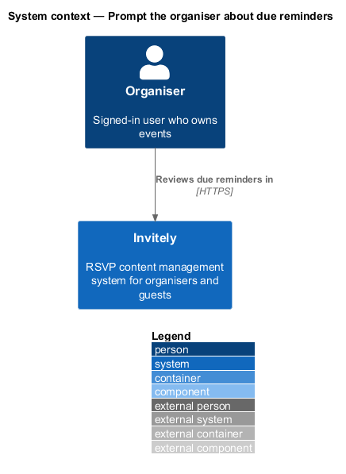
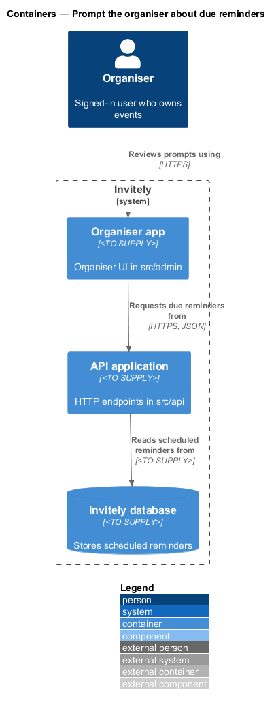
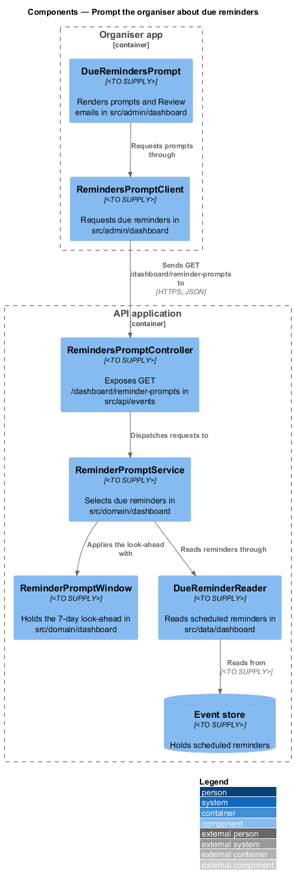
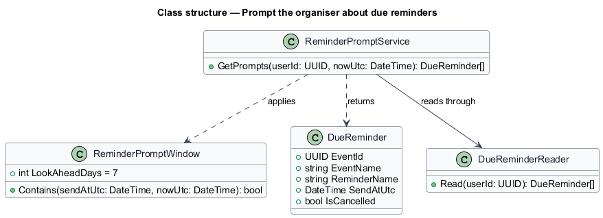
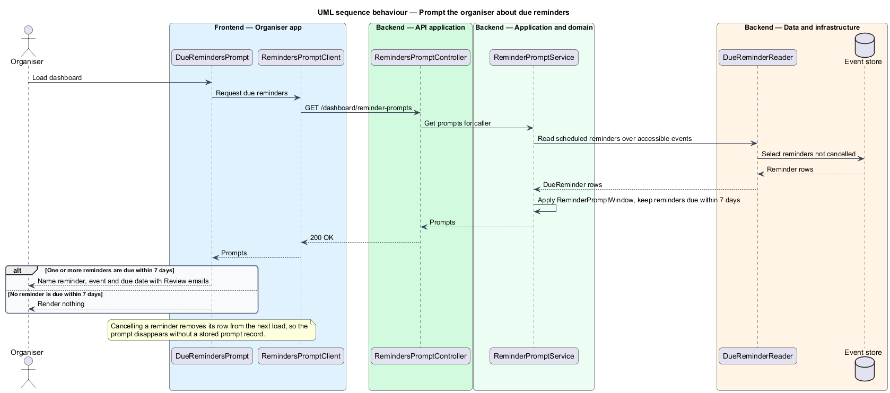

# Prompt the organiser about due reminders

## Overview

A **reminder** is a scheduled email that re-sends an invitation to the guests who have not replied yet. An organiser schedules reminders in the emails area of an event. A reminder that is about to go out is **due**, and the dashboard prompts the organiser when a reminder is due within the next 7 days, so the organiser can review the emails before they are sent.

The prompt is derived each time the dashboard loads. The system does not store a prompt record, so cancelling a reminder or moving its send date removes or changes the prompt on the next load. A prompt names the reminder, its event and its due date, and offers a Review emails action that opens the emails page of that event.

The prompt is one part of the dashboard, described alongside the summary in `docs/detailed-designs/dashboard/show-dashboard-summary/`. Scheduling reminders and sending them are described in the email features under the events and guest subsystems.

## Description

The feature spans the organiser UI, the API, the domain and the data layer.

- **`DueRemindersPrompt`** — organiser UI component in `src/admin/dashboard`. It renders one prompt per due reminder with the reminder name, event name, due date and the Review emails action. It renders nothing when the list is empty.
- **`RemindersPromptClient`** — typed client in `src/admin/dashboard` that requests the due reminders.
- **`RemindersPromptController`** — endpoint class in `src/api/events` that exposes `GET /dashboard/reminder-prompts`.
- **`ReminderPromptService`** — domain service in `src/domain/dashboard` that selects the reminders due within the prompt window for the caller.
- **`ReminderPromptWindow`** — value object in `src/domain/dashboard` holding the 7-day look-ahead.
- **`DueReminder`** — read model in `src/domain/dashboard` holding the reminder name, event identifier, event name, due instant and cancellation state.
- **`DueReminderReader`** — read component in `src/data/dashboard` that selects scheduled reminders over the caller's accessible events.

## Requirements

The feature realizes the following level-2 (L2) requirement. It refines the level-1 (L1) requirement cited in its row.

| L2 ID | Refines (L1) | Requirement |
|-------|--------------|-------------|
| `L2-054` | `L1-008` | The dashboard must prompt the organiser about due reminders. |

## Diagrams

### System context

The organiser sees the reminder prompt on the dashboard in Invitely and follows it to the emails page of the event.

### Containers

The organiser app requests the prompts from the API application, which reads scheduled reminders from the Invitely database.

### Components

`RemindersPromptController` dispatches the request to `ReminderPromptService`, which applies `ReminderPromptWindow` to the rows that `DueReminderReader` returns.

### Class structure

`ReminderPromptService` returns the `DueReminder` rows that fall inside a `ReminderPromptWindow`.

### Behaviour — prompt due reminders

The dashboard requests the prompts on each load. A reminder due within 7 days produces a prompt, and a cancelled reminder produces none, so the prompt disappears on the next load.

