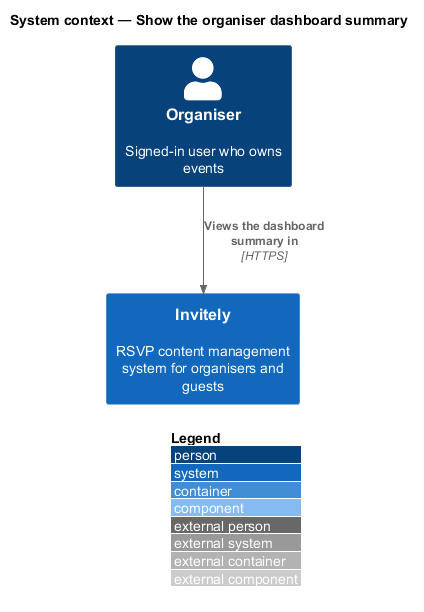
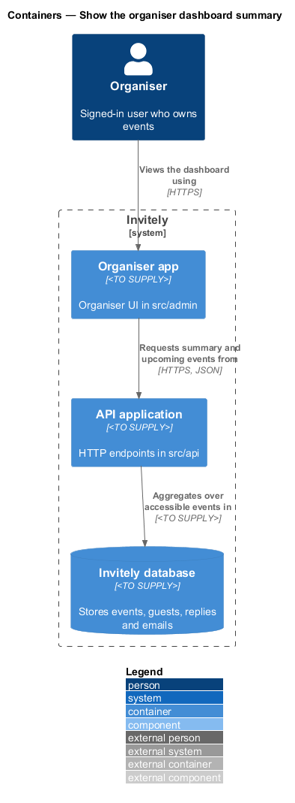
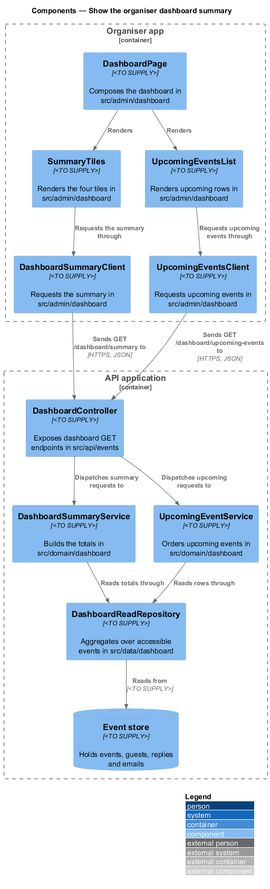
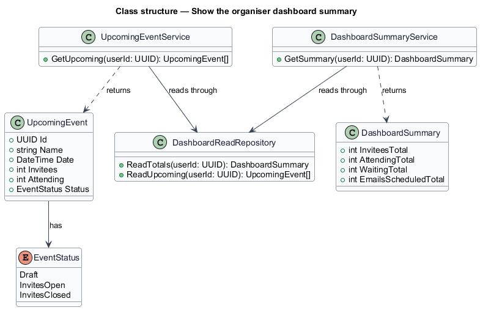
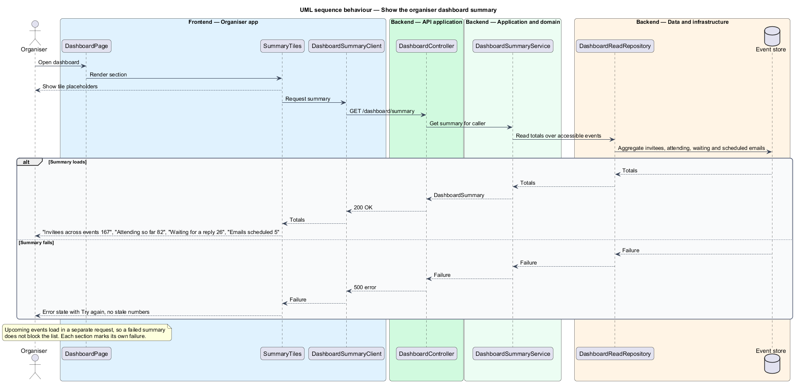

# Show the organiser dashboard summary

## Overview

The organiser dashboard is the first page an organiser sees after signing in. It answers one question across every event the organiser can access: how the guest list stands. It shows four summary tiles, the number of invitees, the number attending, the number still waiting for a reply and the number of scheduled emails, and a list of upcoming events in date order.

The tiles are totals over the events the organiser can access. Each total is computed on the server from the same event data that the per-event pages use, so the dashboard and an event overview report the same numbers for the same event. The summary and the upcoming list are loaded by two separate requests. Each section therefore loads, shows its own loading placeholders and fails on its own, which lets the page show the sections that loaded when the other request fails.

This feature covers the summary tiles and the upcoming events list. The reminder prompt and the per-event overview are described in `docs/detailed-designs/dashboard/prompt-due-reminders/` and `docs/detailed-designs/dashboard/show-event-overview/`.

## Description

The feature spans the organiser UI, the API, the domain and the data layer.

- **`DashboardPage`** — organiser UI page in `src/admin/dashboard`. It composes the summary tiles, the upcoming events list and the reminder prompt, and it handles the empty state when the user has no events.
- **`SummaryTiles`** — organiser UI component in `src/admin/dashboard` that renders the four tiles, their placeholders and their error state with Try again.
- **`UpcomingEventsList`** — organiser UI component in `src/admin/dashboard` that renders the upcoming rows and moves focus between rows with the arrow keys.
- **`DashboardSummaryClient`** — typed client in `src/admin/dashboard` that requests the summary.
- **`UpcomingEventsClient`** — typed client in `src/admin/dashboard` that requests the upcoming events.
- **`DashboardController`** — endpoint class in `src/api/events` that exposes `GET /dashboard/summary` and `GET /dashboard/upcoming-events`.
- **`DashboardSummaryService`** — domain service in `src/domain/dashboard` that builds a `DashboardSummary` for the caller.
- **`DashboardSummary`** — read model in `src/domain/dashboard` holding `InviteesTotal`, `AttendingTotal`, `WaitingTotal` and `EmailsScheduledTotal`.
- **`UpcomingEventService`** — domain service in `src/domain/dashboard` that returns the upcoming events in ascending date order.
- **`UpcomingEvent`** — read model in `src/domain/dashboard` holding the name, date, invitee count, attending count and status of one row.
- **`DashboardReadRepository`** — read component in `src/data/dashboard` that aggregates the totals and lists the rows over the events the caller can access.

The code places each design component as follows.

| Design component | Where it lives |
|------------------|----------------|
| `DashboardPage`, `SummaryTiles`, `UpcomingEventsList` | `DashboardPage` in `src/admin/pages/Dashboard.tsx`, the page sign-in lands on (`#/dashboard`) |
| `DashboardSummaryClient`, `UpcomingEventsClient` | The shared `get` helper, one call per section so each loads and fails on its own |
| `DashboardController`, `DashboardSummaryService`, `UpcomingEventService` | `GET /api/dashboard/summary` and `GET /api/dashboard/upcoming-events` in `src/api/events/dashboard.ts` |
| `DashboardReadRepository` | The existing `Store` calls (`listEvents`, `countGuests`, `responseTotals`, `listEmails`), so the dashboard and the event pages count the same way |

## Requirements

The feature realizes the following level-2 (L2) requirements. Each L2 requirement refines the level-1 (L1) requirement cited in its row.

| L2 ID | Refines (L1) | Requirement |
|-------|--------------|-------------|
| `L2-051` | `L1-008` | The dashboard must summarise all events the organiser can access. |
| `L2-052` | `L1-008` | The dashboard must list upcoming events in date order. |

## Diagrams

### System context

The organiser views the dashboard in Invitely. The dashboard reads totals from events the organiser can access and changes none of them.

### Containers

The organiser app requests the summary and the upcoming list from the API application in separate calls, and the API reads both from the Invitely database.

### Components

`DashboardController` dispatches each request to its service. `DashboardReadRepository` aggregates the totals and the rows over the caller's accessible events, and the page components render each section.

### Class structure

`DashboardSummaryService` returns a `DashboardSummary`, and `UpcomingEventService` returns a list of `UpcomingEvent` rows. Both read through `DashboardReadRepository`.

### Behaviour — show the dashboard summary

The page requests the summary and the upcoming list separately. A failed summary shows the error state in the tiles without stale numbers, and the upcoming list still renders when its own request succeeds.

