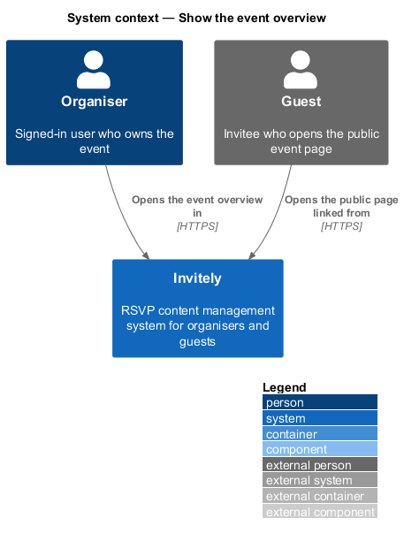
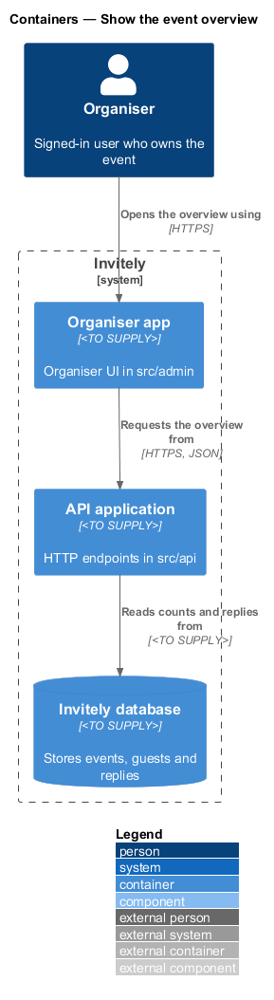
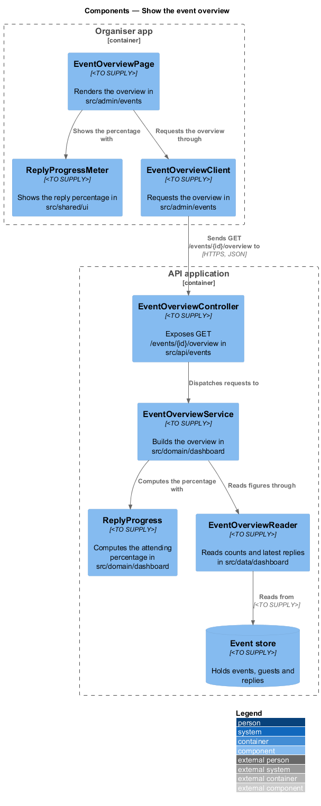
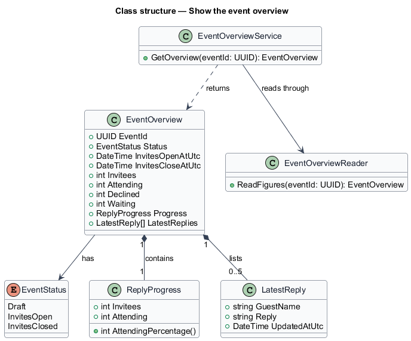
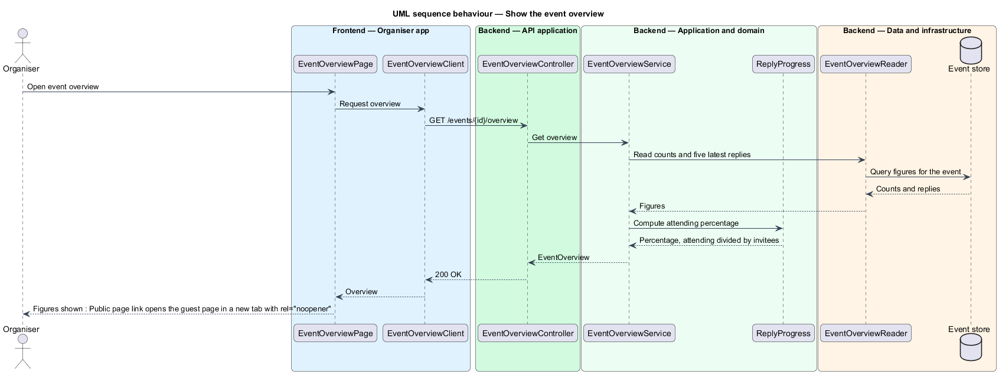

# Show the event overview

## Overview

The **event overview** is the page an organiser opens for one event. It is the event's home page: it shows the event's status and invite window, the invitee count, how many guests have replied and how many are attending, and the latest replies. It also holds the links to the event's other pages, such as the guest list, the responses and the public page.

The overview is a read-only summary. It reads the event's own data and the replies recorded against it. The public page link opens the guest page in a new tab.

The reply percentage reports the share of invitees who are attending. For the example in L2-053 the 52 attending of 84 invitees give 62%, so the percentage is computed as attending divided by invitees and rounded to a whole number. This feature covers the overview page and its read. The dashboard summary across events is described in `docs/detailed-designs/dashboard/show-dashboard-summary/`.

## Description

The spec's label "reply percentage" is computed as attending / invitees; this label is open for the user to confirm.

The feature spans the organiser UI, the API, the domain and the data layer.

- **`EventOverviewPage`** — organiser UI page in `src/admin/events`. It renders the status, the invite window, the reply figures, the latest replies and the navigation to the event's other pages.
- **`ReplyProgressMeter`** — organiser UI component in `src/shared/ui` that shows the reply percentage as a labelled bar and as text.
- **`EventOverviewClient`** — typed client in `src/admin/events` that requests the overview of one event.
- **`EventOverviewController`** — endpoint class in `src/api/events` that exposes `GET /events/{id}/overview` and returns the overview of the event.
- **`EventOverviewService`** — domain service in `src/domain/dashboard` that builds an `EventOverview` for the event.
- **`EventOverview`** — read model in `src/domain/dashboard` holding the event's status, invite window, invitee, attending, declined and waiting counts, the reply percentage and the latest replies.
- **`ReplyProgress`** — value object in `src/domain/dashboard` that computes the attending percentage from the attending count and the invitee count, and returns 0% when there are no invitees.
- **`LatestReply`** — read model in `src/domain/dashboard` holding the guest name, reply, and time of one of the five most recent replies.
- **`EventOverviewReader`** — read component in `src/data/dashboard` that reads the counts and the latest replies for one event.

## Requirements

The feature realizes the following level-2 (L2) requirement. It refines the level-1 (L1) requirement cited in its row.

| L2 ID | Refines (L1) | Requirement |
|-------|--------------|-------------|
| `L2-053` | `L1-008` | The overview must show the event's key facts at a glance. |

## Diagrams

### System context

The organiser opens the overview of an event in Invitely, and guests open the public page that the overview links to.

### Containers

The organiser app requests the overview from the API application, which reads the counts and latest replies from the Invitely database.

### Components

`EventOverviewController` dispatches the request to `EventOverviewService`. `EventOverviewReader` supplies the counts and the latest replies, and `ReplyProgress` computes the percentage.

### Class structure

`EventOverviewService` returns an `EventOverview`, which holds a `ReplyProgress` and a list of `LatestReply` rows.

### Behaviour — show the event overview

The overview loads the counts and the five most recent replies in one request. The percentage is computed from the attending count and the invitee count.

