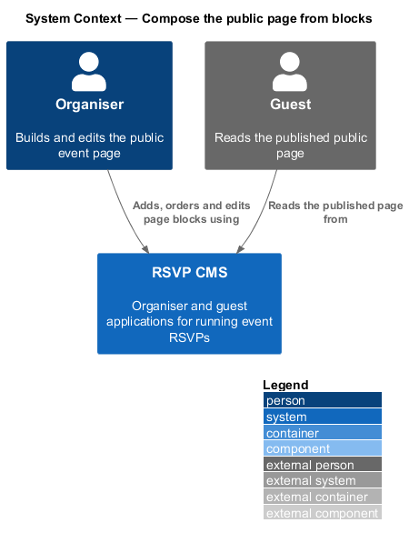
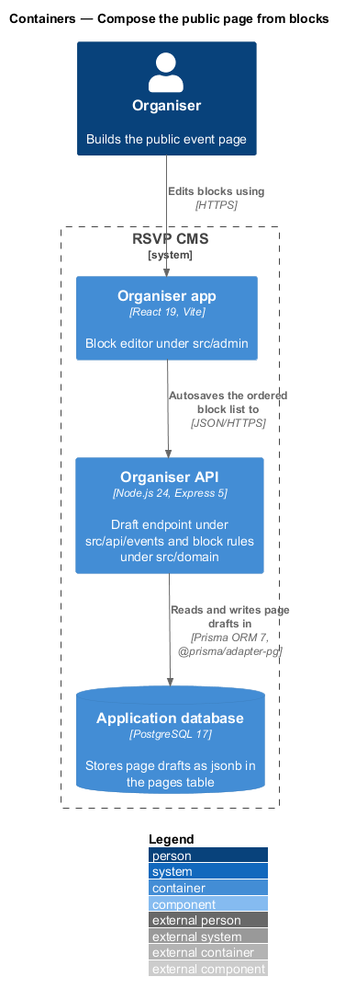
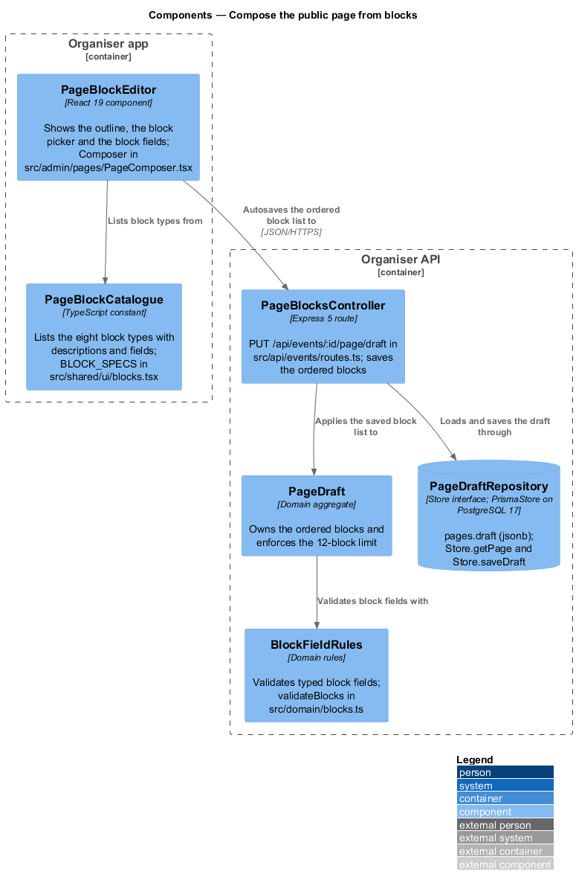
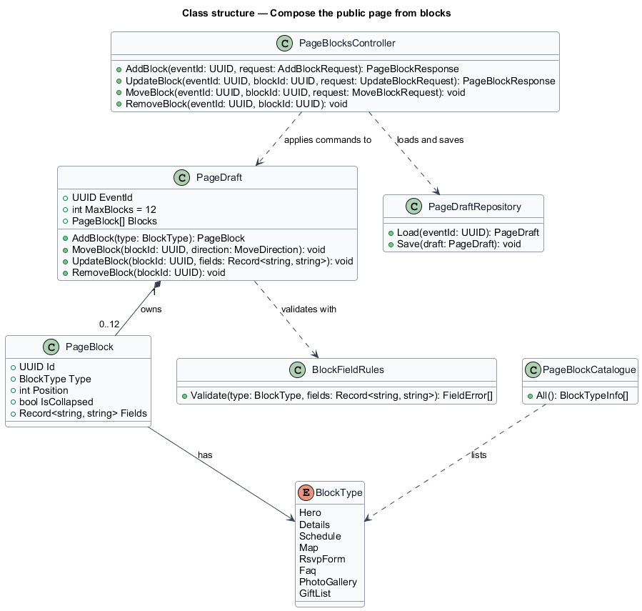
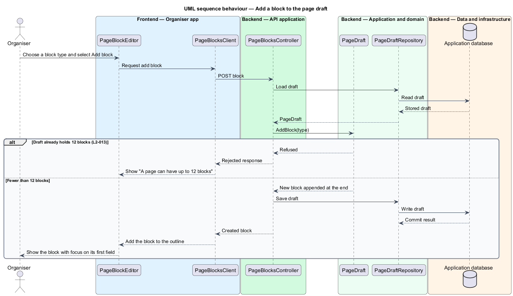
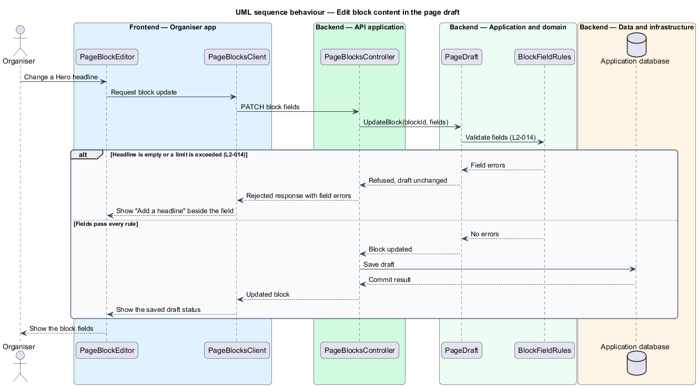

# Compose the public page from blocks

## Overview

The public event page is the page a guest reads before replying to an invitation. The organiser builds that page from an ordered list of **content blocks**: typed sections, each holding its own fields. This feature covers how an organiser adds blocks, orders them and edits their fields inside the page draft.

**block** — typed section of the public page that holds validated fields. The supported block types are Hero, Details, Schedule, Map, RSVP form, FAQ, Photo gallery and Gift list.

**page draft** — unpublished working copy of an event's page, holding the blocks in order. Changes made here are not visible to guests until the organiser publishes them, which is described in the publish-page-draft feature.

The feature sits in the event-page subsystem. The organiser edits blocks in the organiser app (`src/admin`), which sends each change to the organiser API (`src/api/events`). The API applies the change to the page draft in the domain (`src/domain`) and stores the result in the application database through `src/data`. The block type catalogue is shared with the guest page through `src/shared/page-blocks`.

Ordering is available without a mouse. Each block exposes Move up and Move down controls, and the drag gesture is an optional shortcut to the same order change.

## Description

- **`PageBlockEditor`** — component in the organiser app. It shows the block outline, the block picker, the field form for each block and the Move up, Move down, Expand, Collapse and Remove controls.
- **`PageBlockCatalogue`** — shared catalogue, realised as `BLOCK_SPECS` in `src/shared/ui/blocks.tsx`. It lists the eight block types with their one-line descriptions, given in the table below.
- **`PageBlocksController`** — controller under `src/api/events/page-blocks`. It exposes the add, update, move and remove endpoints and dispatches each command to the page draft.
- **`PageDraft`** — domain aggregate that owns the ordered blocks of one event. It appends new blocks, moves blocks, updates fields and removes blocks. It refuses a thirteenth block.
- **`PageBlock`** — domain entity for one block. It holds its identifier, its `BlockType`, its position, its collapsed state and its field values.
- **`BlockType`** — enumeration of the eight block types: `Hero`, `Details`, `Schedule`, `Map`, `RsvpForm`, `Faq`, `PhotoGallery` and `GiftList`.
- **`BlockFieldRules`** — domain rules that validate the typed fields of each block type, such as a non-empty Hero headline and the character limits of each field. `validateBlocks` in `src/domain/blocks.ts` refuses more than 12 blocks, a missing Hero headline, a Hero headline over 120 characters and a button label over 40 characters. The editor also shows a counter and an over-limit error for each field that has a maximum in the table below.
- **`PageDraftRepository`** — persistence component under `src/data`. It loads a page draft for an event and saves it in one write.

The organiser app (`src/admin`) and the guest app (`src/rsvp`) are React 19 applications built with Vite. The API application runs on Node.js 24 with Express 5 and exchanges JSON over HTTPS.

The catalogue holds these block types, descriptions and fields.

| Block type | Label | Description | Fields |
|------------|-------|-------------|--------|
| `hero` | Hero | A large headline with an optional button. | Headline (required, up to 120 characters), Subheading (up to 200), Button label (up to 40) |
| `details` | Details | When and where, in a few lines. | Details (multi-line) |
| `schedule` | Schedule | A timeline of the day. | Schedule items (multi-line) |
| `map` | Map | An address guests can find. | Address |
| `rsvp` | RSVP form | Where guests reply. Its fields are fixed. | None; the guest app supplies the RSVP form |
| `faq` | FAQ | Answers to common questions. | Question, Answer (multi-line) |
| `gallery` | Photo gallery | Photos of the occasion. | Caption |
| `gifts` | Gift list | Where to find the gift list. | Link |

The code places each design component as follows.

| Design component | Where it lives |
|------------------|----------------|
| `PageBlockEditor` | `Composer` in `src/admin/pages/PageComposer.tsx`, loaded by `PageTab` |
| `PageBlockCatalogue` | `BLOCK_SPECS` in `src/shared/ui/blocks.tsx` |
| `PageBlocksController` | No endpoint per block command. The editor applies add, move, update and remove in the browser and saves the whole ordered list with `PUT /api/events/:id/page/draft` (`src/api/events/routes.ts`) |
| `PageDraft` | The editor's block list and the `pages.draft` jsonb column; `MAX_BLOCKS` (12) in `src/domain/blocks.ts` is checked by the editor and by the draft endpoint |
| `PageBlock` | `Block` (`id`, `type`, `fields`) in `src/domain/blocks.ts`; the collapsed state lives only in the editor |
| `BlockType` | `BLOCK_TYPES` in `src/domain/blocks.ts`: `hero`, `details`, `schedule`, `map`, `rsvp`, `faq`, `gallery` and `gifts` |
| `BlockFieldRules` | `validateBlocks` in `src/domain/blocks.ts`, applied on publish |
| `PageDraftRepository` | `Store.getPage` and `Store.saveDraft` |

Persistence goes through the `Store` interface in `src/data/store.ts`. The running app uses `PrismaStore` (`src/data/prismaStore.ts`), which reaches PostgreSQL 17 through Prisma ORM 7 with the `@prisma/adapter-pg` driver adapter. Every automated test and the Playwright e2e server use the in-memory `MemoryStore` (`src/data/memoryStore.ts`) instead. The schema and migrations are `src/data/prisma/schema.prisma` and `src/data/prisma/migrations/`.

## Requirements

| L2 ID | Refines (L1) | Requirement |
|-------|--------------|-------------|
| `L2-013` | `L1-003` | An organiser must build the public page from blocks and reorder them without a mouse. |
| `L2-014` | `L1-003` | Each block must have typed fields that are validated before it is saved to the draft. |

## Diagrams

### System context

The organiser adds, orders and edits blocks in the RSVP CMS, and the guest reads only the published result.

### Containers

The organiser app autosaves the ordered block list over HTTPS to the organiser API, which reads and writes the page draft in the application database.

### Components

`PageBlockEditor` sends the ordered block list to `PageBlocksController`, which stores it as the `PageDraft`. `PageDraft` validates fields with `BlockFieldRules` and is saved through `PageDraftRepository`.

### Class structure

`PageDraft` owns zero to twelve `PageBlock` entities. Each `PageBlock` has a `BlockType`, and `PageDraft` delegates field validation to `BlockFieldRules`.

### Behaviour — add a block

The organiser chooses a block type, and the controller appends it to the draft. `PageDraft` refuses the block when the page already holds twelve blocks, and the editor shows the limit message.

### Behaviour — edit block content

The editor sends the changed fields to the controller. `PageDraft` applies `BlockFieldRules` before the draft is saved, so an invalid field leaves the stored draft unchanged.

