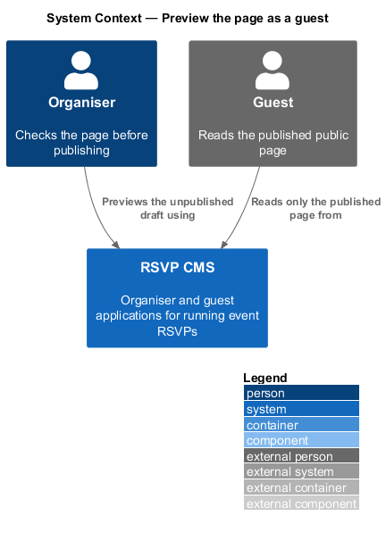
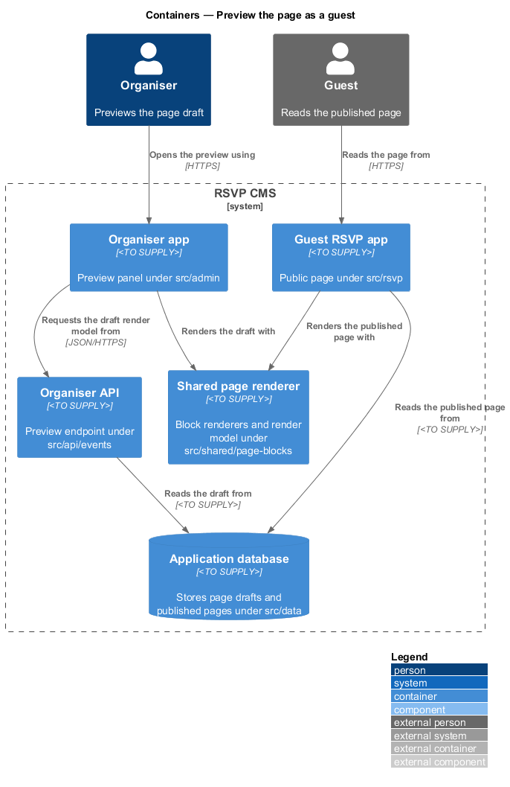
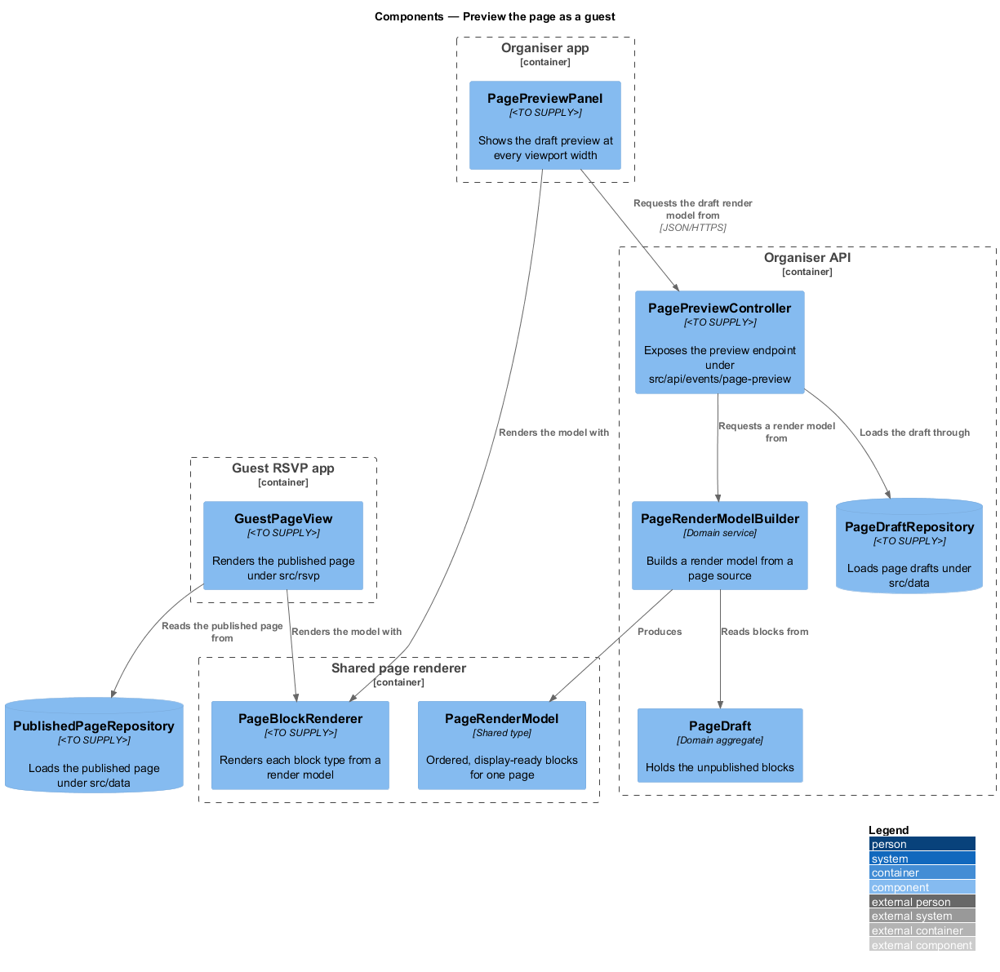
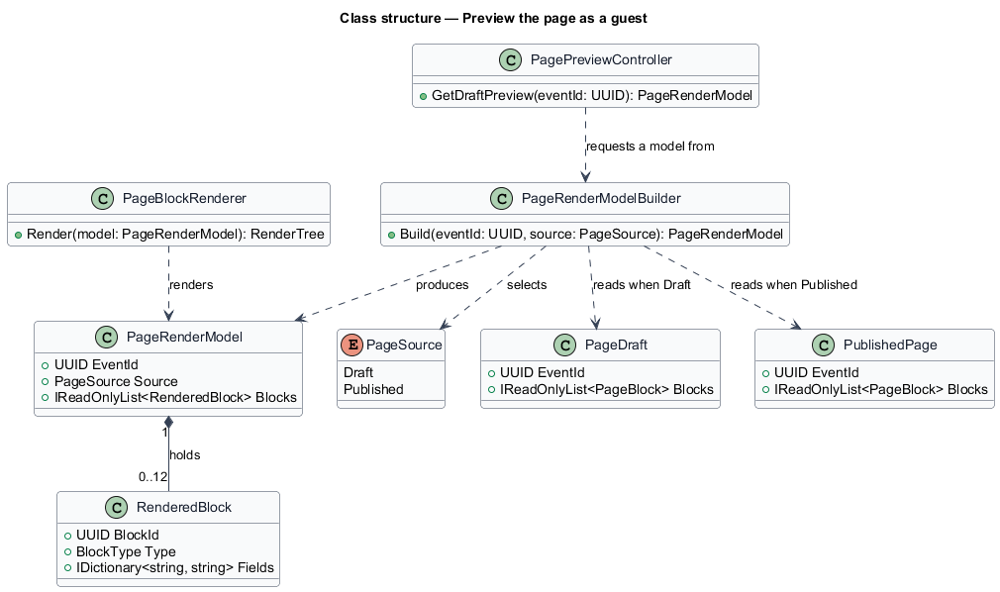
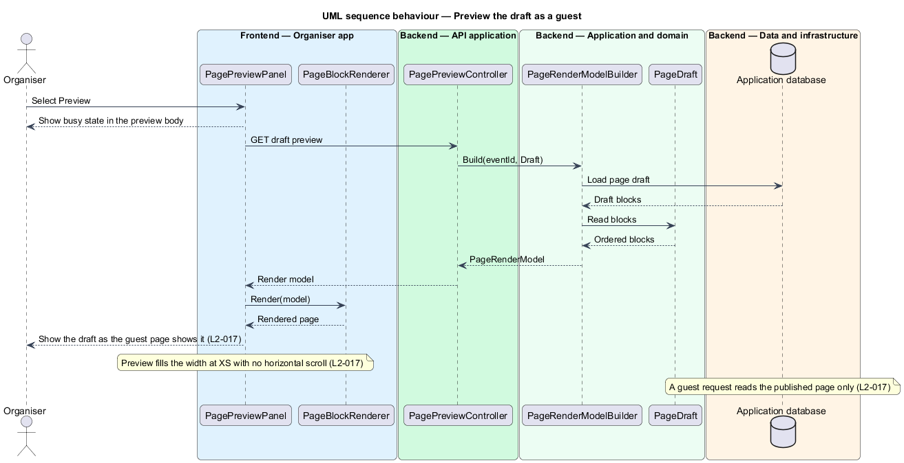

# Preview the page as a guest

## Overview

An organiser needs to see the public page the way a guest sees it before publishing a change. A preview of the draft shows unpublished blocks in the same layout as the guest page, so the organiser can check the content, the order and the responsive layout before the change goes live.

**preview render model** — display-ready description of one page, listing its blocks in order with their field values, which both the preview and the guest page render.

**page source** — the version of the page a render model is built from, either the draft or the published page.

The feature sits in the event-page subsystem. The preview is built from the page draft in the domain (`src/domain`) and sent by the organiser API (`src/api/events`) to the organiser app (`src/admin`). The block rendering components live in `src/shared/page-blocks`, so the preview and the guest page (`src/rsvp`) draw each block with the same components. The guest page reads only the published page, which keeps a preview open in the organiser app from changing what guests see.

## Description

- **`PagePreviewPanel`** — component in the organiser app. It requests the draft render model, shows a busy state while the request is in flight and renders the result at every viewport width.
- **`PagePreviewController`** — controller under `src/api/events/page-preview`. It returns the render model built from the draft.
- **`PageRenderModelBuilder`** — domain service. It builds a `PageRenderModel` from either a `PageDraft` or a `PublishedPage`, as selected by `PageSource`.
- **`PageRenderModel`** — shared type in `src/shared/page-blocks`. It holds the event identifier, the page source and the ordered rendered blocks.
- **`RenderedBlock`** — shared type for one block in a render model, holding its identifier, its `BlockType` and its field values.
- **`PageBlockRenderer`** — shared component in `src/shared/page-blocks`. It renders each block type from a render model, and is used by both the organiser app and the guest app.
- **`GuestPageView`** — component under `src/rsvp`. It renders the published page through `PageBlockRenderer`. It contains no organiser-only code.
- **`PageSource`** — enumeration with the values `Draft` and `Published`.

## Requirements

| L2 ID | Refines (L1) | Requirement |
|-------|--------------|-------------|
| `L2-017` | `L1-003` | Organisers must see the page exactly as a guest will see it before publishing. |

## Diagrams

### System context

The organiser previews the unpublished draft in the RSVP CMS, while the guest reads only the published page from the same system.

### Containers

The preview is served by the organiser API from the draft, and the guest app reads the published page. Both apps render blocks through the shared page renderer.

### Components

`PagePreviewPanel` requests a render model from `PagePreviewController`, which builds it from `PageDraft` with `PageRenderModelBuilder`. `GuestPageView` builds its own model from `PublishedPageRepository`, and both render the model with `PageBlockRenderer`.

### Class structure

`PageRenderModelBuilder` reads either a `PageDraft` or a `PublishedPage`, as selected by `PageSource`, and produces a `PageRenderModel` that holds ordered `RenderedBlock` entries.

### Behaviour — preview the draft

The organiser opens the preview, and the controller returns the draft as a render model. The panel renders it with the same renderer the guest page uses, so the preview matches the guest layout. Only the published page is read for guest requests.

