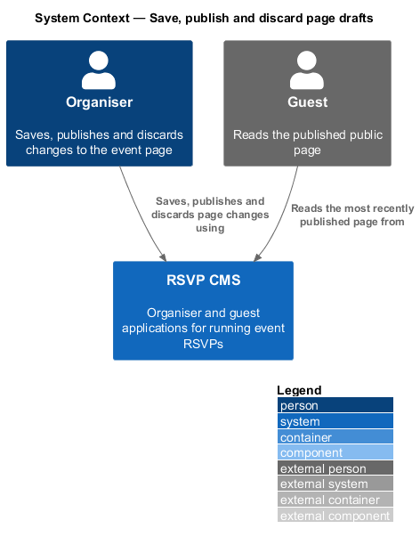
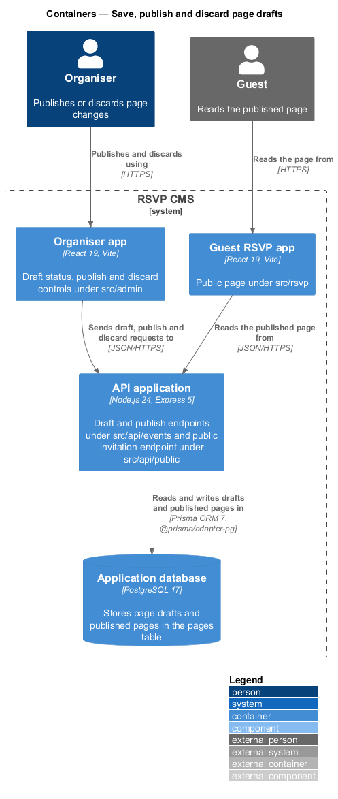
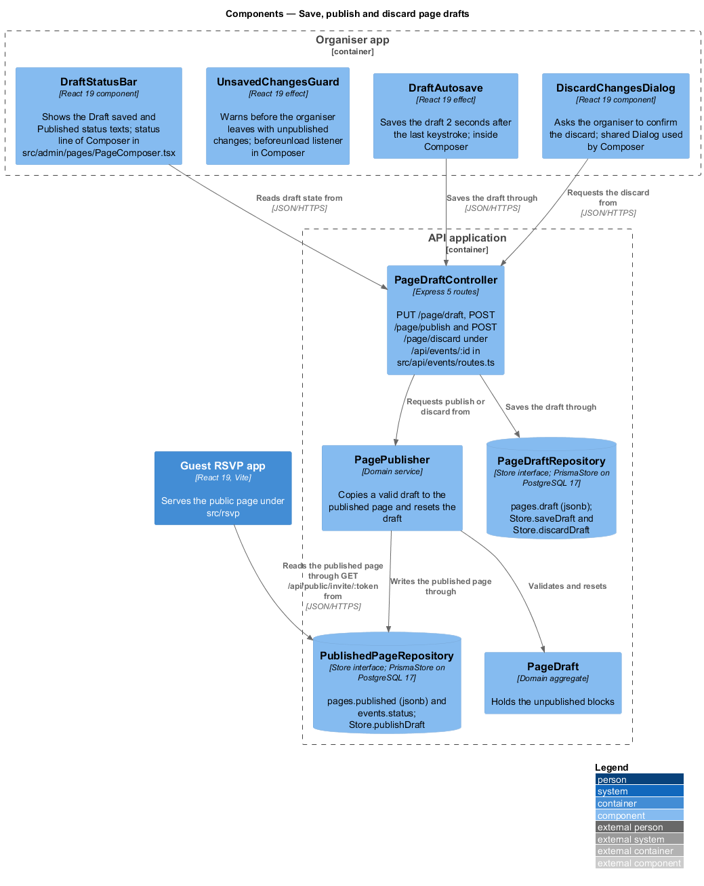
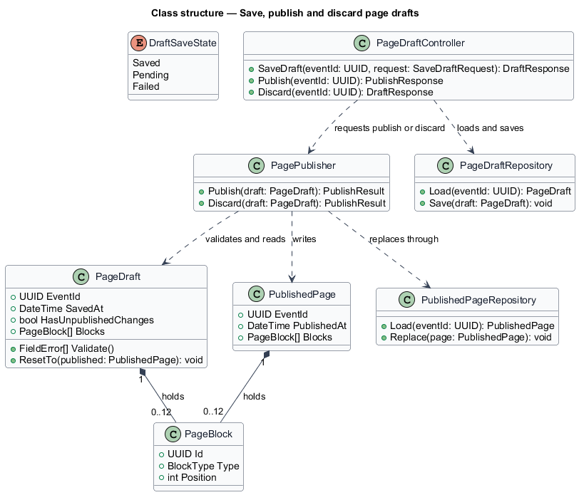
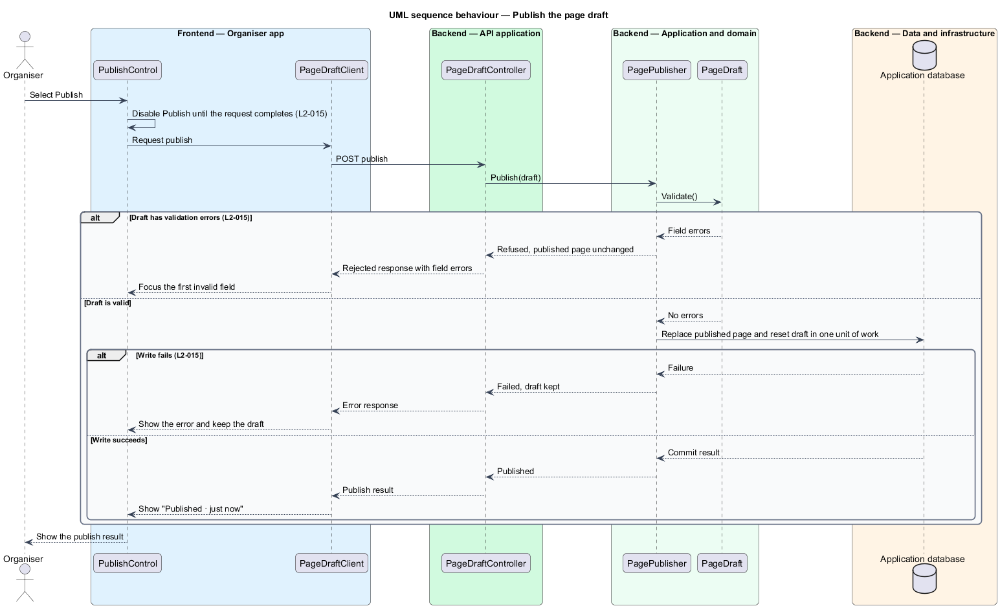
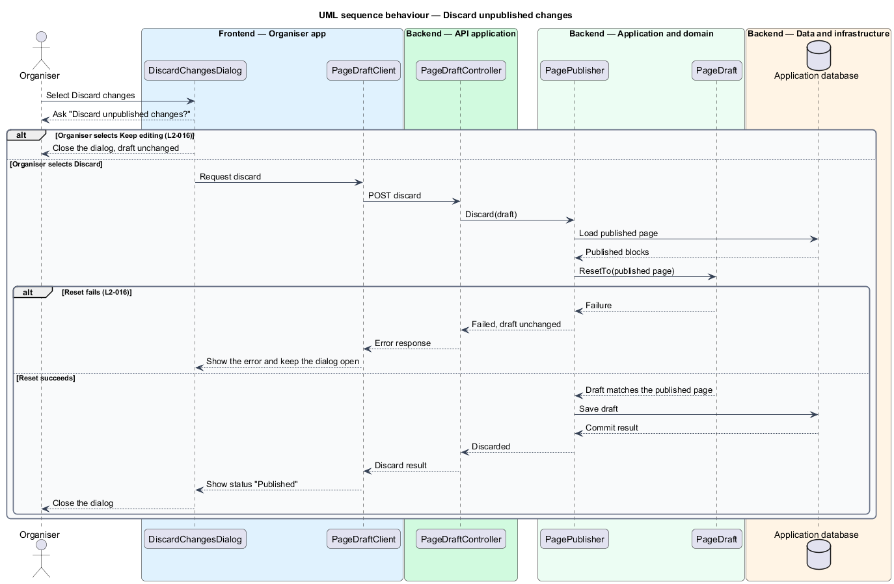

# Save, publish and discard page drafts

## Overview

Changes that an organiser makes to the public event page are held as a page draft until the organiser publishes them. This keeps unfinished edits away from guests and lets the organiser decide when a change goes live. The feature covers three actions on the draft: saving it as the organiser types, publishing it to the public page, and discarding it back to the last published version.

**page draft** — unpublished working copy of an event's page, which the organiser edits in place.

**published page** — the version of an event's page that guests read, which changes only when a publish succeeds.

The feature sits in the event-page subsystem, next to the block editor described in the compose-page-blocks feature. The organiser app (`src/admin`) shows the draft status and the publish, discard and leave-guard controls. The organiser API (`src/api/events`) receives the save, publish and discard requests. The publish rules are in the domain (`src/domain`), and the draft and published page are persisted through `src/data`. The guest app (`src/rsvp`) reads only the published page, so a draft change cannot reach a guest before it is published.

## Description

- **`DraftStatusBar`** — component in the organiser app. It shows the status text "Draft · saved just now" or "Published · just now" and the Publish and Discard changes controls.
- **`DraftAutosave`** — component in the organiser app. It saves the draft once 2 seconds pass without typing and reports the save state.
- **`UnsavedChangesGuard`** — component in the organiser app. It registers the browser warning "You have unpublished changes" while the draft holds unpublished changes.
- **`DiscardChangesDialog`** — dialog in the organiser app. It offers Keep editing and Discard for the question "Discard unpublished changes?".
- **`PageDraftController`** — controller under `src/api/events/page-draft`. It exposes the save, publish and discard endpoints.
- **`PagePublisher`** — domain service. It validates a draft, writes it as the published page and resets the draft to match. It also resets the draft to the published page on discard.
- **`PageDraft`** — domain aggregate for the unpublished blocks. It reports whether it holds unpublished changes, validates its blocks and resets to a published page.
- **`PublishedPage`** — domain entity holding the blocks that guests see and the time of the last publish.
- **`PageDraftRepository`** and **`PublishedPageRepository`** — persistence components under `src/data`. Each loads and saves one page in a single write.
- **`DraftSaveState`** — enumeration of the save states shown by the status bar: `Saved`, `Pending` and `Failed`.

The organiser app (`src/admin`) and the guest app (`src/rsvp`) are React 19 applications built with Vite. The API application runs on Node.js 24 with Express 5 and exchanges JSON over HTTPS.

The code places each design component as follows.

| Design component | Where it lives |
|------------------|----------------|
| `DraftStatusBar` | Status line and buttons of `Composer` in `src/admin/pages/PageComposer.tsx` |
| `DraftAutosave` | Effect in `Composer` that sends `PUT /api/events/:id/page/draft` 2 seconds after the last edit |
| `UnsavedChangesGuard` | `beforeunload` listener in `Composer` |
| `DiscardChangesDialog` | `Dialog` from `src/shared/ui/components.tsx`, opened by `Composer` |
| `PageDraftController` | `PUT /page/draft`, `POST /page/publish` and `POST /page/discard` under `/api/events/:id` in `src/api/events/routes.ts` |
| `PagePublisher` | Merged into the publish and discard routes: `validateBlocks` then `Store.publishDraft`, and `Store.discardDraft` |
| `PageDraft` | `pages.draft` (jsonb); the API reports `hasUnpublishedChanges` by comparing it with `pages.published` |
| `PublishedPage` | `pages.published` (jsonb) and `pages.published_at`; `publishDraft` also sets `events.status` to `Published` in the same transaction |
| `DraftSaveState` | `saveState` in `Composer`: `saved`, `saving` and `error` |
| `PageDraftRepository`, `PublishedPageRepository` | `getPage`, `saveDraft`, `publishDraft` and `discardDraft` on the `Store` interface |

Persistence goes through the `Store` interface in `src/data/store.ts`. The running app uses `PrismaStore` (`src/data/prismaStore.ts`), which reaches PostgreSQL 17 through Prisma ORM 7 with the `@prisma/adapter-pg` driver adapter. Every automated test and the Playwright e2e server use the in-memory `MemoryStore` (`src/data/memoryStore.ts`) instead. The schema and migrations are `src/data/prisma/schema.prisma` and `src/data/prisma/migrations/`.

## Requirements

| L2 ID | Refines (L1) | Requirement |
|-------|--------------|-------------|
| `L2-015` | `L1-003` | Edits must be saved as a draft and only become visible to guests when published. |
| `L2-016` | `L1-003` | Organisers must not lose unpublished changes by accident. |

## Diagrams

### System context

The organiser saves, publishes and discards page changes, and the guest reads the most recently published page.

### Containers

The organiser app sends draft, publish and discard requests to the organiser API. The guest app reads the published page through the public endpoint of the API application, and never the draft.

### Components

`PageDraftController` delegates publish and discard to `PagePublisher`. The publisher validates `PageDraft` and writes `PublishedPage` through `PublishedPageRepository`, and the guest app reads that same published page.

### Class structure

`PagePublisher` reads a `PageDraft` and writes a `PublishedPage`. Both hold zero to twelve `PageBlock` entities, and `PageDraftController` depends on the publisher and the draft repository.

### Behaviour — publish the draft

The publish control disables itself while the request is in flight, so a second press sends no request. The publisher replaces the published page and resets the draft in one unit of work, and a failed write leaves the published page unchanged.

### Behaviour — discard unpublished changes

The discard dialog confirms the action first. On confirmation the publisher resets the draft to the last published page, and a failed reset leaves the draft unchanged.

