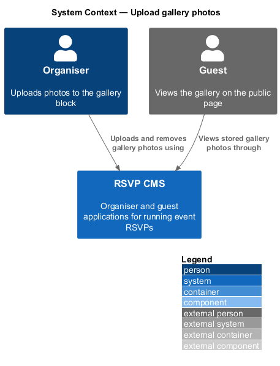
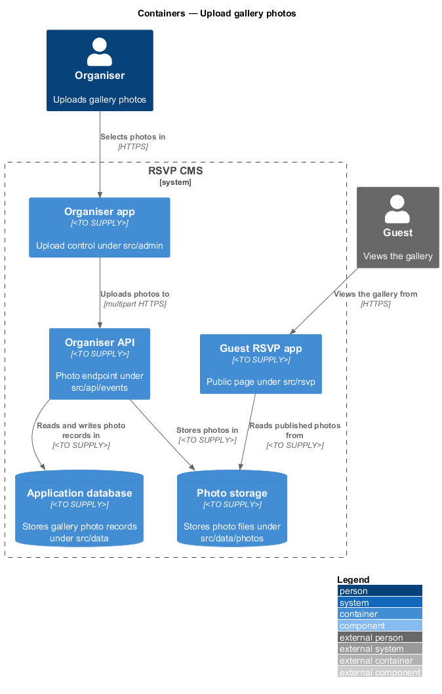
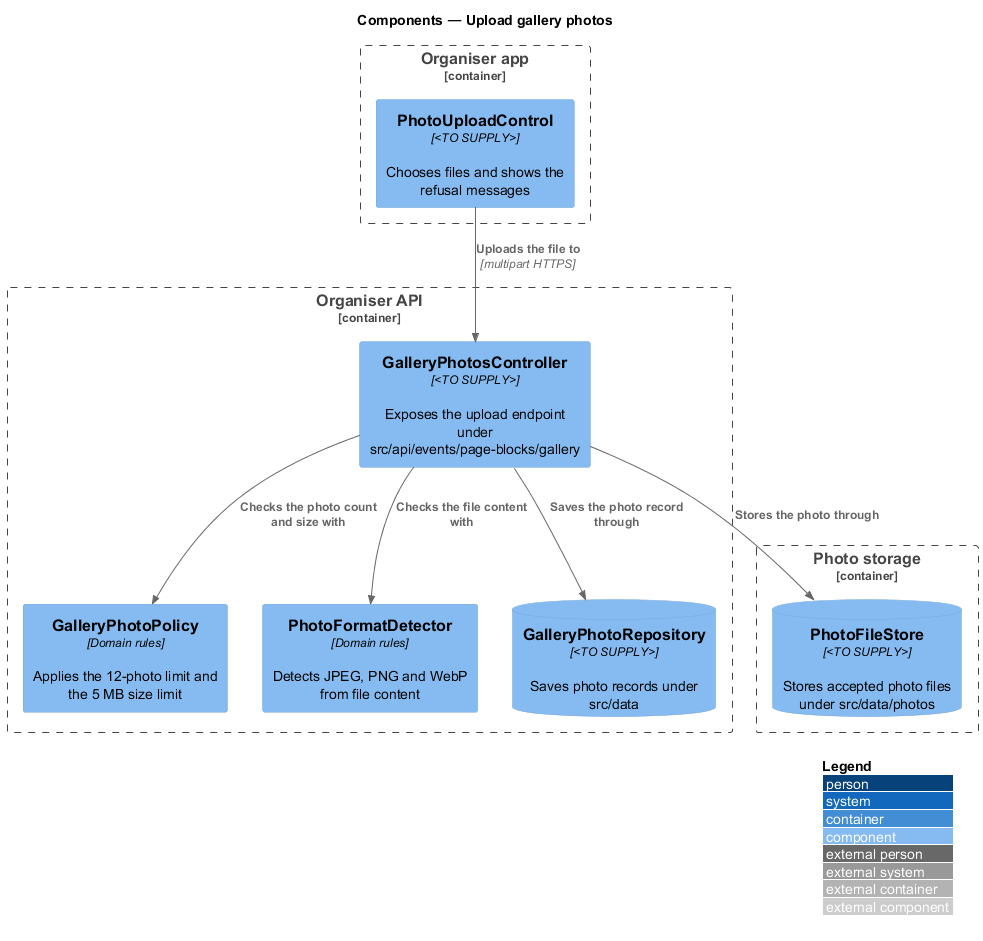
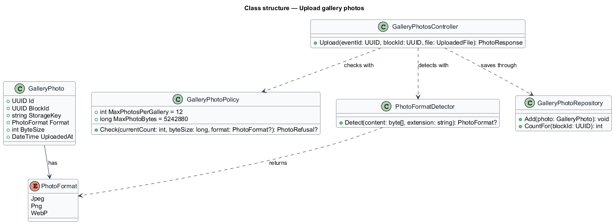
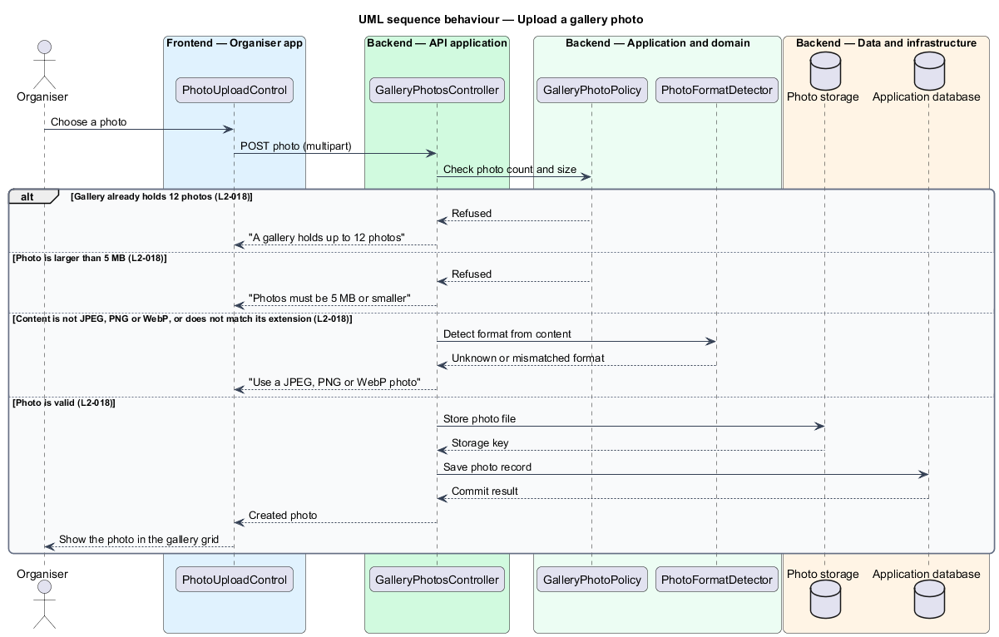

# Upload gallery photos

## Overview

The gallery block on the public event page shows a set of photos chosen by the organiser. Photos are uploaded from the organiser app, so the system shall limit how many photos a gallery holds and check each file before storing it. The rules protect the guest page from oversized or mislabelled files.

**gallery photo** — image file uploaded to a gallery block and shown on the public page.

The feature sits in the event-page subsystem, under the gallery block. The organiser app (`src/admin`) provides the file chooser and the refusal messages. The organiser API (`src/api/events/page-blocks/gallery`) receives the upload and applies the checks in the domain (`src/domain`). The photo file is stored by components under `src/data/photos`, and the photo record is saved through `src/data`. The guest page reads the stored photos but has no upload path.

## Description

- **`PhotoUploadControl`** — component in the organiser app. It lets the organiser choose a photo for the gallery block and displays the refusal message returned by the API.
- **`GalleryPhotosController`** — controller under `src/api/events/page-blocks/gallery`. It receives the multipart upload, runs the checks in a fixed order and returns the created photo or the refusal.
- **`GalleryPhotoPolicy`** — domain rules. It holds the limit of 12 photos per gallery and the limit of 5 MB per photo, and returns the refusal that applies.
- **`PhotoFormatDetector`** — domain rules. It reads the file content, detects whether it is a JPEG, PNG or WebP image and reports a mismatch with the file extension.
- **`PhotoFormat`** — enumeration of the accepted formats: `Jpeg`, `Png` and `WebP`.
- **`PhotoFileStore`** — storage component under `src/data/photos` that writes the accepted photo and returns its storage key. `<TO SUPPLY>` for the storage product.
- **`GalleryPhoto`** — domain entity for one stored photo, holding its block, storage key, format and size.
- **`GalleryPhotoRepository`** — persistence component under `src/data` that saves photo records and counts the photos in a gallery.

## Requirements

| L2 ID | Refines (L1) | Requirement |
|-------|--------------|-------------|
| `L2-018` | `L1-003` | Photos in the gallery block must be limited and checked before they are stored. |

## Diagrams

### System context

The organiser uploads photos to a gallery block, and guests view the stored photos on the public page.

### Containers

The organiser app sends the multipart upload to the organiser API. The API stores the photo file in photo storage and the photo record in the application database, and the guest app reads the stored file.

### Components

`GalleryPhotosController` runs `GalleryPhotoPolicy` and `PhotoFormatDetector` before `PhotoFileStore` writes the photo.

### Class structure

`GalleryPhotosController` depends on the policy, the format detector and the repository. `GalleryPhoto` records the `PhotoFormat` that the detector reported.

### Behaviour — upload a photo

The controller checks the photo count, the file size and the file format in that order, and each failed check returns its message without storing the file. A valid photo is then stored. The order of the three checks is a design choice of this feature.

