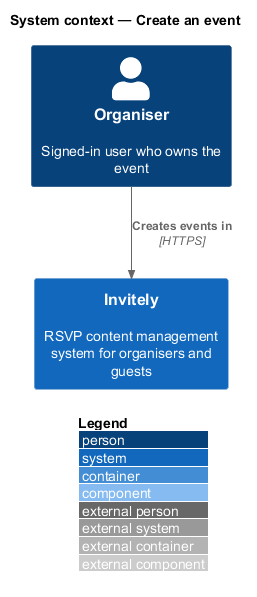
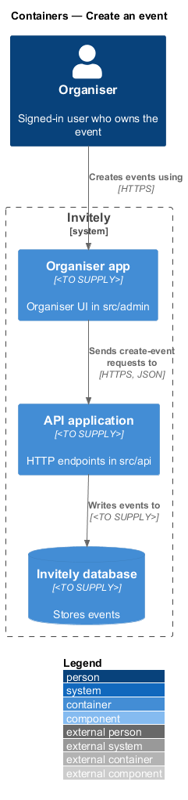
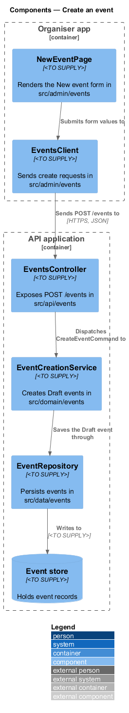
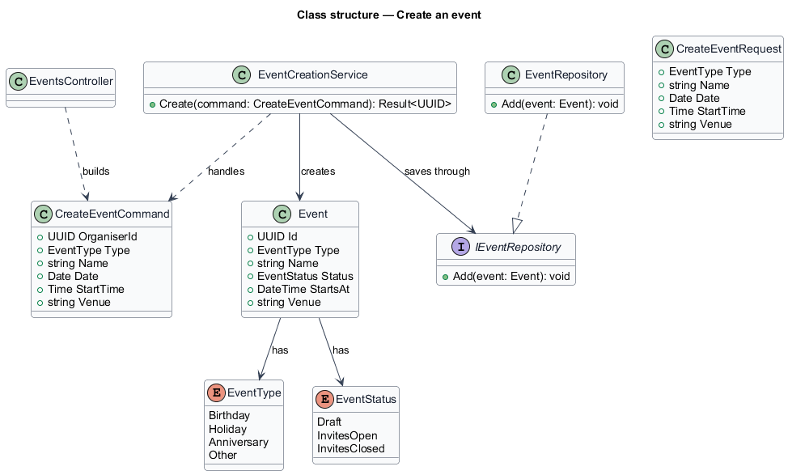
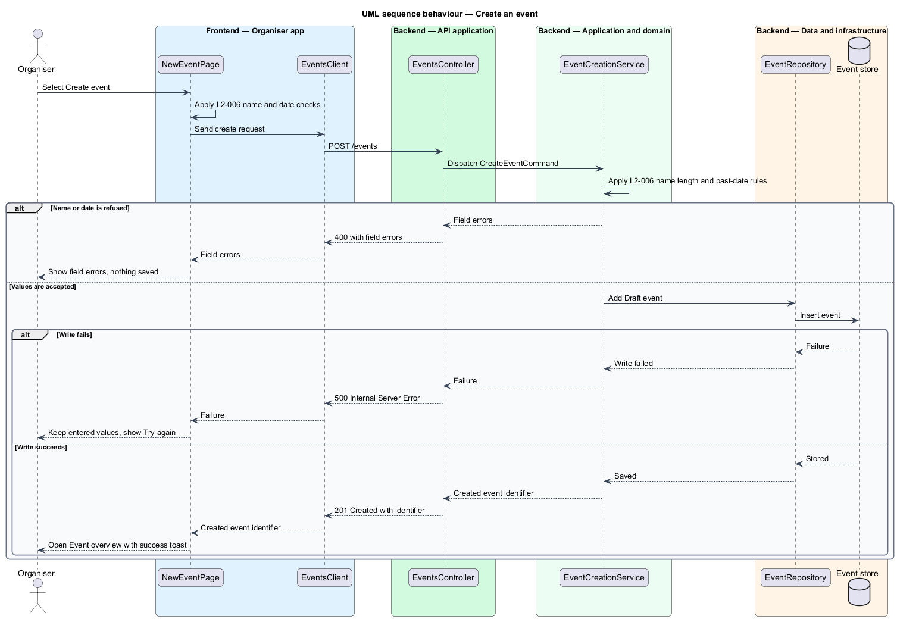

# Create an event

## Overview

Invitely is an RSVP content management system. An **organiser** runs one or more **events**, which are planned occasions such as a birthday, a holiday, an anniversary or another occasion, each with a guest list, an invite window and a public page. The event is the root object that every other feature in the events subsystem reads or changes.

This feature covers the first step in an event's life. An organiser opens the New event page, enters the event's type, name, date, start time and optional venue, and selects Create event. The system saves the event in **Draft** status (the state of an event that has never been published) and takes the organiser to the event's overview page.

Creation is the only feature in the events subsystem that adds a new event. Editing details, managing the invite window, deleting an event, regenerating invitation links and listing events are described in sibling features under `docs/detailed-designs/events/`. The creation path spans the organiser app, the API application, the domain layer and the data layer.

## Description

The feature is a vertical slice from the organiser UI to the event store.

- **`NewEventPage`** — organiser UI page in `src/admin/events`. It renders the event fields, runs the client-side checks, shows the busy and error states, and keeps the entered values when a request fails.
- **`EventsClient`** — typed client in `src/admin/events`. It sends the create request to the API and returns either the created event identifier or a list of field errors.
- **`EventsController`** — endpoint class in `src/api/events`. It exposes `POST /events`, dispatches the request to the domain, and maps the result to an HTTP response.
- **`CreateEventRequest`** — request body in `src/api/events` carrying `Type`, `Name`, `Date`, `StartTime` and `Venue` (optional).
- **`CreateEventCommand`** — domain command in `src/domain/events` carrying the submitted values and the identifier of the organiser who creates the event.
- **`EventCreationService`** — domain service in `src/domain/events`. It checks the length of `Name`, rejects a date in the past, creates the `Event` in Draft status, and asks the repository to save it.
- **`Event`** — domain entity in `src/domain/events`. It holds the event's identifier, type, name, date, start time, venue and status.
- **`EventType`** — enumeration in `src/domain/events` of the occasion kinds named in L1-002: birthday, holiday, anniversary and other. The full list of values is `<TO SUPPLY>`.
- **`EventStatus`** — enumeration in `src/domain/events` with the value `Draft` used by this feature. The values `Invites open` and `Invites closed` are owned by the event status feature.
- **`EventRepository`** — persistence class in `src/data/events` that writes the `Event` to the event store.

## Requirements

The feature realizes the following level-2 (L2) requirement. The requirement refines a level-1 (L1) requirement, cited by identifier.

| L2 ID | Refines (L1) | Requirement |
|-------|--------------|-------------|
| `L2-006` | `L1-002` | An organiser must create an event from the New event page with the fields shown in the design: type, name, date, start time, venue (optional). |

## Diagrams

### System context

The organiser creates events in Invitely. Invitely stores each event and returns the organiser to the event overview.

### Containers

The organiser app sends the create request to the API application, which writes the event to the Invitely database.

### Components

`EventsController` dispatches `CreateEventCommand` to `EventCreationService`. The service creates the `Event` and `EventRepository` persists it.

### Class structure

`EventCreationService` handles `CreateEventCommand`, creates an `Event` with an `EventType` and an `EventStatus`, and saves it through `EventRepository`.

### Behaviour — create an event

The organiser app runs the client-side checks and sends the request. The domain applies the name and date rules, and the repository commits the Draft event. A failed request keeps the organiser's values on the page.

