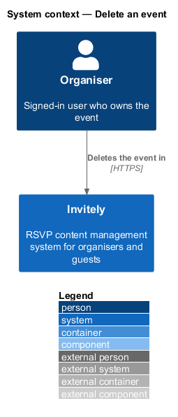
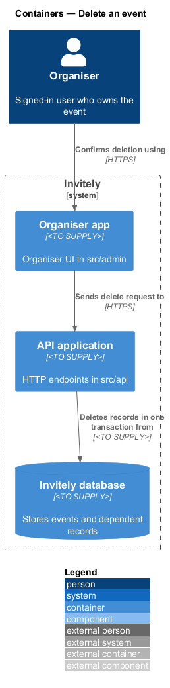
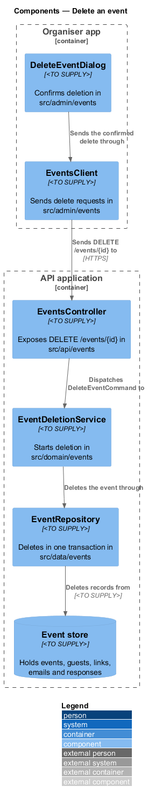
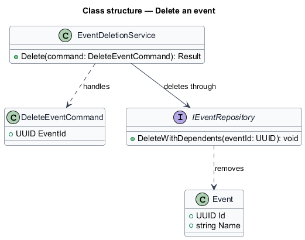
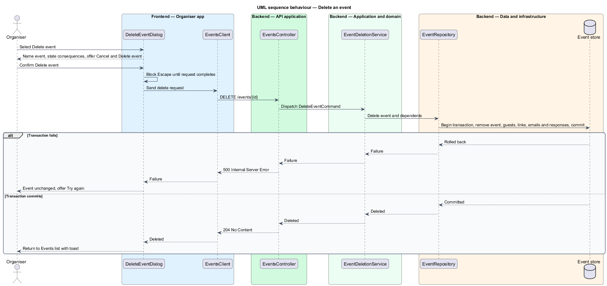

# Delete an event

## Overview

Deleting an event removes the event and everything attached to it: its public page, its invitees, its invitation links, its scheduled emails and its responses. Deletion is permanent, so the organiser confirms it in a dialog before the request is sent. Only the organiser of the event may delete it.

The deletion runs as one **unit of work**, a set of writes that either all commit or all roll back. The event and its dependent records are removed together, so a failed request leaves the event and its data unchanged, and the dialog offers Try again.

The feature covers the dialog and the transactional removal.

## Description

The feature spans the organiser UI, the API, the domain and the data layer.

- **`DeleteEventDialog`** — organiser UI dialog in `src/admin/events`. It names the event, states the consequences, offers Cancel and Delete event, and blocks closing with Escape while the request is in progress.
- **`EventsClient`** — typed client in `src/admin/events` that sends the delete request and returns the result.
- **`EventsController`** — endpoint class in `src/api/events` that exposes `DELETE /events/{id}`.
- **`DeleteEventCommand`** — domain command in `src/domain/events` carrying the event identifier.
- **`EventDeletionService`** — domain service in `src/domain/events` that asks the repository to delete the event as one unit of work.
- **`EventRepository`** — persistence class in `src/data/events`. Its delete operation removes the event, guests, invitation links, scheduled emails and responses in one transaction.

## Requirements

The feature realizes the following level-2 (L2) requirement. It refines the level-1 (L1) requirement cited in its row.

| L2 ID | Refines (L1) | Requirement |
|-------|--------------|-------------|
| `L2-010` | `L1-002` | Only the organiser must be able to delete an event. Deletion is permanent and must be confirmed. |

## Diagrams

### System context

The organiser deletes an event in Invitely. The removed event no longer appears in the organiser's lists or on the guest page.

### Containers

The organiser app opens the dialog and sends the delete request to the API application, which removes the event and its records from the Invitely database.

### Components

`EventDeletionService` asks `EventRepository` to remove the event and its dependent records together.

### Class structure

`EventDeletionService` handles `DeleteEventCommand` and removes the `Event` through `EventRepository`.

### Behaviour — delete an event

The organiser confirms in the dialog, and the API deletes the event. The repository removes all records in one transaction. A failure rolls back every removal and leaves the event unchanged.

