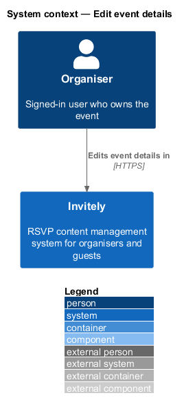
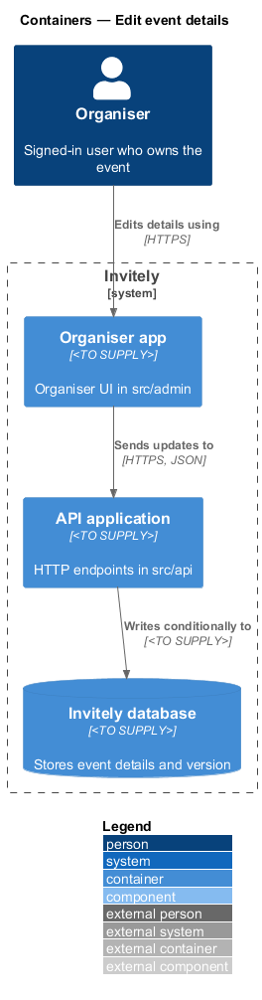
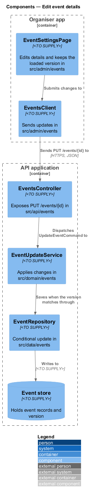
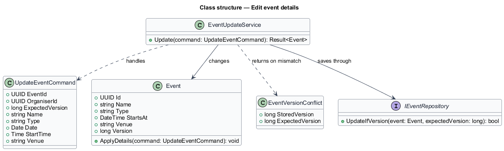
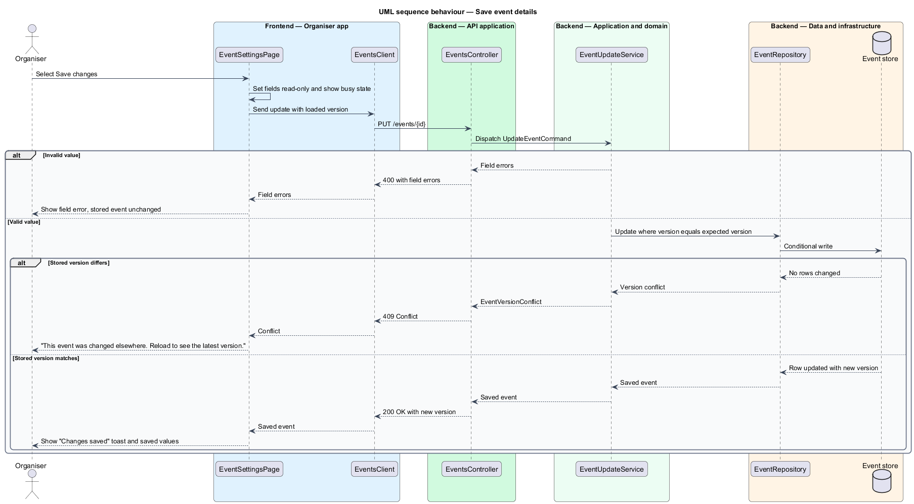

# Edit event details

## Overview

After an event is created, the organiser changes its details from the Event settings page. The details are the event's name, type, date, start time and venue. Editing changes the stored event and leaves its invite window, guests and responses unchanged, because those belong to other features in the events subsystem.

Two organisers may open the same event at the same time. The feature uses **optimistic concurrency**: each saved event carries a version value, and a save sends the version the page was loaded with. When the stored version differs, the save is refused, so one user's change is never overwritten silently. The version value is a **concurrency token**, a value that changes on every write.

This feature covers the save path from the Event settings page to the event store, including the conflict case. The creation of an event and the invite window rules are described in `docs/detailed-designs/events/create-event/` and `docs/detailed-designs/events/manage-invite-window/`.

## Description

The feature spans the organiser UI, the API, the domain and the data layer.

- **`EventSettingsPage`** — organiser UI page in `src/admin/events`. It shows the details fields, keeps the loaded version, disables the fields while a save is in flight, and keeps the entered values when a save fails.
- **`EventsClient`** — typed client in `src/admin/events`. It sends the update with the loaded version and returns either the saved event or the list of field errors and the conflict result.
- **`EventsController`** — endpoint class in `src/api/events`. It exposes `PUT /events/{id}` and maps the domain result to an HTTP response.
- **`UpdateEventRequest`** — request body in `src/api/events` carrying the editable fields and the `Version` the page was loaded with.
- **`UpdateEventCommand`** — domain command in `src/domain/events` carrying the submitted values and the expected version.
- **`EventUpdateService`** — domain service in `src/domain/events`. It loads the `Event`, applies the changed values, and asks the repository to save only when the expected version matches.
- **`Event`** — domain entity in `src/domain/events`. It holds the editable details and the `Version` concurrency token.
- **`EventRepository`** — persistence class in `src/data/events`. Its conditional update writes the event only when the stored version equals the expected version, and it returns a conflict otherwise.
- **`EventVersionConflict`** — domain result in `src/domain/events` returned when the stored version differs from the expected version.

## Requirements

The feature realizes the following level-2 (L2) requirement. It refines the level-1 (L1) requirement cited in its row.

| L2 ID | Refines (L1) | Requirement |
|-------|--------------|-------------|
| `L2-008` | `L1-002` | An organiser must edit the event details from Event settings. |

## Diagrams

### System context

The organiser edits the event details in Invitely. The change reaches guests only through the public event page, which other features describe.

### Containers

The organiser app sends the update to the API application, which writes the change to the Invitely database with a conditional update.

### Components

`EventsController` dispatches `UpdateEventCommand` to `EventUpdateService`. `EventRepository` applies the change only when the stored version matches.

### Class structure

`EventUpdateService` handles `UpdateEventCommand`, changes an `Event`, and returns either the saved event or an `EventVersionConflict`.

### Behaviour — save event details

A valid save returns the new version. An invalid value leaves the stored event unchanged. A save against a stale version is refused with the conflict message, so the organiser reloads instead of overwriting the other change.

