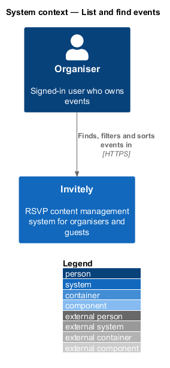
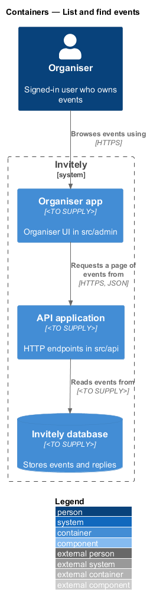
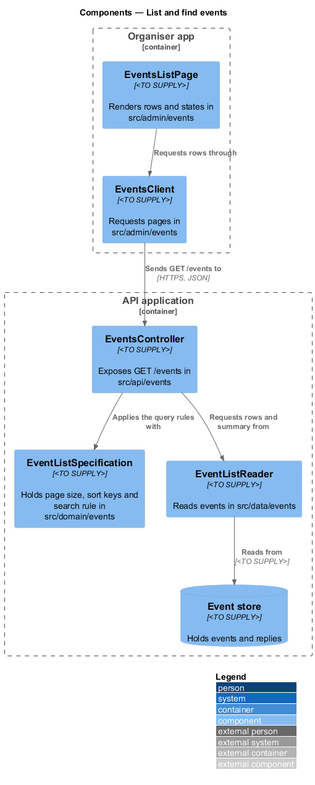
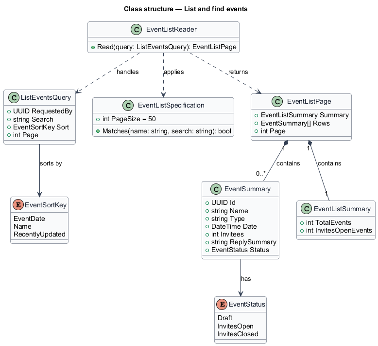
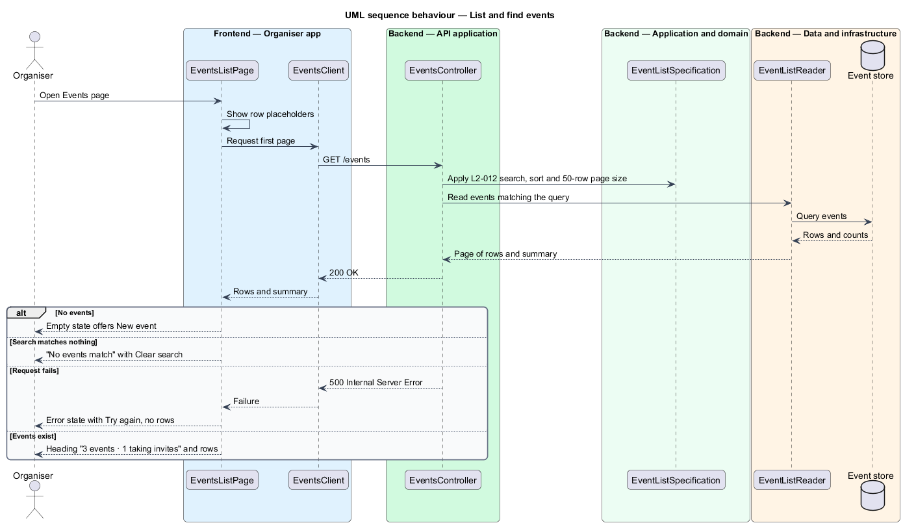

# List and find events

## Overview

The Events page is the organiser's index of events. It lists every event the signed-in user can access, with each event's key facts, and lets the user find an event by name, filter it and sort it. A page of events is loaded at a time, so the page stays responsive when an organiser has many events.

Each row shows the event's name, type, date, invitee count, reply summary and status. The status comes from the status rule in the manage-invite-window feature, so the list and the event overview always agree. The heading reports the total number of events and how many are taking invites, for example "3 events · 1 taking invites".

The list is produced by a read-only query. Its rows are a projection of the event store, not the event entity, so the list does not change any data. Creating events and editing them are described in sibling features under `docs/detailed-designs/events/`.

## Description

The feature spans the organiser UI, the API, the domain and the data layer.

- **`EventsListPage`** — organiser UI page in `src/admin/events`. It renders the heading, the rows, the search field, the sort control, the pager, and the loading, empty, no-results and error states.
- **`EventsClient`** — typed client in `src/admin/events` that sends the list query and returns a page of rows.
- **`EventsController`** — endpoint class in `src/api/events` that exposes `GET /events` with the search, sort and page parameters.
- **`ListEventsQuery`** — query object in `src/domain/events` carrying the search text, the sort key (Event date, Name or Recently updated), the page number and the requesting user identifier.
- **`EventListSpecification`** — domain component in `src/domain/events` that defines the page size of 50 rows, the allowed sort keys, and the matching rule for the search text.
- **`EventSummary`** — read model in `src/domain/events` carrying the name, type, date, invitee count, reply summary and status of one row.
- **`EventListSummary`** — read model in `src/domain/events` carrying the total event count and the count of events whose status is Invites open.
- **`EventListReader`** — read component in `src/data/events` that runs the query against the event store and returns the matching rows and summary.

## Requirements

The feature realizes the following level-2 (L2) requirement. It refines the level-1 (L1) requirement cited in its row.

| L2 ID | Refines (L1) | Requirement |
|-------|--------------|-------------|
| `L2-012` | `L1-002` | The Events page must list all events the signed-in user can access and let them be found, filtered and sorted. |

## Diagrams

### System context

The organiser opens the Events page in Invitely to find and open events. The page reads event data and changes none of it.

### Containers

The organiser app requests a page of rows from the API application, which runs the read query against the Invitely database.

### Components

`EventsController` builds a `ListEventsQuery` and passes it to `EventListSpecification`. `EventListReader` returns the rows and the summary that `EventsListPage` renders.

### Class structure

`EventListReader` returns an `EventListSummary` and a set of `EventSummary` rows for a `ListEventsQuery`, and each row holds an `EventStatus`.

### Behaviour — list and find events

The page requests a page of 50 rows at most, with the search and sort applied on the server. An empty result shows the empty state, and a failed request shows the error state with Try again and no rows.

