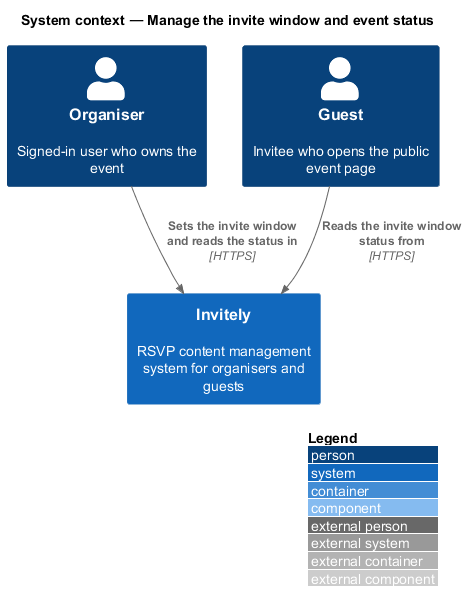
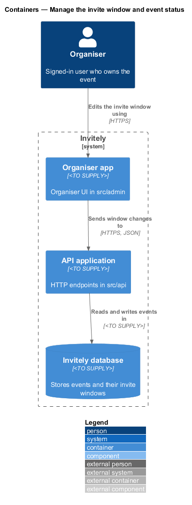
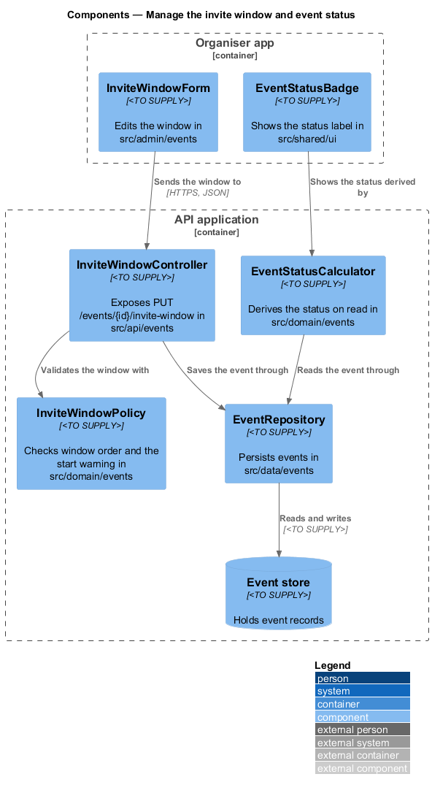
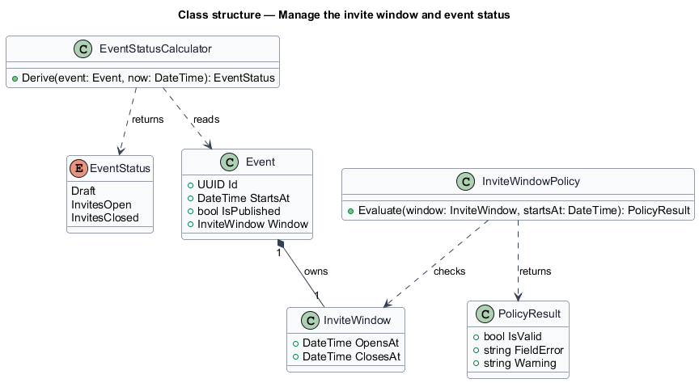
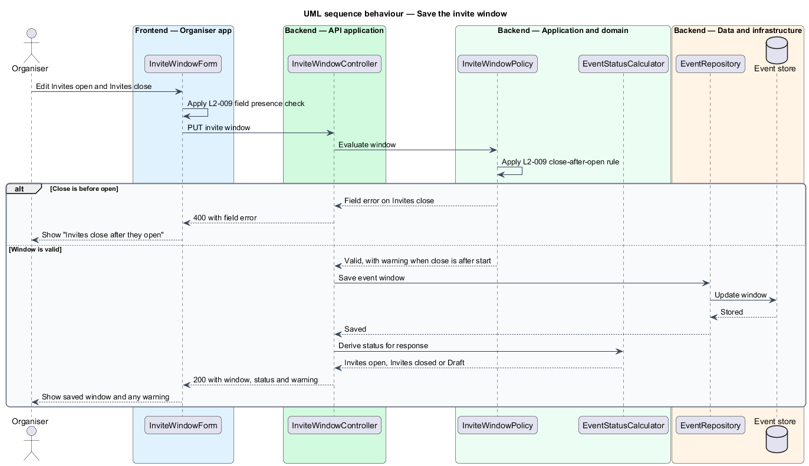

# Manage the invite window and event status

## Overview

An event in Invitely has an **invite window**, the interval during which guests may reply to the event. The window opens at one instant and closes at a later instant. An organiser sets the window on the event's settings and reads the result as the event's **status**.

The **status** is the single state an organiser sees for an event: **Draft** (the event has never been published), **Invites open** (the window has started and not ended) or **Invites closed** (the window has ended). The status is derived from the event's data at the moment it is read, so a change to the window is visible on the next read without a stored status to update.

This feature covers two rules from the events subsystem. The first validates the window's open and close times and warns when the window closes after the event starts. The second derives the status. Creating the event, editing its other details and the guest-side reply rules are described in sibling features under `docs/detailed-designs/events/`.

## Description

The feature spans the organiser UI, the API, the domain and the data layer.

- **`InviteWindowForm`** — organiser UI component in `src/admin/events`. It shows the Invites open and Invites close fields, displays field errors and the close-after-start warning, and keeps the entered values on failure.
- **`EventStatusBadge`** — presentational component in `src/shared/ui`. It renders the status label for an event, so the overview and the events list show the same text.
- **`InviteWindowController`** — endpoint class in `src/api/events`. It exposes `PUT /events/{id}/invite-window` and returns any warning with the saved window.
- **`InviteWindowRequest`** — request body in `src/api/events` carrying `OpensAt` and `ClosesAt` as date-time values.
- **`InviteWindow`** — value object in `src/domain/events` holding the open instant and the close instant.
- **`InviteWindowPolicy`** — domain policy in `src/domain/events`. It rejects a close instant that is before the open instant and reports a warning when the close instant is after the event start.
- **`EventStatus`** — enumeration in `src/domain/events` with the values `Draft`, `InvitesOpen` and `InvitesClosed`.
- **`EventStatusCalculator`** — domain service in `src/domain/events`. It derives the status from the `Event`'s publication flag, its `InviteWindow` and the current instant supplied by a clock abstraction.
- **`Event`** — domain entity in `src/domain/events`. It holds the `InviteWindow`, the start instant and the publication flag.
- **`EventRepository`** — persistence class in `src/data/events` that loads and saves the `Event` with its window.

## Requirements

The feature realizes the following level-2 (L2) requirements. Each L2 requirement refines the level-1 (L1) requirement cited in its row.

| L2 ID | Refines (L1) | Requirement |
|-------|--------------|-------------|
| `L2-007` | `L1-002` | Each event must have one status derived from its data: Draft, Invites open or Invites closed. |
| `L2-009` | `L1-002` | Each event must have an invite window that opens and closes at specific times. |

## Diagrams

### System context

The organiser sets the invite window in Invitely. Guests read the resulting status through the public event page, which is described in the guest reply features.

### Containers

The organiser app sends the window to the API application, which validates it and stores the window with the event in the Invitely database.

### Components

`InviteWindowController` dispatches the window to `InviteWindowPolicy`, which checks the order of the two instants. `EventStatusCalculator` derives the status on each read, and `EventRepository` persists the window.

### Class structure

`Event` owns an `InviteWindow`, and `EventStatusCalculator` reads the `Event` and returns an `EventStatus`.

### Behaviour — save the invite window

The API rejects a window that closes before it opens, as required by `L2-009`. A valid window is saved, and a window that closes after the event starts is saved with a warning. The status is not stored; it is derived from the saved window by `L2-007` on the next read.

