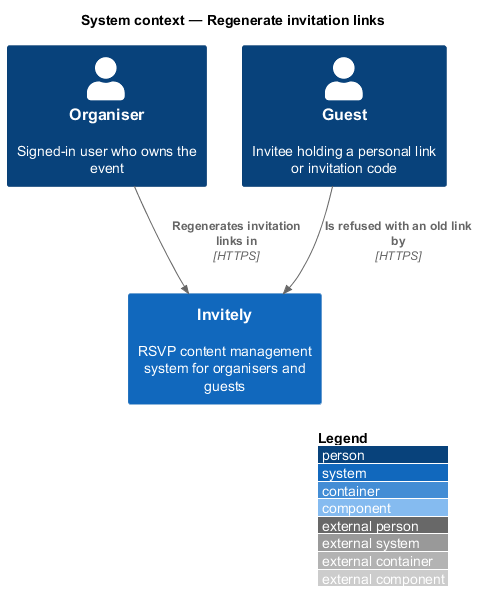
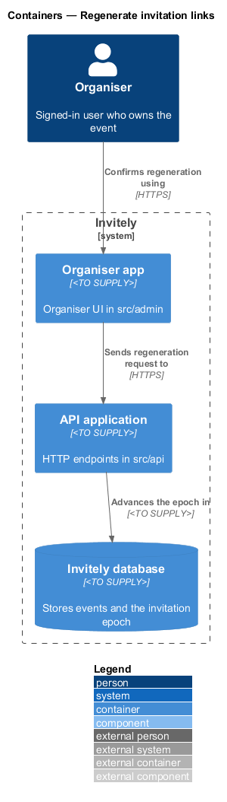
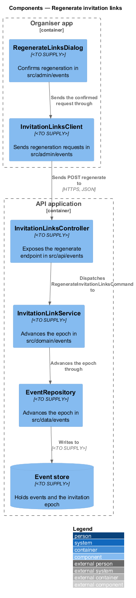
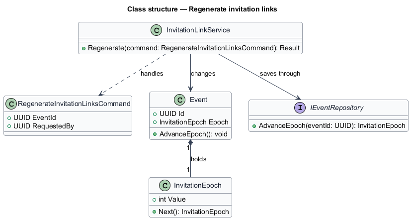
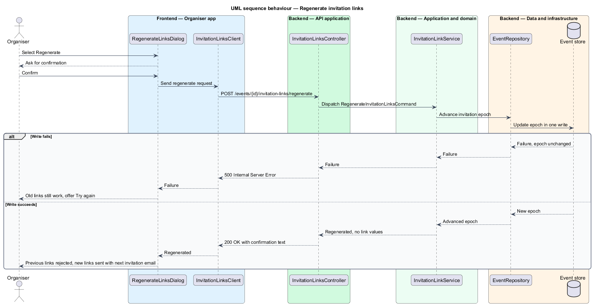

# Regenerate invitation links

## Overview

Each guest of an event receives a personal invitation link, and a guest without a link may enter an **invitation code**. Both identify the guest and the event without a sign-in. If a link or code leaks, the organiser needs to make every existing link and code for the event stop working at once. Regeneration provides that control.

Regeneration advances the event's **invitation epoch**, a counter stored on the event. Every personal link and invitation code records the epoch it was issued under. When a guest opens a link or enters a code, the guest-access check compares the recorded epoch with the event's current epoch. A mismatch means the link or code was issued before the last regeneration, so the request is rejected with the invalid state. Advancing one counter invalidates every issued link and code in a single write, without the system listing or touching each guest's token.

The response to the organiser states that new links are sent with the next invitation email. It shows no link values, so the organiser interface never exposes a token. This feature covers the organiser's confirmed regeneration and its response. The guest-side checks that consume the epoch are described in the guest access features.

## Description

The feature spans the organiser UI, the API, the domain and the data layer.

- **`RegenerateLinksDialog`** — organiser UI dialog in `src/admin/events`. It asks for confirmation, shows the busy state, and reports the result without displaying any link.
- **`InvitationLinksClient`** — typed client in `src/admin/events` that sends the regeneration request.
- **`InvitationLinksController`** — endpoint class in `src/api/events` that exposes `POST /events/{id}/invitation-links/regenerate`.
- **`RegenerateInvitationLinksCommand`** — domain command in `src/domain/events` carrying the event identifier and the requesting user identifier.
- **`InvitationLinkService`** — domain service in `src/domain/events` that advances the epoch on the `Event` and returns the regeneration result.
- **`Event`** — domain entity in `src/domain/events` that holds the `InvitationEpoch` counter.
- **`InvitationEpoch`** — value object in `src/domain/events` holding the non-negative integer counter that every issued link and code records.
- **`EventRepository`** — persistence class in `src/data/events` that advances the epoch in a single conditional write.

The code places each design component as follows.

| Design component | Where it lives |
|------------------|----------------|
| `RegenerateLinksDialog`, `InvitationLinksClient` | `DangerZone` and `RegenerateDialog` in `src/admin/pages/Settings.tsx`, on the event's Settings tab, using the shared `post` helper |
| `InvitationLinksController`, `InvitationLinkService` | `POST /api/events/:id/invitation-links/regenerate` in `src/api/events/routes.ts`; it answers with the message only, never a link value |
| `Event`, `InvitationEpoch` | `EventRecord.linkEpoch`, the `link_epoch` column of `events`; each guest's `link_epoch` records the epoch its token and code were issued under |
| `EventRepository` | `Store.regenerateLinks`, one increment of `link_epoch`. The mail worker gives a guest with an older epoch a new token and code (`Store.reissueLink`) just before it sends them the next email |

## Requirements

The feature realizes the following level-2 (L2) requirement. It refines the level-1 (L1) requirement cited in its row.

| L2 ID | Refines (L1) | Requirement |
|-------|--------------|-------------|
| `L2-011` | `L1-002` | An organiser must be able to invalidate every invitation link and invitation code for an event, for example after a leak. |

## Diagrams

### System context

The organiser regenerates the links in Invitely. Guests holding old links meet the invalid state when they open them.

### Containers

The organiser app sends the regeneration request to the API application, which advances the epoch in the Invitely database.

### Components

`InvitationLinksController` dispatches the command to `InvitationLinkService`, which advances the epoch through `EventRepository`. The guest-access components read the same epoch on each link or code check.

### Class structure

`InvitationLinkService` handles `RegenerateInvitationLinksCommand` and advances the `InvitationEpoch` held by `Event`.

### Behaviour — regenerate invitation links

The organiser confirms the regeneration, and the epoch advances in one write. A failed write leaves the epoch unchanged, so the old links keep working. A successful response carries no link values.

