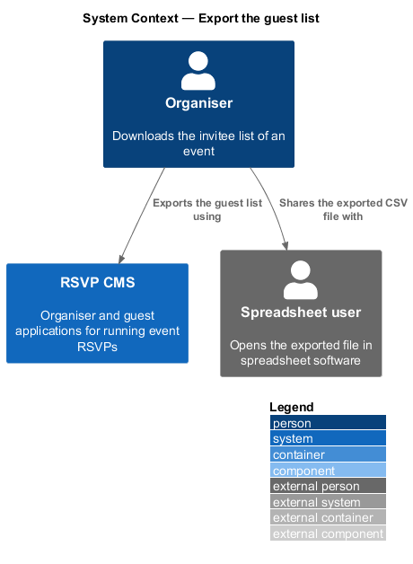
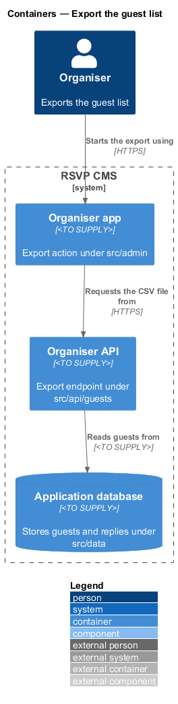
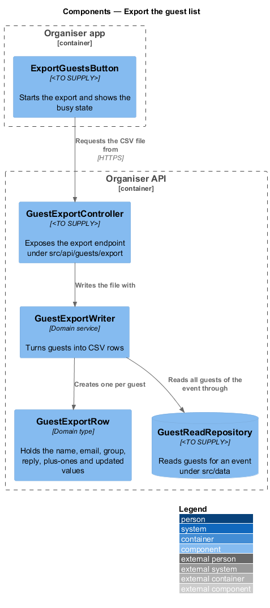
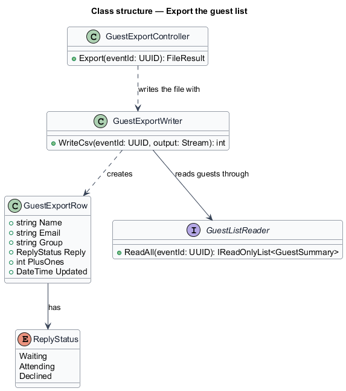
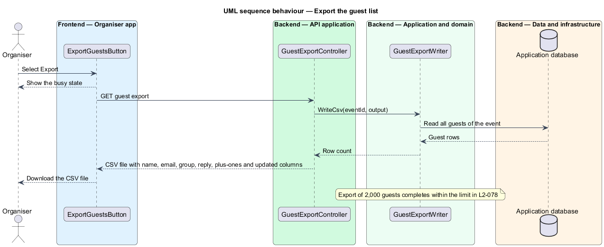

# Export the guest list

## Overview

An organiser exports the guest list to keep a copy outside the system, to share the invitee list with a helper or to check it in a spreadsheet. The export is a CSV file with one row per guest.

**CSV export** — text file with one row per guest and a header row, produced from the guest list at the time of the request.

The feature sits in the guests subsystem. The Export action in the organiser app (`src/admin`) starts the download. The organiser API (`src/api/guests/export`) produces the file. The export writer in the domain (`src/domain`) reads the guests of the event through the guest read repository in `src/data` and writes them as CSV rows.

## Description

- **`ExportGuestsButton`** — component in the organiser app. It starts the export, shows the busy state until the file arrives and then downloads it.
- **`GuestExportController`** — controller under `src/api/guests/export`. It returns the CSV file as a download.
- **`GuestExportWriter`** — domain service. It reads every guest of an event, creates one `GuestExportRow` per guest and writes the rows with the columns name, email, group, reply, plus-ones and updated.
- **`GuestExportRow`** — domain type holding the values of one exported row.
- **`GuestListReader`** — domain interface defined by the view-guest-list feature. The export writer uses it to read all guests of an event.
- **`GuestReadRepository`** — persistence component under `src/data` that implements the reader over the guest table.
- **`ReplyStatus`** — enumeration of the reply states written to the reply column: `Waiting`, `Attending` and `Declined`.

## Requirements

| L2 ID | Refines (L1) | Requirement |
|-------|--------------|-------------|
| `L2-028` | `L1-004` | Organisers must be able to export the guest list. |

## Diagrams

### System context

The organiser exports the guest list from the RSVP CMS and shares the resulting CSV file with spreadsheet users.

### Containers

The organiser app requests the CSV file from the organiser API, which reads the guests from the application database and returns the file to the browser.

### Components

`GuestExportController` calls `GuestExportWriter`, which creates a `GuestExportRow` for each guest and writes it as a CSV row.

### Class structure

`GuestExportWriter` reads guests through `GuestListReader` and creates `GuestExportRow` values for the file.

### Behaviour — export the guest list

The export writer reads every guest of the event and writes one row for each before the file is returned. The button shows a busy state until the download starts.

