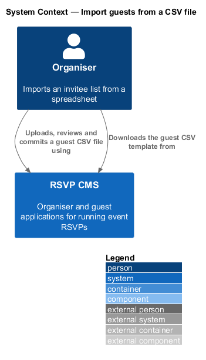
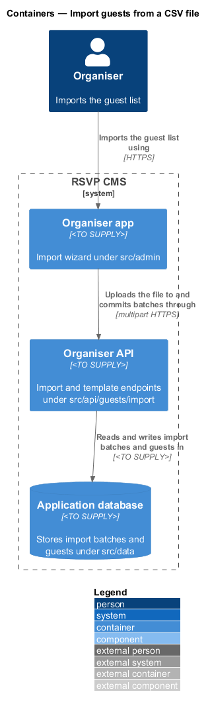
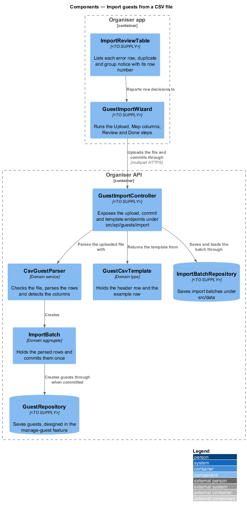
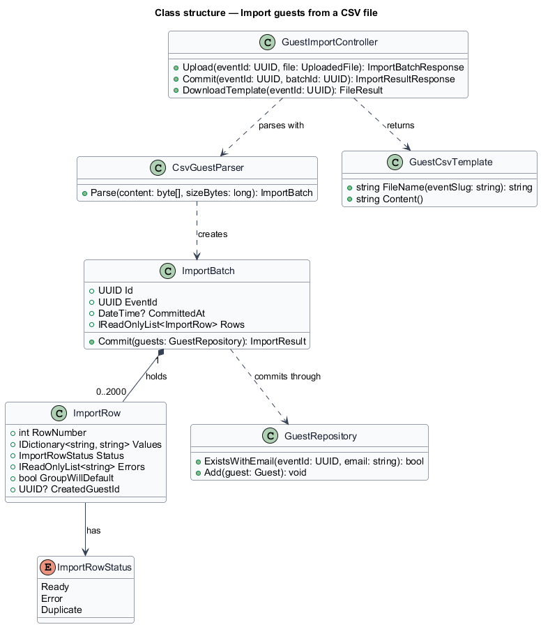
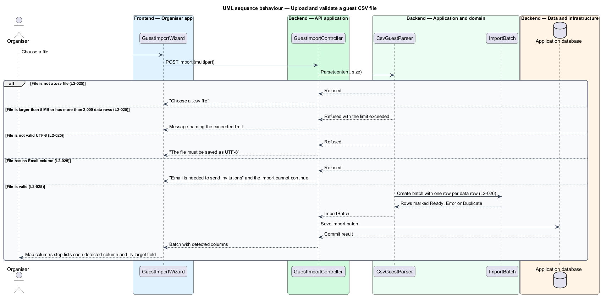
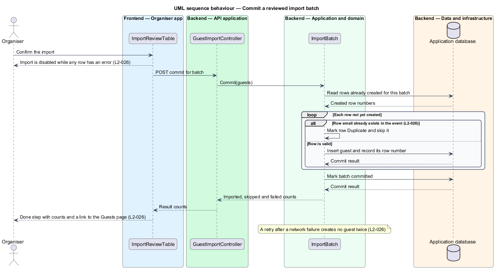

# Import guests from a CSV file

## Overview

Organisers often keep their invitee list in a spreadsheet. Rather than typing each guest into the system, an organiser can upload a CSV file with one row per invitee. Because a bad import can add wrong or duplicate people to an event, nothing is saved until the file has been checked and the organiser has reviewed each row and confirmed the import. The feature also supplies a template that shows the expected columns.

**import batch** — one uploaded CSV file, parsed into rows that the organiser reviews and then commits as a unit.

**import row** — one data row of a batch, with its values, its errors and its decision: ready to import, in error or a duplicate of an existing guest.

**column mapping** — the association between each column of the file and a guest field, shown to the organiser in the Map columns step.

The feature sits in the guests subsystem. The import wizard in the organiser app (`src/admin`) runs four steps: Upload, Map columns, Review and Done. The organiser API (`src/api/guests/import`) receives the file, parses it in the domain (`src/domain`) and stores the batch through `src/data`. Creating guests reuses the guest repository defined by the manage-guest feature, so an imported guest follows the same rules as one added by hand.

## Description

- **`GuestImportWizard`** — component in the organiser app. It runs the Upload, Map columns, Review and Done steps and disables Import while any row has an error.
- **`ImportReviewTable`** — component in the organiser app. It lists each error row with its row number and reason, marks duplicates and shows the group notice "Group will be set to Friends" for rows whose group is not one of the known groups.
- **`GuestImportController`** — controller under `src/api/guests/import`. It exposes the upload, commit and template endpoints.
- **`CsvGuestParser`** — domain service. It checks the file extension, the 5 MB size limit, the 2,000 data-row limit, the UTF-8 encoding and the presence of an Email column, then creates an `ImportBatch`.
- **`ImportBatch`** — domain aggregate for one uploaded file. It holds its rows and commits them once, recording the row number of each guest it creates so a retry creates no guest twice.
- **`ImportRow`** — domain entity for one data row, holding the row number, the mapped values, the errors, the status and the identifier of the guest it created.
- **`ImportRowStatus`** — enumeration with the values `Ready`, `Error` and `Duplicate`.
- **`GuestCsvTemplate`** — domain type that gives the template file name from the event slug and returns the header row `name, email, group, plus-ones` with one example row.
- **`ImportBatchRepository`** — persistence component under `src/data` that saves and loads import batches.
- **`GuestRepository`** — persistence component designed in the manage-guest feature. It creates each guest that an import commits.

The code places each design component as follows.

| Design component | Where it lives |
|------------------|----------------|
| `GuestImportWizard`, `ImportReviewTable` | `ImportGuestsPage` in `src/admin/pages/ImportGuests.tsx` at `#/events/:id/import`, reached from Import CSV on the Guests tab and its empty state; the template is built in the browser |
| `GuestImportController` | `POST /api/events/:id/guests/import/review` and `POST /api/events/:id/guests/import` in `src/api/guests/import.ts`; the file travels base64-encoded in JSON |
| `CsvGuestParser`, `ImportRow`, `ImportRowStatus`, `GuestCsvTemplate` | `checkImportFile`, `reviewImport`, `parseCsv` and `guestTemplate` in `src/domain/guestImport.ts`; rows are checked with `validateGuest`, as for a guest added by hand |
| `ImportBatch`, `ImportBatchRepository` | Not stored: review is stateless, and the import checks the file again and creates only the ready rows, so a retry finds the guests it already created as duplicates and adds no one twice (L2-026 AC4) |

## Requirements

| L2 ID | Refines (L1) | Requirement |
|-------|--------------|-------------|
| `L2-025` | `L1-004` | A guest list can be imported from a spreadsheet, but nothing is saved until the file has been checked. |
| `L2-026` | `L1-004` | Each row must be checked and the organiser must confirm before guests are created. |
| `L2-027` | `L1-004` | Organisers must be able to download a template with the correct columns. |

## Diagrams

### System context

The organiser uploads, reviews and commits a guest CSV file in the RSVP CMS, and downloads the template from the same system.

### Containers

The organiser app drives the import wizard and sends the file to the organiser API. The API stores the batch and the created guests in the application database.

### Components

`GuestImportController` parses the uploaded file with `CsvGuestParser`, which creates an `ImportBatch`. The batch saves through `ImportBatchRepository` and creates guests through `GuestRepository` when the organiser commits it.

### Class structure

`ImportBatch` holds up to 2,000 `ImportRow` entries, each with an `ImportRowStatus`. `CsvGuestParser` creates the batch, and `GuestCsvTemplate` supplies the template the controller returns.

### Behaviour — upload and validate a file

The parser checks the file in a fixed order and returns the matching message for each failure, so no batch is stored for a refused file. A valid file produces a batch whose rows are marked Ready, Error or Duplicate before the organiser reviews them.

### Behaviour — commit a reviewed batch

The commit step creates one guest for each Ready row and skips each Duplicate row. The batch records every created row, so a retry after a network failure creates no guest twice.

