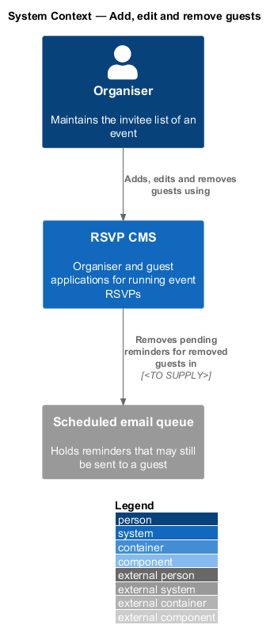
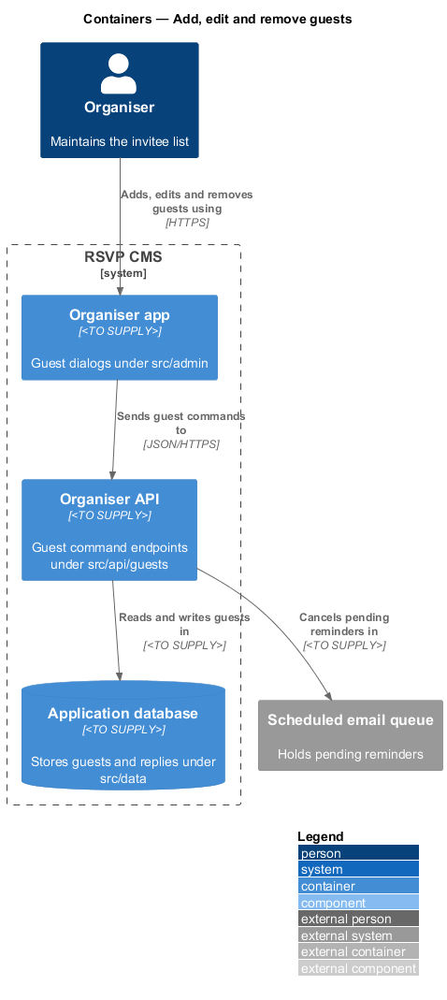
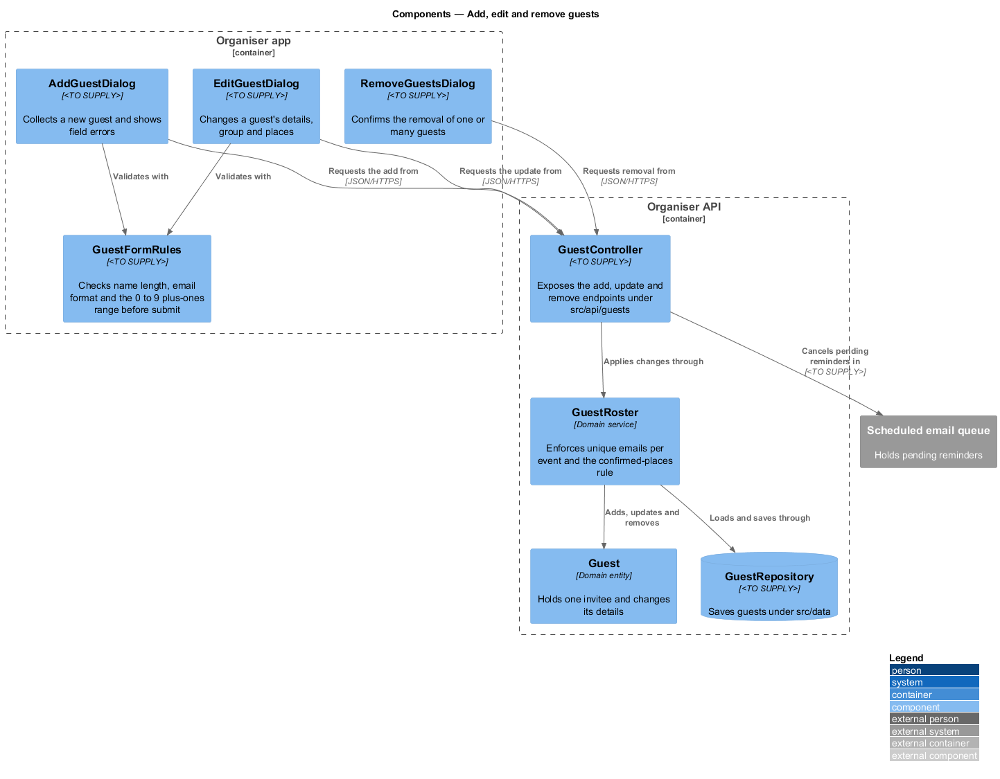
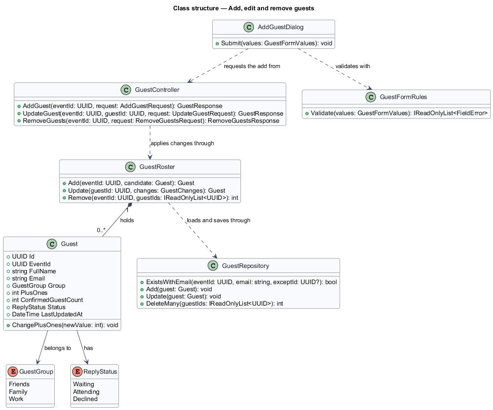
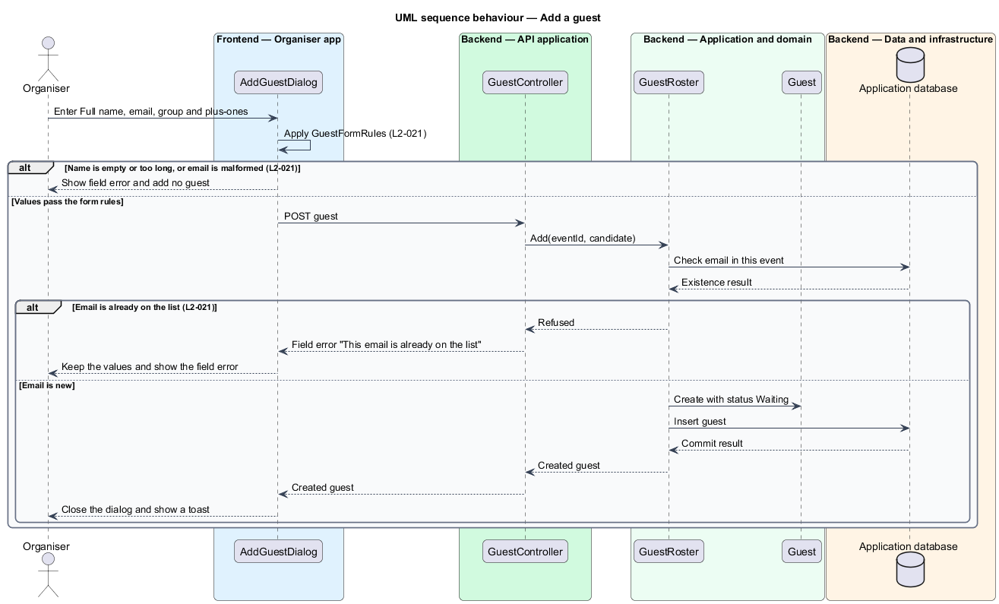
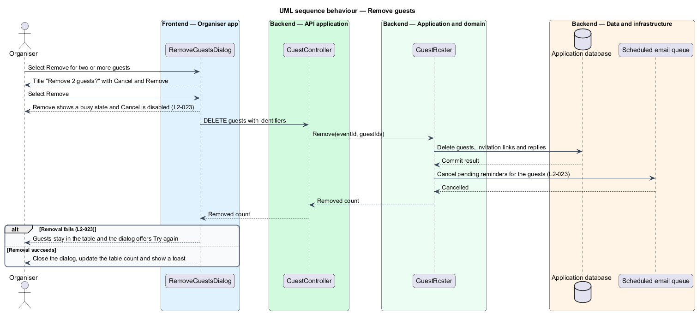

# Add, edit and remove guests

## Overview

An organiser keeps the invitee list accurate by adding guests as people are invited, correcting their details as they change and removing people who should no longer receive an invitation. Each change shall respect the rules of the list: an email address identifies one guest within an event, a guest who has already replied cannot have fewer confirmed places than they hold, and removing a guest also removes what depends on them.

**confirmed places** — number of places a guest has already accepted in a reply, which an edit may not reduce without asking the guest again.

**invitation link** — personal link tied to one guest, which stops working when the guest is removed.

The feature sits in the guests subsystem. The Add guest, Edit guest and Remove guests dialogs in the organiser app (`src/admin`) check the form values and send each command to the organiser API (`src/api/guests`). The guest rules are held in the domain (`src/domain`), which enforces email uniqueness and the confirmed-places rule before the change is stored in the application database through `src/data`. Removing a guest cancels any reminder still queued for that guest.

## Description

- **`AddGuestDialog`** — dialog in the organiser app. It collects the full name, email, group and plus-ones of a new guest, shows field errors and keeps the entered values when the request fails.
- **`EditGuestDialog`** — dialog in the organiser app. It changes the details, group and places of an existing guest and shows the confirmed-places error when the new plus-ones value is too low.
- **`RemoveGuestsDialog`** — dialog in the organiser app. It names the number of guests being removed, shows the busy state while the removal is in flight and offers Try again on failure.
- **`GuestFormRules`** — component in the organiser app. It checks the name length, the email format and the whole-number range of the plus-ones field before a request is sent. `<TO SUPPLY>` for the exact client-side rule set.
- **`GuestController`** — controller under `src/api/guests`. It exposes the add, update and remove endpoints.
- **`GuestRoster`** — domain service. It adds, updates and removes guests for one event and enforces the unique-email and confirmed-places rules.
- **`Guest`** — domain entity for one invitee. It holds the guest's details, group, plus-ones, confirmed guest count and reply status, and it changes its plus-ones through `ChangePlusOnes`.
- **`GuestGroup`** — enumeration of the groups a guest may belong to: `Friends`, `Family` and `Work`.
- **`ReplyStatus`** — enumeration of the reply states shown for a guest. It is defined by the guest list design and used here to set the initial status of a new guest.
- **`GuestRepository`** — persistence component under `src/data`. It checks whether an email is used in an event, and it inserts, updates and deletes guests.
- **Scheduled email queue** — external component that holds pending reminders. Its identifier and interface are `<TO SUPPLY>`.

## Requirements

| L2 ID | Refines (L1) | Requirement |
|-------|--------------|-------------|
| `L2-021` | `L1-004` | Organisers must add a guest one at a time from the Add guest dialog. |
| `L2-022` | `L1-004` | Organisers must edit a guest's details, group and number of places. |
| `L2-023` | `L1-004` | Organisers must remove one or many guests, with confirmation. |

## Diagrams

### System context

The organiser maintains the invitee list in the RSVP CMS, and the system cancels pending reminders in the scheduled email queue for removed guests.

### Containers

The organiser app sends guest commands to the organiser API, which writes to the application database and cancels reminders in the scheduled email queue.

### Components

The three dialogs validate with `GuestFormRules` and send their commands to `GuestController`. The controller applies them through `GuestRoster`, which changes `Guest` entities and saves them through `GuestRepository`.

### Class structure

`GuestRoster` holds zero or more `Guest` entities for an event. `Guest` refers to a `GuestGroup` and a `ReplyStatus`, and `AddGuestDialog` validates its values with `GuestFormRules` before it calls the controller.

### Behaviour — add a guest

The dialog validates the form before it sends the request. The roster refuses an email that another guest in the same event already uses, and the dialog keeps the entered values so the organiser can correct them.

### Behaviour — remove guests

The removal dialog stays open with a busy state until the request completes. The roster deletes the guests, their invitation links and their replies, cancels their pending reminders and leaves the guests in place when the removal fails.

