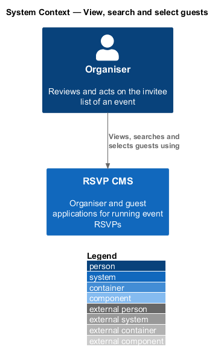
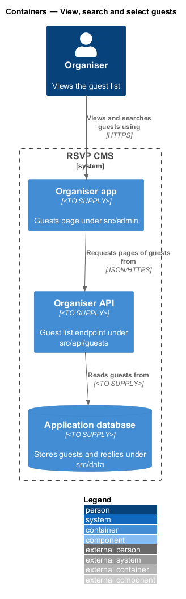
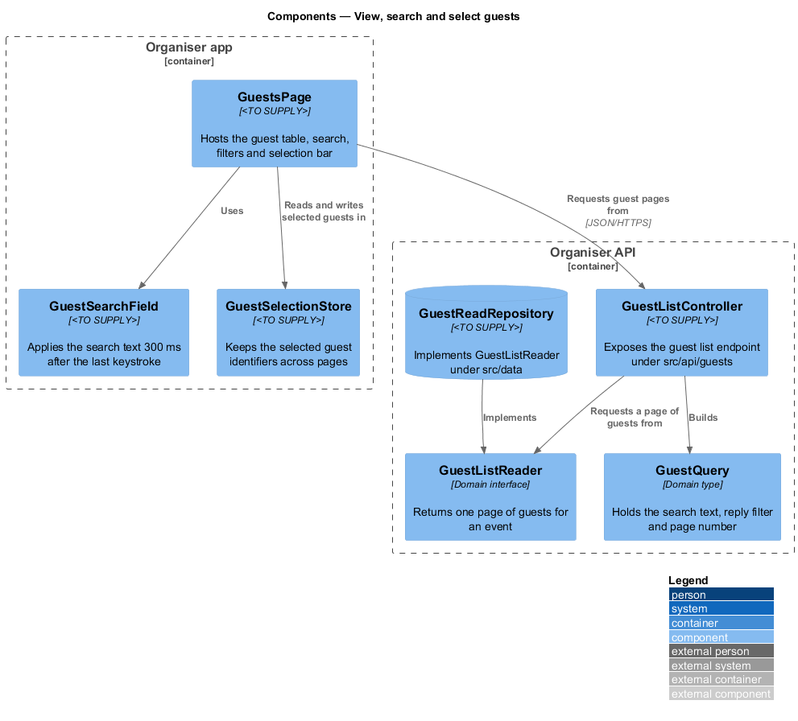
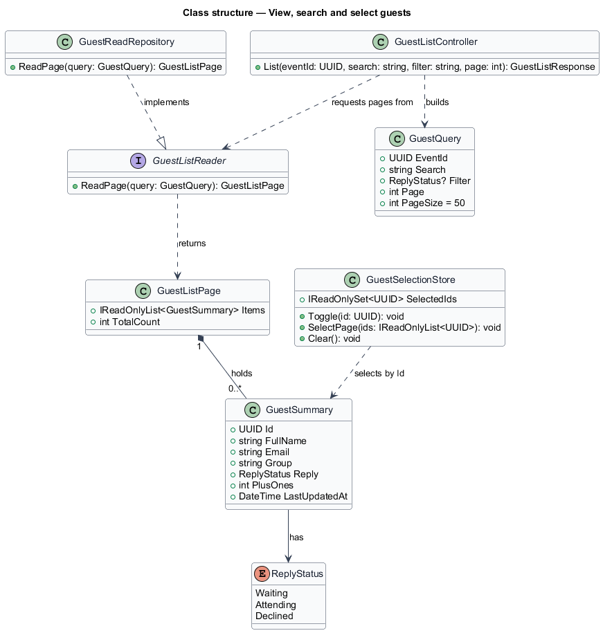
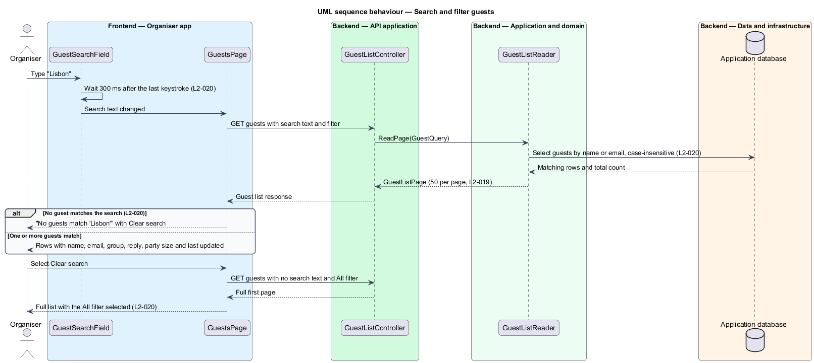

# View, search and select guests

## Overview

The guest list is the organiser's record of every invitee for an event. Before an organiser can edit, remove or export guests, the organiser needs to see those invitees, find particular people and mark a set of them for a bulk action. This feature covers the read side of the list: the table, the search and filter controls and the selection of rows.

**guest** — invitee of one event, identified by a name and an email address.

**reply status** — the state of a guest's reply, one of Waiting, Attending or Declined.

**selection** — the set of guests an organiser has marked for an action, kept in the organiser app while the organiser moves between pages.

The feature sits in the guests subsystem. The Guests page in the organiser app (`src/admin`) renders the table and the controls. The organiser API (`src/api/guests`) returns one page of guests for a query. The query and the page of results are defined in the domain (`src/domain`), and the rows are read from the application database through `src/data`. Selection is held in the browser and sent to the server only when the organiser acts on it, so the read path has no server-side selection state.

## Description

- **`GuestsPage`** — component in the organiser app. It hosts the guest table, the search field, the filter chips and the selection bar. It shows placeholder rows while loading and the error state with Try again when the request fails.
- **`GuestSearchField`** — component in the organiser app. It applies the search text 300 ms after the organiser stops typing.
- **`GuestSelectionStore`** — component in the organiser app. It holds the identifiers of the selected guests across pages and supports selecting the current page, clearing the selection and counting the selected guests.
- **`GuestListController`** — controller under `src/api/guests`. It exposes the guest list endpoint and builds a `GuestQuery` from the request.
- **`GuestQuery`** — domain type holding the event identifier, the search text, the optional reply filter and the page number. The page size is 50 rows.
- **`GuestSummary`** — domain read model for one row: name, email, group, reply status, party size and last update time.
- **`GuestListPage`** — domain read model holding one page of `GuestSummary` rows and the total count of matching guests.
- **`GuestListReader`** — domain interface that returns a `GuestListPage` for a `GuestQuery`.
- **`GuestReadRepository`** — persistence component under `src/data` that implements `GuestListReader` over the guest table.
- **`ReplyStatus`** — enumeration of the reply states: `Waiting`, `Attending` and `Declined`.

## Requirements

| L2 ID | Refines (L1) | Requirement |
|-------|--------------|-------------|
| `L2-019` | `L1-004` | The Guests page must show every invitee with their key details. |
| `L2-020` | `L1-004` | Organisers must find guests quickly. |
| `L2-024` | `L1-004` | Organisers must select guests to act on several at once. |

## Diagrams

### System context

The organiser views, searches and selects guests in the RSVP CMS.

### Containers

The Guests page in the organiser app requests pages of guests from the organiser API, which reads them from the application database.

### Components

`GuestsPage` uses `GuestSearchField` for the search text and `GuestSelectionStore` for the selection. `GuestListController` builds a `GuestQuery` and asks `GuestListReader` for a page, which `GuestReadRepository` answers from the database.

### Class structure

`GuestListReader` returns a `GuestListPage` that holds `GuestSummary` rows. `GuestSelectionStore` refers to the rows by identifier and does not hold a copy of them.

### Behaviour — search and filter guests

The search field waits 300 ms after the last keystroke before the page requests the matching guests. The reader matches names and emails without regard to case, and the page shows the no-results message when nothing matches.

