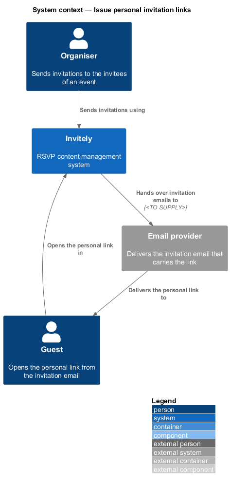
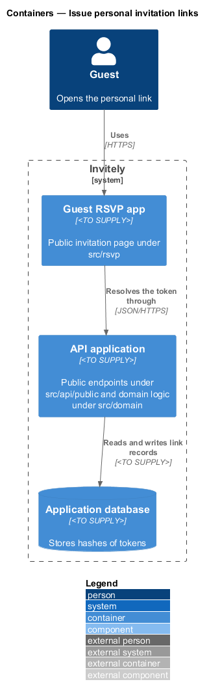
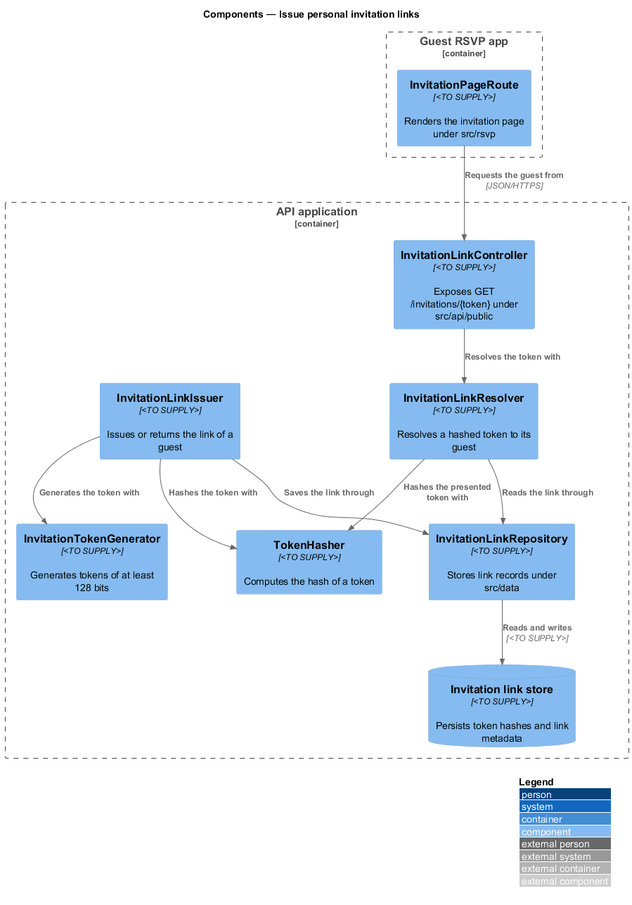
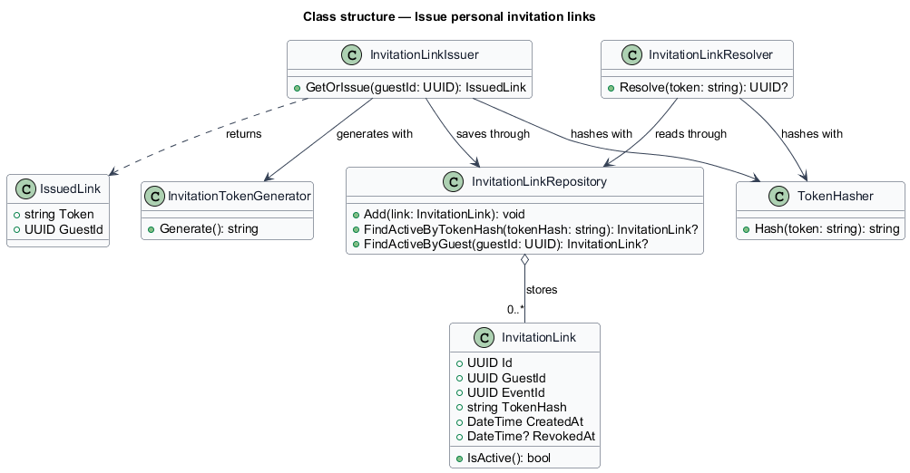
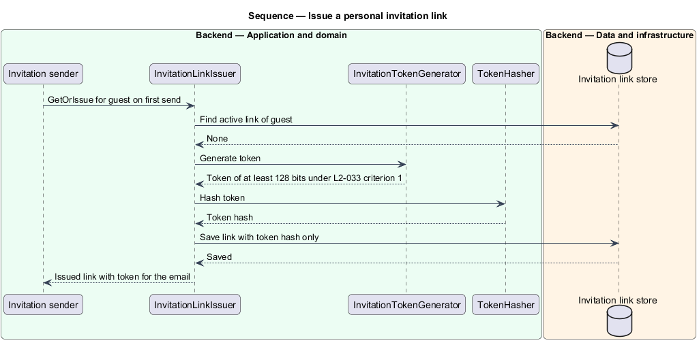
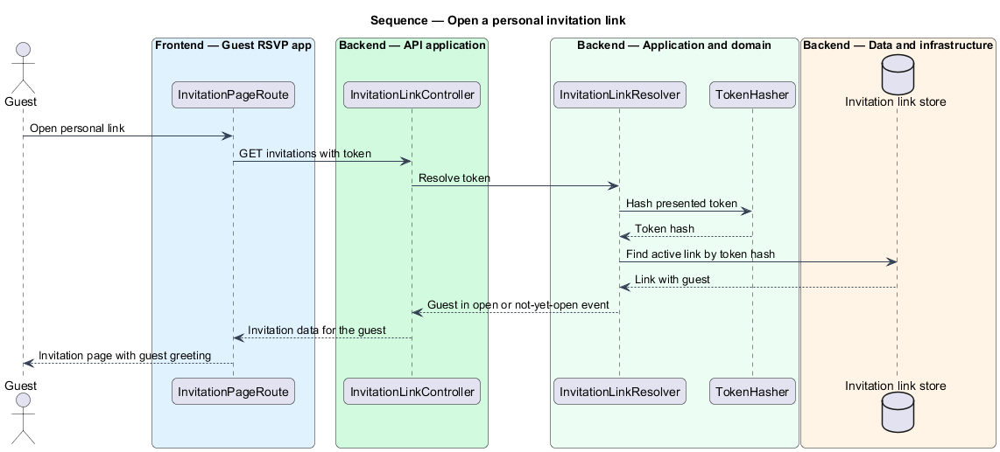

# Issue personal invitation links

## Overview

A **personal invitation link** is a web address that identifies one guest of one event without sign-in. The guest opens the link from the invitation email and sees the invitation page for that guest. Each invitee of an event in Invitely receives one personal link, and the same link is used in the invitation and in every reminder for that guest.

The feature covers three things: generating the token that the link carries, storing a hash of that token, and resolving an opened link to its guest.

Two terms recur below:

- **token** — random value carried in a personal link, generated once for a guest
- **token hash** — digest of the token, stored in place of the token

The feature does not decide when invitations are sent and does not decide whether a guest may reply. Those decisions belong to the schedule feature and to the guest invitation access feature of the guest subsystem respectively.

## Description

The feature is a vertical slice that runs from the guest's browser to the link store. Issuing happens during sending. Resolving happens when the guest opens the link.

- **`InvitationLinkIssuer`** — domain service under `src/domain/invitations`. It returns the existing active link of a guest or issues a new one on the first send. Reminders call the same method, so the link stays the same.
- **`InvitationTokenGenerator`** — domain service under `src/domain/invitations`. It produces a token of at least 128 bits from a cryptographically secure random source and encodes it as URL-safe text.
- **`TokenHasher`** — domain service under `src/domain/invitations`. It computes the hash of a token.
- **`InvitationLink`** — entity under `src/domain/invitations`. It holds the `GuestId`, the `EventId`, the `TokenHash` and the `CreatedAt` value. A regeneration by the event feature sets `RevokedAt`.
- **`InvitationLinkResolver`** — domain service under `src/domain/invitations`. It finds the guest for a hashed token in an open or not-yet-open event.
- **`InvitationLinkRepository`** — repository under `src/data`. It stores and reads `InvitationLink` entities and never reads or writes the token itself.
- **`InvitationLinkController`** — endpoint under `src/api/public`. It exposes `GET /invitations/{token}`, which is unauthenticated.
- **`InvitationPageRoute`** — route under `src/rsvp`. It renders the invitation page for the guest returned by the endpoint and shows the guest's name in the greeting.

## Requirements

The feature realizes the following level-2 (L2) requirement. The requirement refines a level-1 (L1) requirement, cited by identifier.

| L2 ID | Refines (L1) | Requirement |
|-------|--------------|-------------|
| `L2-033` | `L1-005` | Each guest must have a personal link that identifies them without sign-in. |

## Diagrams

### System context

The organiser sends invitations that contain personal links. The guest opens a personal link in the browser, and Invitely resolves it to the guest's invitation page without sign-in.

### Containers

The API application issues links during sending and stores only the token hash. The guest RSVP app opens the link through the public endpoint of the API application.

### Components

`InvitationLinkIssuer` uses `InvitationTokenGenerator` and `TokenHasher` to create the link. `InvitationLinkResolver` uses the same hasher to find the guest for an opened token.

### Class structure

`InvitationLinkIssuer` creates `InvitationLink` entities that hold a `TokenHash` and never a token. `InvitationLinkResolver` returns the `GuestId` of the matching link.

### Behaviour — issue a link on first send

When an invitation is first sent, the issuer creates a token of at least 128 bits and stores its hash under `L2-033` criterion 1. The token is placed in the email, and the stored value is the hash alone.

### Behaviour — open a personal link

When a guest opens a link, the endpoint hashes the token, resolves the guest and returns the invitation page under `L2-033` criterion 2. A reminder reuses the link issued at the first send under criterion 3.

