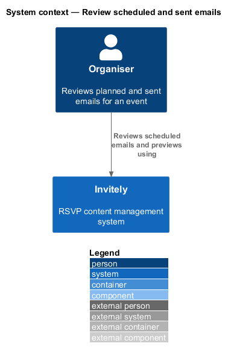
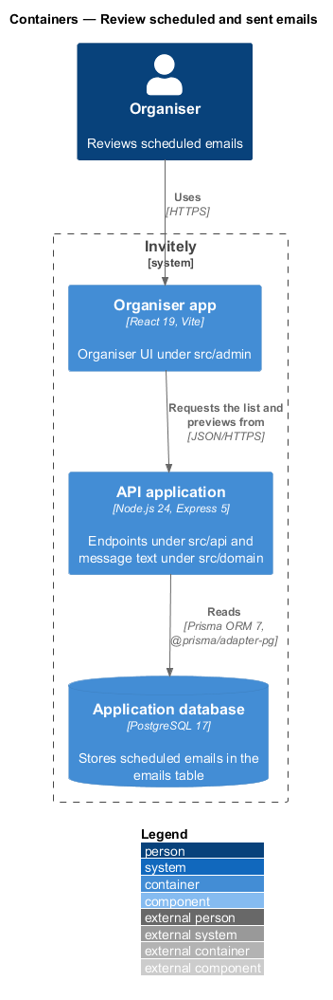
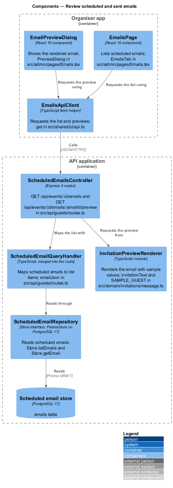
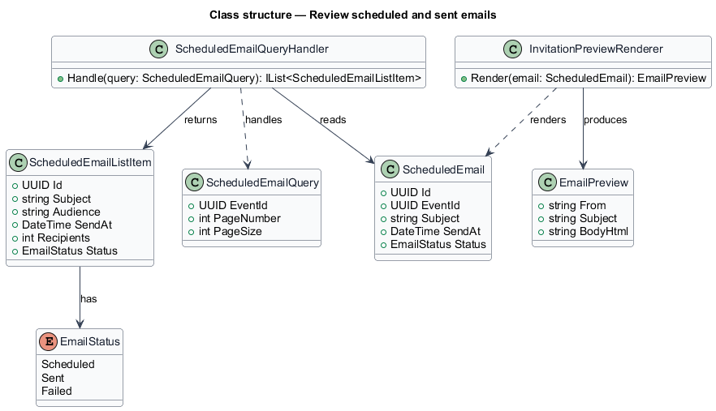
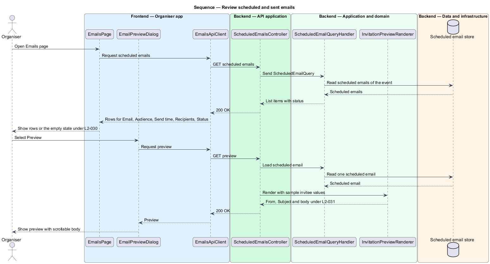

# Review scheduled and sent emails

## Overview

An organiser of an event in Invitely plans and tracks the emails sent to its guests. The **Emails page** is the place where the organiser sees each planned or sent email for the event, its audience, its send time and its status. For each email the page offers a **preview**, the exact message a guest will receive. The page is the read side of the invitations subsystem: it reads the scheduled emails that the schedule feature creates and never changes them.

Two terms recur below:

- **scheduled email** — message held with a send time until the dispatcher sends it, created by the schedule feature
- **email preview** — rendering of a scheduled email with a sample invitee's name and sample personal link text, shown before the email is sent

## Description

The feature is a vertical slice that runs from the Emails page to the scheduled email store. It adds read operations and a preview renderer and does not add new stored data.

- **`EmailsPage`** — admin page under `src/admin/invitations`. It lists the scheduled emails of an event with the columns Email, Audience, Send time, Recipients, Status and Preview.
- **`EmailPreviewDialog`** — admin dialog under `src/admin/invitations`. It shows From, Subject and the rendered body, scrolls the body inside the dialog and shows a busy state while the preview loads.
- **`EmailsApiClient`** — typed admin client under `src/admin/invitations`. It requests the list and the preview.
- **`ScheduledEmailsController`** — endpoint under `src/api/guests`. It exposes the list and the preview of the scheduled emails of an event.
- **`ScheduledEmailQuery`** — request object carrying the `EventId` and the page parameters.
- **`ScheduledEmailQueryHandler`** — query handler under `src/domain/invitations`. It reads the scheduled emails of an event and maps them to `ScheduledEmailListItem` values.
- **`ScheduledEmailListItem`** — value under `src/domain/invitations`. It holds the fields the list shows.
- **`InvitationPreviewRenderer`** — renderer under `src/domain/invitations`. It produces the `EmailPreview` from a `ScheduledEmail` using the same template as the sent email, with a sample invitee's name and sample personal link text.
- **`EmailPreview`** — value under `src/domain/invitations`. It holds the From value, the Subject and the rendered body.
- **`ScheduledEmailRepository`** — repository under `src/data`, shared with the schedule feature. It reads the scheduled emails of an event.

The organiser app (`src/admin`) and the guest app (`src/rsvp`) are React 19 applications built with Vite. The API application runs on Node.js 24 with Express 5 and exchanges JSON over HTTPS.

The code places each design component as follows.

| Design component | Where it lives |
|------------------|----------------|
| `EmailsPage` | `EmailsTab` in `src/admin/pages/Emails.tsx` |
| `EmailPreviewDialog` | `PreviewDialog` in `src/admin/pages/Emails.tsx` |
| `EmailsApiClient` | The shared `get` helper in `src/shared/ui/api.ts` |
| `ScheduledEmailsController` | `GET /api/events/:id/emails` and `GET /api/events/:id/emails/:emailId/preview` in `src/api/guests/routes.ts` |
| `ScheduledEmailQuery` | Path parameters only; the list returns every email of the event, ordered by send time |
| `ScheduledEmailQueryHandler`, `ScheduledEmailListItem` | `emailJson` in `src/api/guests/routes.ts`: kind, audience label, send time, recipients, status and subject |
| `InvitationPreviewRenderer`, `EmailPreview` | `invitationText`, `personalLink` and `SAMPLE_GUEST` in `src/domain/invitations/message.ts`; the route returns `from`, `replyTo`, `subject` and `body`, the same text the mail worker sends |
| `ScheduledEmailRepository` | `Store.listEmails` and `Store.getEmail` |

Persistence goes through the `Store` interface in `src/data/store.ts`. The running app uses `PrismaStore` (`src/data/prismaStore.ts`), which reaches PostgreSQL 17 through Prisma ORM 7 with the `@prisma/adapter-pg` driver adapter. Every automated test and the Playwright e2e server use the in-memory `MemoryStore` (`src/data/memoryStore.ts`) instead. The schema and migrations are `src/data/prisma/schema.prisma` and `src/data/prisma/migrations/`.

## Requirements

The feature realizes the following level-2 (L2) requirements. Each L2 requirement refines a level-1 (L1) requirement, cited by identifier.

| L2 ID | Refines (L1) | Requirement |
|-------|--------------|-------------|
| `L2-030` | `L1-005` | Organisers must see every email planned or sent for an event. |
| `L2-031` | `L1-005` | Organisers must see the exact email a guest will receive. |

## Diagrams

### System context

The organiser reads the scheduled emails of an event in Invitely and opens their previews. Invitely does not contact the email provider while the organiser reads the list or a preview.

### Containers

The organiser app requests the list and previews from the API application over HTTPS. The API application reads the scheduled emails from the application database.

### Components

`ScheduledEmailsController` dispatches `ScheduledEmailQuery` to the query handler, which reads through `ScheduledEmailRepository`. `InvitationPreviewRenderer` builds the preview for the dialog.

### Class structure

`ScheduledEmailQueryHandler` maps `ScheduledEmail` entities to `ScheduledEmailListItem` values. `InvitationPreviewRenderer` produces an `EmailPreview` from a `ScheduledEmail`.

### Behaviour — list and preview scheduled emails

The page loads the list of the event under `L2-030`, and the handler returns the list items with their status. When the organiser opens a preview, the renderer produces the message under `L2-031` and the dialog shows it.

