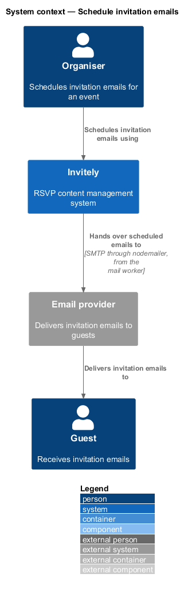
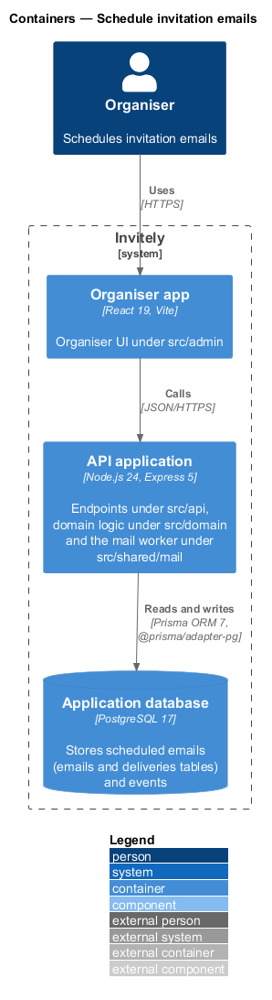
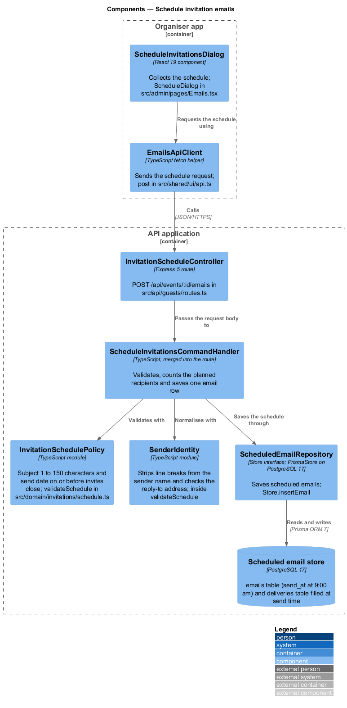
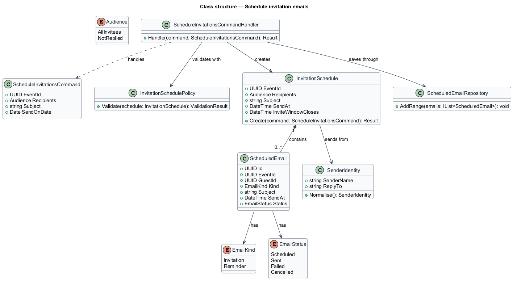
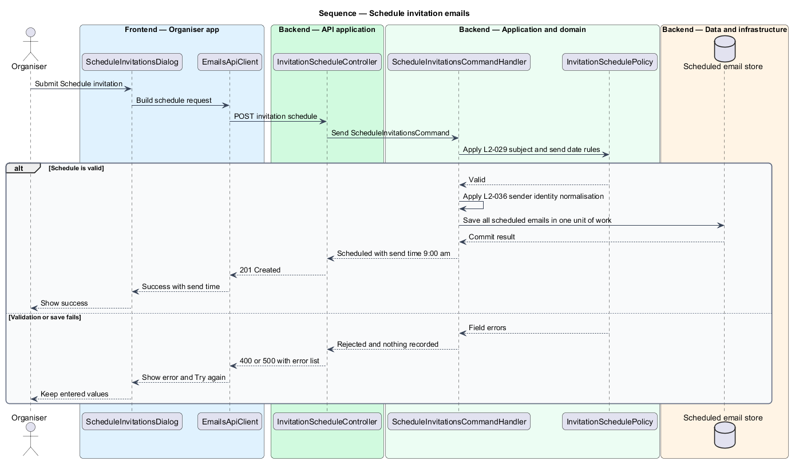

# Schedule invitation emails

## Overview

Invitely is a content management system that runs the RSVP for an event. An organiser adds invitees to an event and then sends each invitee an **invitation email**, the message that asks the guest to reply and carries the guest's personal link. This feature covers the decision to send: which invitees receive the email, its subject, the date it goes out and the sender identity it uses.

The feature sits in the invitations subsystem, which owns every email an event sends. Scheduling produces one **scheduled email** per recipient. A scheduled email is a message held with a send time until the dispatcher sends it. Scheduling is all or nothing: the scheduled emails for one request are saved in one unit of work, so a failure leaves no partial schedule.

The feature does not compose the body of the message, send it or record its delivery. Those concerns belong to the sibling features in the invitations subsystem. Two terms recur below:

- **invite window** — interval in which guests may reply
- **sender identity** — sender name and reply-to address applied to every email of an event

## Description

The feature is a vertical slice that runs from the organiser dialog to the scheduled email store.

- **`ScheduleInvitationsDialog`** — admin dialog under `src/admin/invitations`. It offers the Recipients choice, the Subject and the Send on date, defaults Send on to the invite window open date, and shows the send time on success.
- **`EmailsApiClient`** — typed admin client under `src/admin/invitations`. It builds the schedule request and returns a typed result to the dialog.
- **`InvitationScheduleController`** — endpoint under `src/api/guests`. It exposes `POST /events/{eventId}/invitation-schedules` and dispatches `ScheduleInvitationsCommand`.
- **`ScheduleInvitationsCommand`** — request object carrying the `EventId`, the `Recipients` choice, the `Subject` and the `SendOnDate`.
- **`ScheduleInvitationsCommandHandler`** — application handler under `src/domain/invitations`. It validates the command, builds the `InvitationSchedule` and saves it in one unit of work.
- **`InvitationSchedulePolicy`** — rule object under `src/domain/invitations`. It applies the subject length rule and the rule that the send date falls before the invite window closes.
- **`InvitationSchedule`** — aggregate under `src/domain/invitations`. It creates one `ScheduledEmail` for each recipient, with the send time set to 9:00 am on the send date.
- **`ScheduledEmail`** — entity under `src/domain/invitations`. It holds the recipient, the subject, the send time and the status `Scheduled`.
- **`SenderIdentity`** — value object under `src/domain/invitations`. It removes line breaks from the sender name and validates the reply-to address. The Event settings feature also uses it when the organiser saves the settings.
- **`ScheduledEmailRepository`** — repository under `src/data`. It adds the scheduled emails of one request in one transaction.

The organiser app (`src/admin`) and the guest app (`src/rsvp`) are React 19 applications built with Vite. The API application runs on Node.js 24 with Express 5 and exchanges JSON over HTTPS.

The mail worker (`sendDueEmails` and `startMailWorker` in `src/shared/mail/worker.ts`) polls for due emails and takes a lease on each through `locked_until`. It creates the deliveries, then sends each one through a `MailTransport` from `src/shared/mail/transport.ts`: `SmtpTransport` through nodemailer in production, `LogTransport` in development and `MemoryTransport` in tests. Each delivery has a unique idempotency key. A failed send is retried after 1, 2, 4 and 8 minutes, with at most 5 attempts. The message text comes from `invitationText` in `src/domain/invitations/message.ts`. The queue operations (`dueEmailIds`, `claimEmail`, `materialiseDeliveries`, `dueDeliveries`, `markDelivery`, `settleEmail`) are methods of the `Store` interface.

The code places each design component as follows.

| Design component | Where it lives |
|------------------|----------------|
| `ScheduleInvitationsDialog` | `ScheduleDialog` in `src/admin/pages/Emails.tsx` |
| `EmailsApiClient` | The shared `post` helper in `src/shared/ui/api.ts` |
| `InvitationScheduleController` | `POST /api/events/:id/emails` in `src/api/guests/routes.ts` |
| `ScheduleInvitationsCommand` | JSON body with `audience` (`all` or `non-responders`), `subject`, `sendOn`, `senderName` and `replyTo` |
| `ScheduleInvitationsCommandHandler` | Merged into the route: it validates, counts the planned recipients and saves one `emails` row |
| `InvitationSchedulePolicy`, `SenderIdentity` | `validateSchedule` in `src/domain/invitations/schedule.ts`: subject of 1 to 150 characters, send date on or before invites close, line breaks removed from subject and sender name, reply-to like name@example.com |
| `InvitationSchedule` | `sendTime` in the same module sets `send_at` to 9:00 am on the send date |
| `ScheduledEmail` | One `emails` row per schedule with status `Scheduled`, and one `deliveries` row per guest created when the email is sent. Recipients are resolved at send time, not when scheduling |
| `ScheduledEmailRepository` | `Store.insertEmail` |

Persistence goes through the `Store` interface in `src/data/store.ts`. The running app uses `PrismaStore` (`src/data/prismaStore.ts`), which reaches PostgreSQL 17 through Prisma ORM 7 with the `@prisma/adapter-pg` driver adapter. Every automated test and the Playwright e2e server use the in-memory `MemoryStore` (`src/data/memoryStore.ts`) instead. The schema and migrations are `src/data/prisma/schema.prisma` and `src/data/prisma/migrations/`.

## Requirements

The feature realizes the following level-2 (L2) requirements. Each L2 requirement refines a level-1 (L1) requirement, cited by identifier.

| L2 ID | Refines (L1) | Requirement |
|-------|--------------|-------------|
| `L2-029` | `L1-005` | Organisers must schedule the invitation email for all invitees or only for those who have not replied. |
| `L2-036` | `L1-005` | Emails must come from the organiser's name and replies must reach the organiser. |

## Diagrams

### System context

The organiser schedules invitations in Invitely. Invitely hands the scheduled emails to the email provider, which delivers them to guests.

### Containers

The organiser app calls the API application over HTTPS. The API application validates the schedule and stores the scheduled emails in the application database.

### Components

`InvitationScheduleController` dispatches `ScheduleInvitationsCommand` to the handler. The handler applies `InvitationSchedulePolicy`, normalises the `SenderIdentity` and saves the aggregate through `ScheduledEmailRepository`.

### Class structure

`ScheduleInvitationsCommandHandler` creates an `InvitationSchedule`, which contains one `ScheduledEmail` per recipient and uses a `SenderIdentity`.

### Behaviour — schedule invitation emails

The handler applies the rules of `L2-029` before it creates any scheduled email. It normalises the sender identity under `L2-036` and saves all scheduled emails in one unit of work. A failure at validation or at save returns field errors and records nothing.

