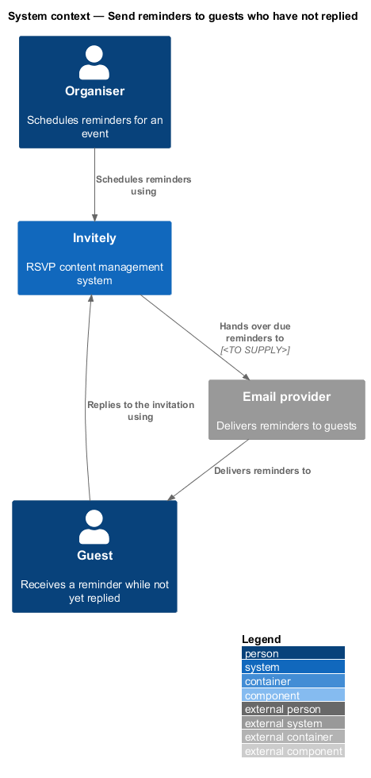
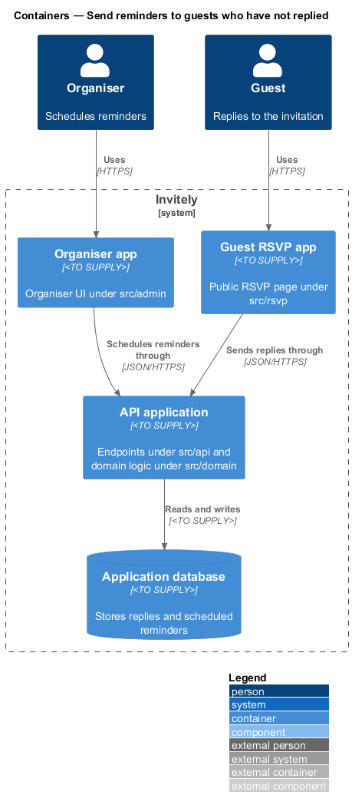
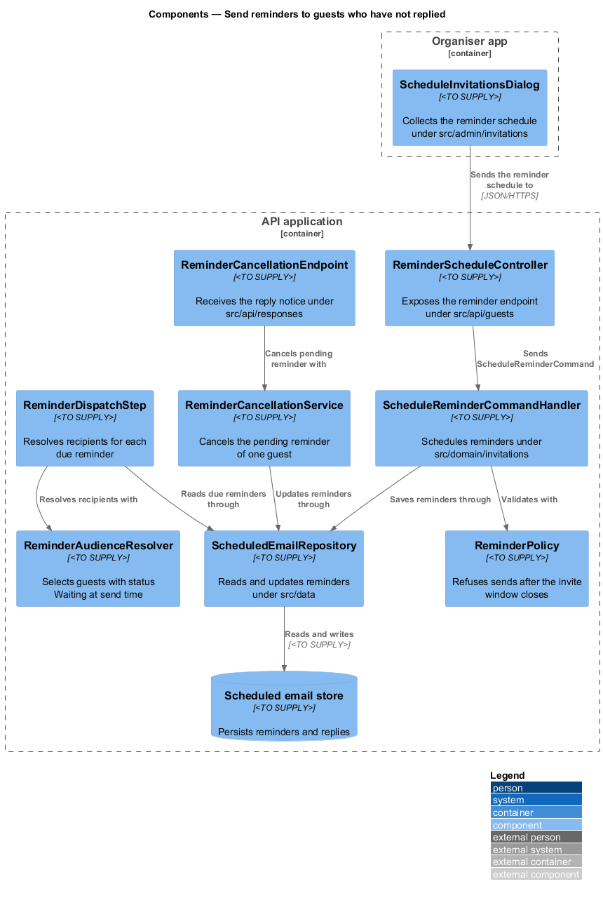
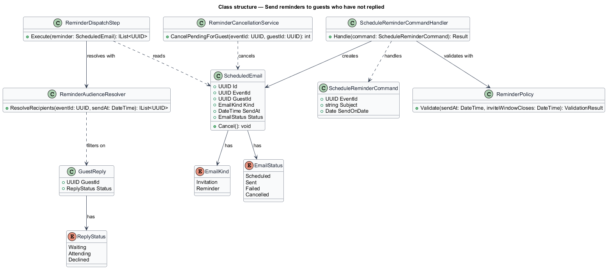
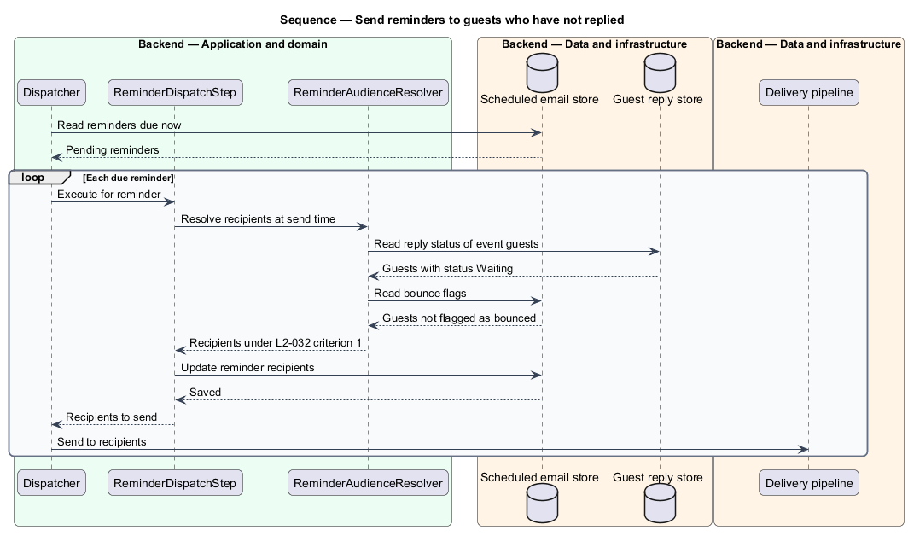
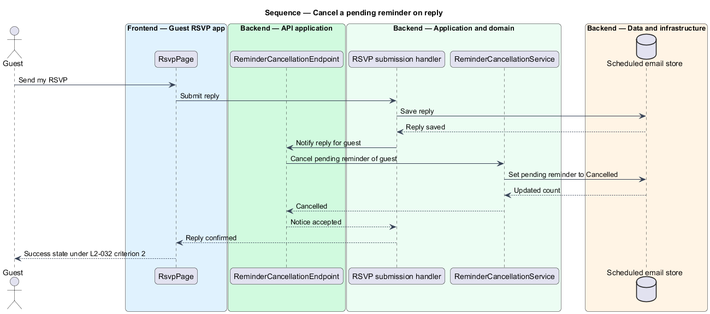

# Send reminders to guests who have not replied

## Overview

A **reminder** is a scheduled email that asks guests who have not replied to an event to reply before the invite window closes. An organiser of an event in Invitely schedules a reminder for the audience "Invitees who haven't replied" and chooses a send date. Reminders are the only scheduled emails that depend on a guest's reply, so this feature defines the rules that link reminders to replies.

The feature has two rules. First, a reminder reaches only guests whose reply status is Waiting at the moment the reminder is sent. Second, a reply from a guest cancels that guest's pending reminder, so the reminder is not sent. A third rule refuses any reminder scheduled after the invite window closes.

Two terms recur below:

- **invite window** — interval in which guests may reply
- **pending reminder** — reminder for one guest that has a send time in the future and has not been sent or cancelled

The feature reuses the scheduled email model of the schedule feature. A reminder is one scheduled email per recipient with the kind Reminder. The sending itself, with its retries and idempotency, belongs to the track-delivery-outcomes feature.

## Description

The feature is a vertical slice that runs from the organiser's reminder scheduling to the cancellation performed when a guest replies.

- **`ScheduleReminderCommand`** — request object carrying the `EventId`, the `Subject`, the `SendOnDate` and the audience `NotReplied`.
- **`ScheduleReminderCommandHandler`** — application handler under `src/domain/invitations`. It applies `ReminderPolicy` and saves one reminder per waiting guest.
- **`ReminderPolicy`** — rule object under `src/domain/invitations`. It refuses a send time after the invite window closes with the message "Reminders must go out before invites close".
- **`ReminderAudienceResolver`** — resolver under `src/domain/invitations`. It returns the guests whose reply status is Waiting at the send time and excludes guests flagged as bounced by the track-delivery-outcomes feature.
- **`ReminderDispatchStep`** — step under `src/domain/invitations` that the dispatcher calls for each due reminder. It replaces the recipients of the reminder with the result of `ReminderAudienceResolver` before the send.
- **`ReminderCancellationService`** — service under `src/domain/invitations`. It sets the status of the pending reminder of one guest to Cancelled.
- **`ScheduledEmail`** — entity defined by the schedule feature. A reminder uses the kind Reminder and carries the `GuestId` of its recipient.
- **`ScheduledEmailRepository`** — repository under `src/data`, shared with the schedule feature. It reads and updates the pending reminders of a guest.
- **`ReminderCancellationEndpoint`** — internal call path under `src/api/responses`. The RSVP submission of the responses feature calls it after a reply is saved.
- **`ReminderScheduleController`** — endpoint under `src/api/guests`. It exposes `POST /events/{eventId}/reminders` and dispatches `ScheduleReminderCommand`.

## Requirements

The feature realizes the following level-2 (L2) requirement. The requirement refines a level-1 (L1) requirement, cited by identifier.

| L2 ID | Refines (L1) | Requirement |
|-------|--------------|-------------|
| `L2-032` | `L1-005` | Reminders must reach only guests who have not replied, and a reply must stop reminders for that guest. |

## Diagrams

### System context

The organiser schedules reminders in Invitely. Invitely hands the due reminders to the email provider, and each guest who has not replied receives one reminder.

### Containers

The organiser app schedules reminders through the API application. The guest RSVP app sends replies through the same API application, and the reply cancels the matching pending reminder in the application database.

### Components

`ReminderScheduleController` dispatches `ScheduleReminderCommand`, which applies `ReminderPolicy`. At send time, `ReminderDispatchStep` uses `ReminderAudienceResolver`. When a reply is saved, the RSVP submission calls `ReminderCancellationService`.

### Class structure

`ScheduleReminderCommandHandler` creates `ScheduledEmail` entities of kind Reminder. `ReminderCancellationService` changes the status of those entities to Cancelled.

### Behaviour — send a reminder to waiting guests

When a reminder becomes due, the dispatcher calls `ReminderDispatchStep`. The step resolves the recipients under `L2-032` criterion 1 and sends only to guests with status Waiting at that moment.

### Behaviour — cancel a pending reminder on reply

When a guest replies, the RSVP submission calls the cancellation path. The pending reminder of that guest is set to Cancelled before the dispatcher can send it, under `L2-032` criterion 2.

