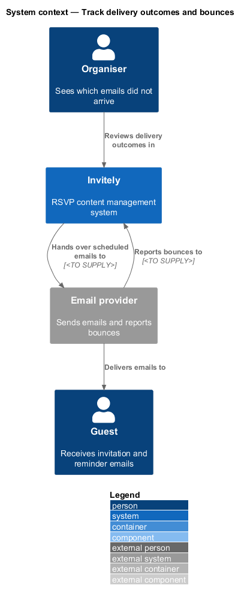
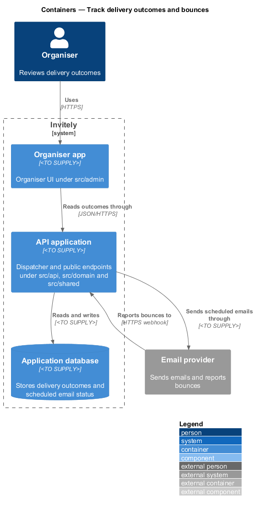
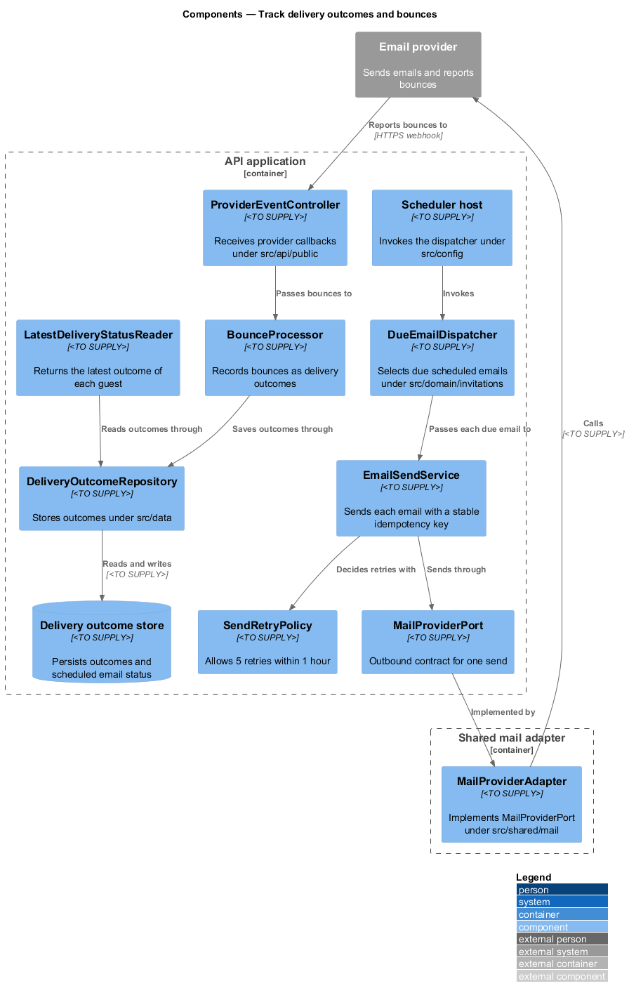
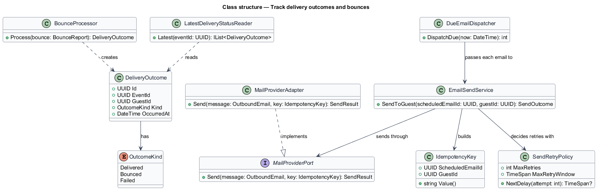
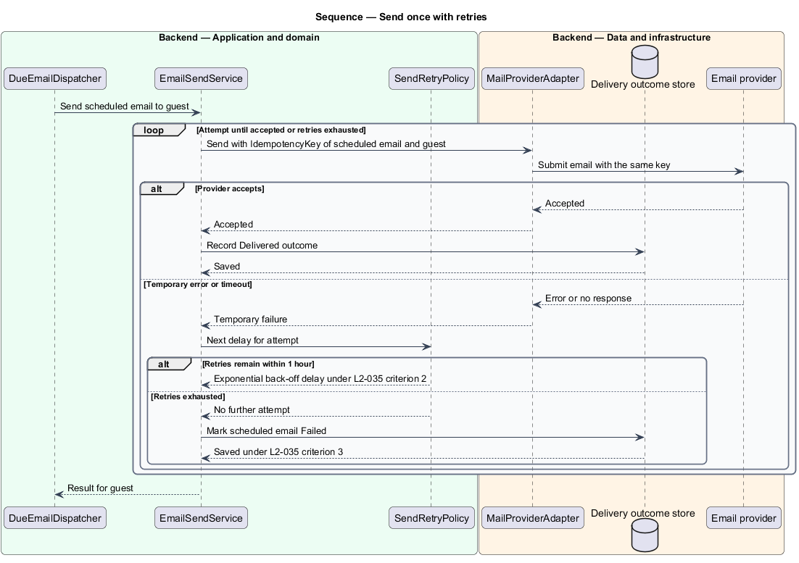
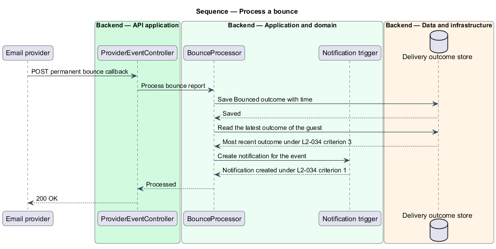

# Track delivery outcomes and bounces

## Overview

Invitely hands every scheduled email to an external email provider, and the provider reports what became of it. This feature covers two concerns of the invitations subsystem. The first is sending: each scheduled email is handed to the provider once, even when the system retries the send. The second is outcomes: a permanent bounce for a guest is recorded, shown to the organiser and used to exclude that guest from later reminders.

A **delivery outcome** is a record of one result reported for one guest's email, such as delivered or bounced, with the time it occurred. A **bounce** is a delivery outcome reported by the provider as permanent, meaning the address cannot receive the email. An **idempotency key** is a value sent with each send request so that the provider treats repeated requests for the same send as one send.

The feature takes the scheduled emails that the schedule feature creates and the reminder rules of the send-reminders feature as inputs. It reports outcomes to the organiser through the guest list and the notifications, which belong to other subsystems.

## Description

The feature is a vertical slice that runs from the dispatcher to the provider and back through a provider callback.

- **`DueEmailDispatcher`** — domain use case under `src/domain/invitations`. A scheduler host under `src/config` invokes it. It selects the scheduled emails whose send time has passed and passes each one to `EmailSendService`.
- **`EmailSendService`** — domain service under `src/domain/invitations`. It builds the send request for one guest with a stable `IdempotencyKey`, calls the provider port and records the result as a `DeliveryOutcome` or a retry.
- **`IdempotencyKey`** — value under `src/domain/invitations`. It is derived from the `ScheduledEmail` identifier and the `GuestId`, so every retry of one send carries the same key.
- **`SendRetryPolicy`** — rule object under `src/domain/invitations`. It allows 5 retries with exponential back-off within 1 hour and marks the scheduled email as Failed when the retries are exhausted.
- **`MailProviderPort`** — interface under `src/domain/invitations`. It is the outbound contract for sending one email with an idempotency key.
- **`MailProviderAdapter`** — adapter under `src/shared/mail`. It implements `MailProviderPort` for the chosen provider. It sits in `src/shared` because the dispatcher and the provider callback both use the provider's contract.
- **`DeliveryOutcome`** — entity under `src/domain/invitations`. It holds the `GuestId`, the `EventId`, the `Kind` (Delivered, Bounced or Failed) and the `OccurredAt` value.
- **`BounceProcessor`** — domain service under `src/domain/invitations`. It records a bounce as a `DeliveryOutcome`, requests a notification for the event and leaves earlier outcomes unchanged.
- **`LatestDeliveryStatusReader`** — query service under `src/domain/invitations`. It returns the most recent `DeliveryOutcome` of each guest. The guest list and the reminder audience resolver use it.
- **`ProviderEventController`** — endpoint under `src/api/public`. It receives provider callbacks at `POST /webhooks/mail-provider`, passes each bounce to `BounceProcessor`.
- **`DeliveryOutcomeRepository`** — repository under `src/data`. It stores and reads delivery outcomes and the scheduled email status.

## Requirements

The feature realizes the following level-2 (L2) requirements. Each L2 requirement refines a level-1 (L1) requirement, cited by identifier.

| L2 ID | Refines (L1) | Requirement |
|-------|--------------|-------------|
| `L2-034` | `L1-005` | Organisers must know which emails did not arrive. |
| `L2-035` | `L1-005` | Emails must be sent once even when the system retries. |

## Diagrams

### System context

The dispatcher hands scheduled emails to the email provider. The provider delivers them to guests and reports bounces back to Invitely, which informs the organiser.

### Containers

The dispatcher runs inside the API application. The provider calls the public endpoint of the same application to report bounces. Both paths write to the application database.

### Components

`DueEmailDispatcher` drives `EmailSendService`, which uses `SendRetryPolicy` and the `MailProviderPort` implemented by `MailProviderAdapter`. `ProviderEventController` passes bounces to `BounceProcessor`.

### Class structure

`EmailSendService` builds an `IdempotencyKey` for each send. `DeliveryOutcome` entities record each result, and `LatestDeliveryStatusReader` derives the most recent status of a guest from them.

### Behaviour — send once with retries

Each send carries the same idempotency key on every attempt. A temporary provider error or a timeout is retried with exponential back-off under `L2-035` criterion 2, and a timeout after provider acceptance does not produce a second email under criterion 1.

### Behaviour — process a bounce

The provider callback is received and the bounce is recorded for the guest. The guest is then flagged in the guest list, and the notification is created under `L2-034` criterion 1. Earlier outcomes stay in the record, so the most recent outcome is the one shown under criterion 3.

