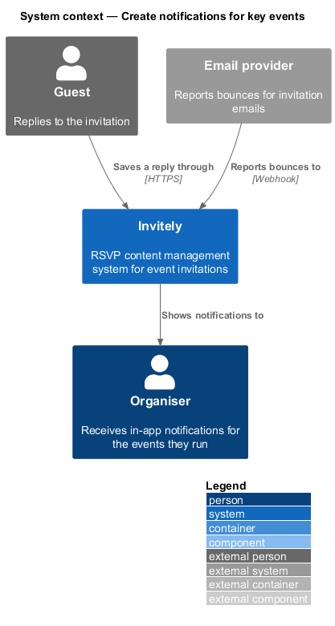
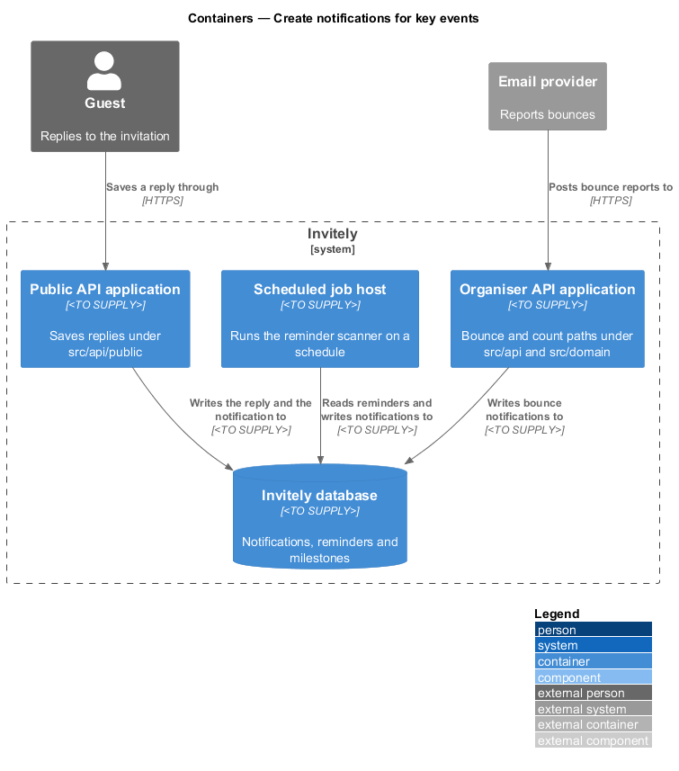
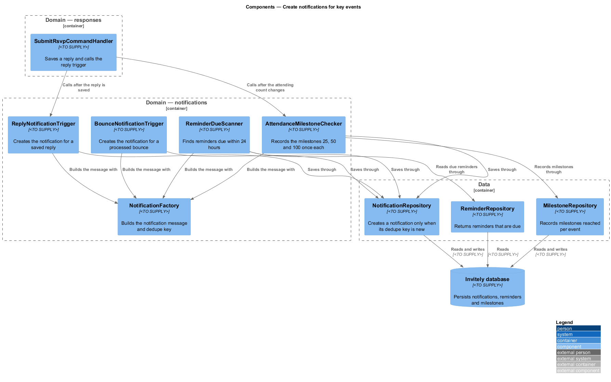
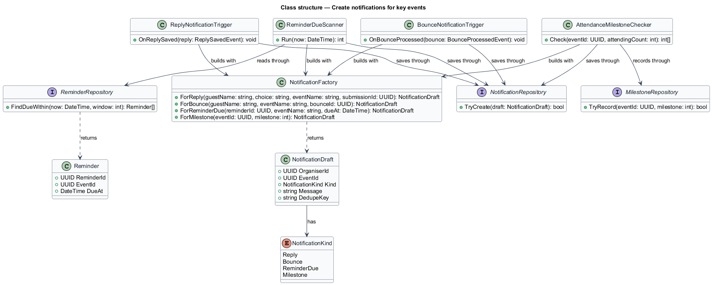
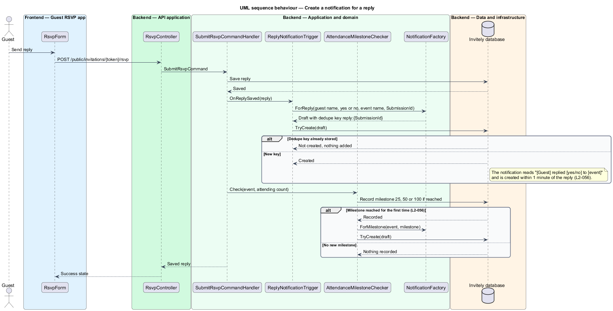
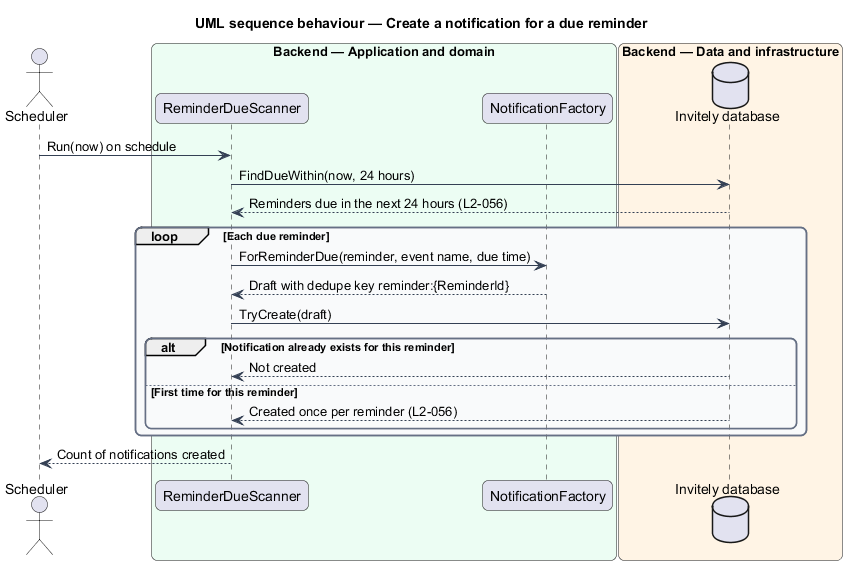

# Create notifications for key events

## Overview

Invitely is a content management system for running event RSVPs. A **notification** is an in-app message for an organiser about one event. An organiser is informed when a guest replies, when an invitation email bounces, when a reminder is about to be due, and when attendance reaches a milestone. This feature decides when each of those events creates a notification.

A **trigger** is a component that reacts to one kind of event and asks the factory for a notification. A **dedupe key** is a text value that identifies one notification for one occurrence of an event, so that a notification is created once even when the same event is processed again. The dedupe key is stored with the notification, and a second create with the same key does nothing.

The feature is built from four triggers in `src/domain/notifications`. Two are called from the reply and bounce paths that other features own. A reminder scanner runs on a schedule, and a milestone checker runs after the attending count changes. Notifications are stored in `src/data` and read by [List and mark notifications read](../list-notifications/README.md).

A **milestone** is an attending count of 25, 50 or 100. A **reminder** is a scheduled email that goes to guests who have not replied. The scheduling of reminders is part of the invitation subsystem and is not described here.

## Description

The feature is a set of triggers and one factory in `src/domain/notifications`, together with the repositories that store them.

- **`NotificationFactory`** — domain component in `src/domain/notifications`. It builds a `NotificationDraft` for each kind. For a reply it builds the message "[Guest] replied [yes/no] to [event]" with the dedupe key `reply:{SubmissionId}`.
- **`NotificationDraft`** — value with the organiser, the event, the kind, the message and the dedupe key.
- **`ReplyNotificationTrigger`** — domain component. The reply handler in `src/domain/responses` calls its `OnReplySaved` operation after a reply is saved, so that the notification is created within 1 minute of the reply.
- **`BounceNotificationTrigger`** — domain component. The bounce processing of the invitation subsystem calls its `OnBounceProcessed` operation, so that a notification is created for the event.
- **`ReminderDueScanner`** — domain component. Its `Run` operation finds the reminders due within 24 hours and creates one `ReminderDue` notification for each. It is started by the scheduled job host, whose technology is `<TO SUPPLY>`.
- **`AttendanceMilestoneChecker`** — domain component. Its `Check` operation records each of the milestones 25, 50 and 100 the first time the attending count reaches it, and creates one `Milestone` notification for it.
- **`NotificationRepository`** — data component in `src/data`. Its `TryCreate` operation stores a draft only when its dedupe key is new.
- **`ReminderRepository`** and **`MilestoneRepository`** — data components in `src/data`. The first returns reminders due within a window. The second records each milestone reached for an event.

## Requirements

The feature realizes the following level-2 (L2) requirement. The requirement refines a level-1 (L1) requirement, cited by identifier.

| L2 ID | Refines (L1) | Requirement |
|-------|--------------|-------------|
| `L2-056` | `L1-009` | Notifications must be created for the events organisers need to know about. |

The acceptance criteria of `L2-056` fix four triggers. A reply creates a notification within 1 minute. A bounce creates a notification for the event. A reminder due within 24 hours creates one notification per reminder. An attending count of 25, 50 or 100 creates one notification for that milestone.

## Diagrams

### System context

A guest reply and a bounce report reach Invitely, and the organiser reads the resulting notifications in the same system.

### Containers

The Public API application saves replies and writes the reply notification. The scheduled job host and the Organiser API application write the reminder and bounce notifications to the Invitely database.

### Components

`SubmitRsvpCommandHandler` calls `ReplyNotificationTrigger` and `AttendanceMilestoneChecker` after a reply is saved. Each trigger builds its draft with `NotificationFactory` and saves it through `NotificationRepository`. `ReminderDueScanner` reads due reminders through `ReminderRepository`.

### Class structure

Each trigger uses `NotificationFactory` to build a `NotificationDraft`, and each draft has a `NotificationKind`. `ReminderDueScanner` reads `Reminder` items, and `AttendanceMilestoneChecker` records milestones through `MilestoneRepository`.

### Behaviour — create a notification for a reply

The reply handler saves the reply and calls the reply trigger, which creates the notification once for the submission. The milestone checker then creates a milestone notification only when a threshold is reached for the first time.

### Behaviour — create notifications for a due reminder

The scanner finds the reminders due within 24 hours and creates one notification for each. A reminder that already has a notification is skipped.

---
