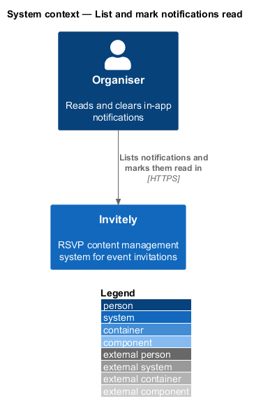
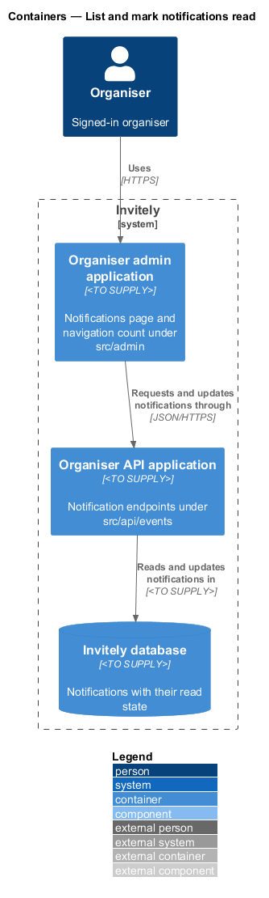
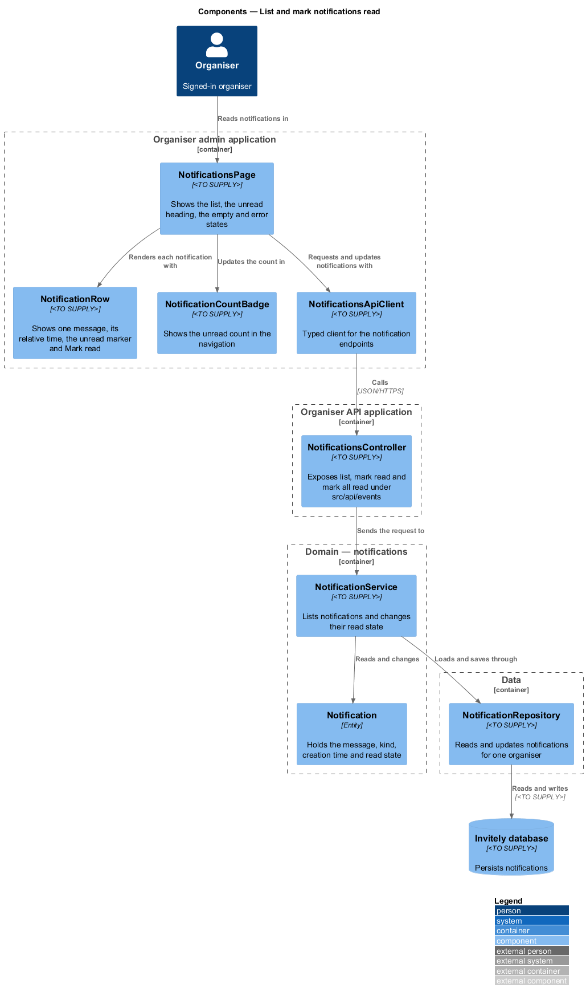
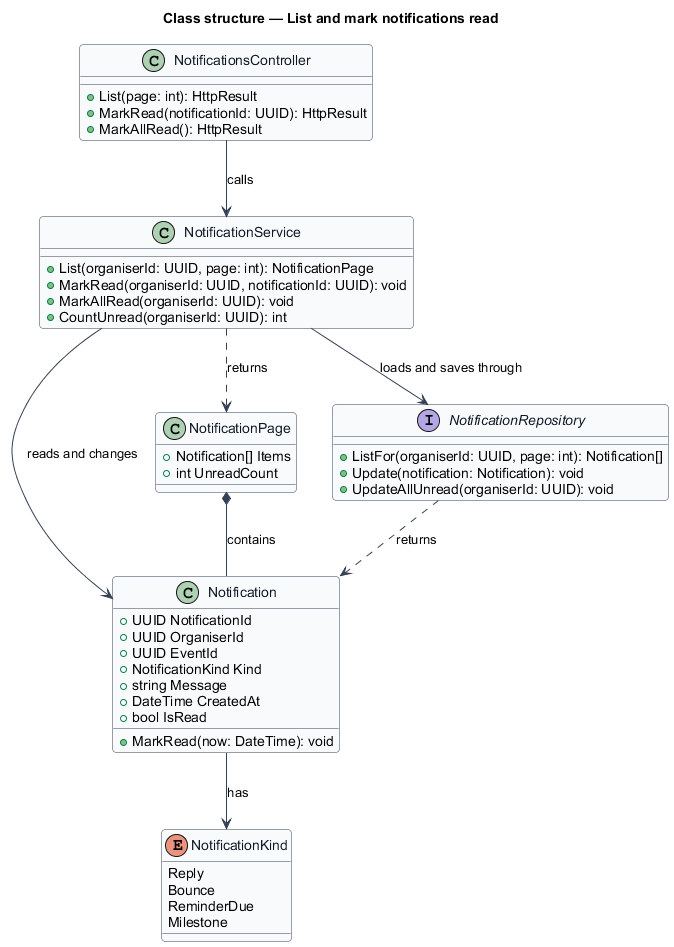
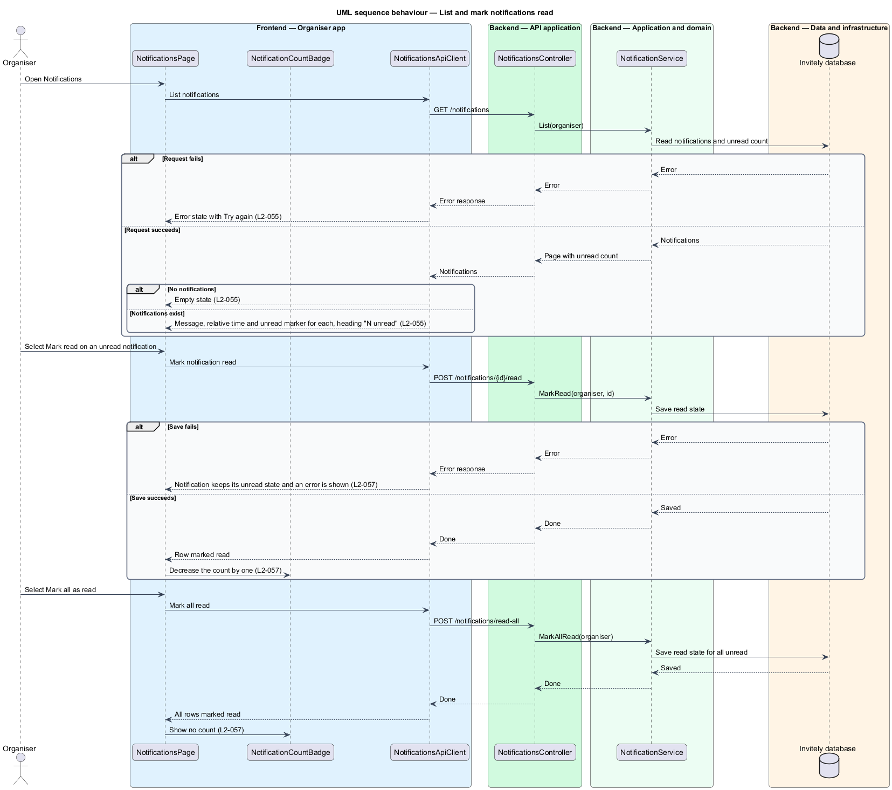

# List and mark notifications read

## Overview

Invitely is a content management system for running event RSVPs. The system records events that an organiser needs to act on, such as a guest reply or an email bounce, as **notifications**. A notification is a short in-app message that belongs to one organiser and one event. It has a creation time and a read state. A notification is **unread** until the organiser marks it read.

This feature covers the reading side of notifications. The Notifications page lists the organiser's notifications, newest first, with the unread ones marked. The page heading states the unread count, and the navigation shows the same count. The organiser marks one notification read, or all of them at once. The feature does not decide which events create notifications. That is covered by [Create notifications for key events](../create-notifications/README.md).

The page belongs to the organiser admin application (`src/admin`). Its server side is the organiser API, which consists of the notification endpoints and the notification service in `src/domain/notifications`. The notification store is in `src/data`.

## Description

The feature is a vertical slice from the Notifications page to the notification store.

- **`NotificationsPage`** — organiser-app page in `src/admin`. It shows the loading state, the list, the empty state, the error state with Try again, and the heading "N unread".
- **`NotificationRow`** — component in `src/admin`. It shows the message, the relative time, the unread marker when the notification is unread, and the Mark read action.
- **`NotificationCountBadge`** — component in `src/admin`, part of the navigation shell. It shows the unread count and drops the count only after the server confirms a change.
- **`NotificationsApiClient`** — typed client in `src/admin` for the list, mark read and mark all read endpoints.
- **`NotificationsController`** — endpoint in `src/api/events`, next to the dashboard endpoints. It exposes `GET /notifications`, `POST /notifications/{id}/read` and `POST /notifications/read-all`.
- **`NotificationService`** — domain service in `src/domain/notifications`. It lists the notifications of one organiser with the unread count, marks one notification read, and marks all unread notifications read.
- **`Notification`** — entity in `src/domain/notifications` with the identifier, the organiser, the event, the kind, the message, the creation time and the read state. Its `MarkRead` operation sets the read state once.
- **`NotificationKind`** — enumeration of Reply, Bounce, ReminderDue and Milestone.
- **`NotificationRepository`** — data component in `src/data`. It lists notifications for one organiser and saves read state. Its storage layout is `<TO SUPPLY>`.

## Requirements

The feature realizes the following level-2 (L2) requirements. Each L2 requirement refines a level-1 (L1) requirement, cited by identifier.

| L2 ID | Refines (L1) | Requirement |
|-------|--------------|-------------|
| `L2-055` | `L1-009` | The Notifications page must list notifications with their state. |
| `L2-057` | `L1-009` | Organisers must be able to clear unread notifications. |

The acceptance criteria of `L2-055` fix the message, relative time and unread marker for each row, the heading "3 unread" form, the empty state and the error state with Try again. The criteria of `L2-057` fix the mark read action, the navigation count that drops by one, the mark all action, and the rule that a failed action keeps the notification unread.

## Diagrams

### System context

The organiser reads and clears notifications in Invitely.

### Containers

The Notifications page in the Organiser admin application requests notifications through the Organiser API application, which reads and updates them in the Invitely database.

### Components

`NotificationsPage` renders each row with `NotificationRow` and keeps `NotificationCountBadge` in step. `NotificationsController` passes each request to `NotificationService`, which reads and changes `Notification` entities through `NotificationRepository`.

### Class structure

`NotificationService` returns a `NotificationPage` that holds `Notification` items and the unread count. Each `Notification` has a `NotificationKind`.

### Behaviour — list and mark notifications read

The page lists the notifications on load. A mark read request changes the badge only after the server saves the change, and a failed save keeps the notification unread.

---
