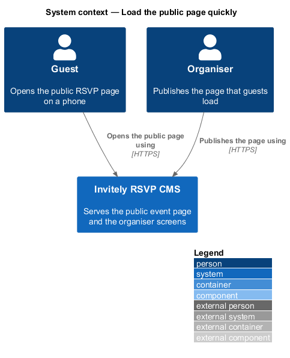
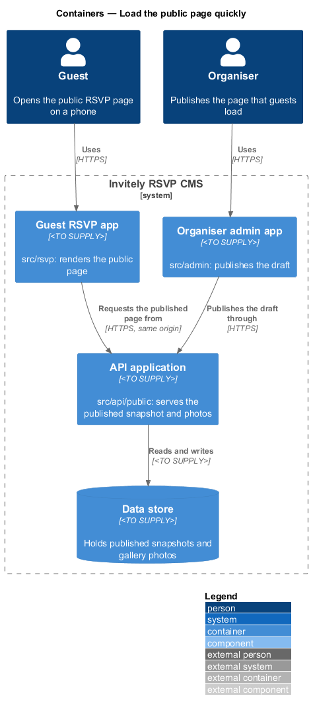
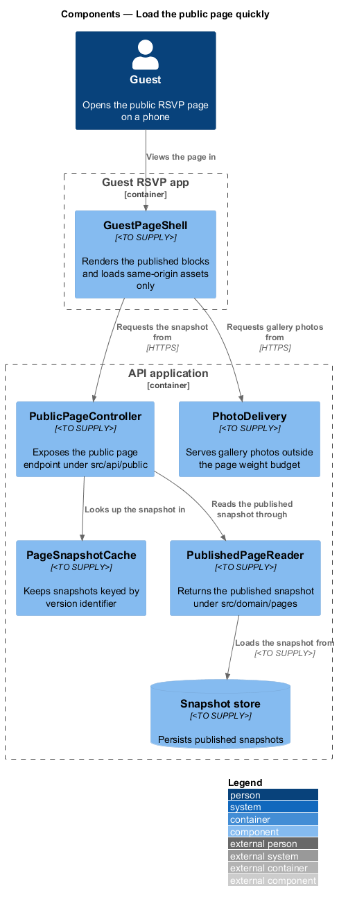
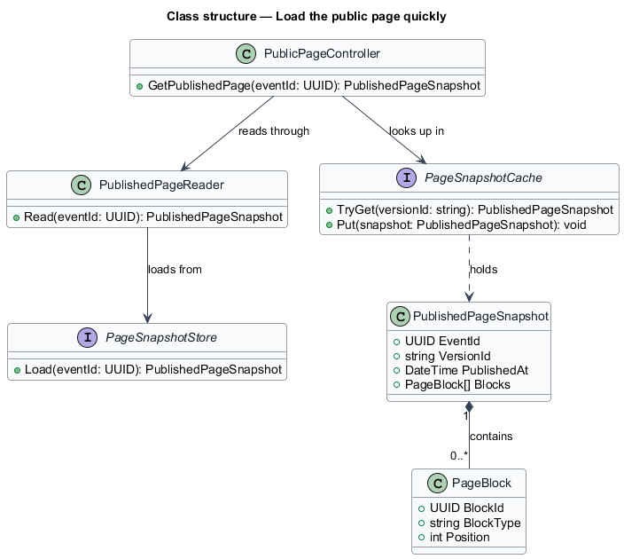
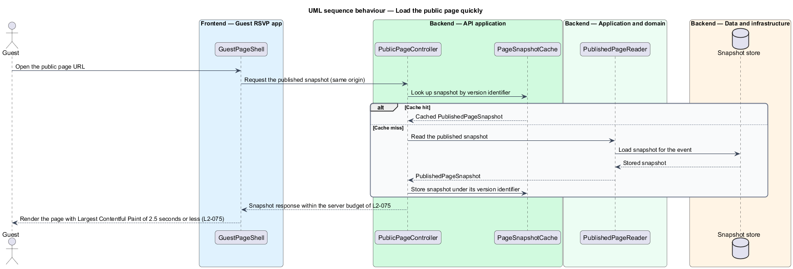

# Load the public page quickly

## Overview

The public page is the **guest page**: the single page a guest opens from an invitation to read event details and reply. A *published snapshot* is the immutable copy of the page blocks that an organiser has published; guests read only snapshots, never the draft. This feature defines how a guest reads a snapshot quickly on a typical mobile connection.

Guests open the page on phones over slow networks, often from a message link. A cold load therefore transfers little data, renders the first content early and avoids repeated work on the server. The feature sits in the `performance` subsystem and touches the guest app in `src/rsvp`, the public endpoints in `src/api/public` and the published-page read in `src/domain/pages`.

Two terms are used below. A *snapshot version* is the identifier that changes each time an organiser publishes, so a cached copy is valid for exactly one version. A *page weight budget* is the transferred size limit for the page excluding photos.

## Description

The feature is a set of cooperating components that serve and render the published page.

- **`GuestPageShell`** — component in the Guest RSVP app under `src/rsvp`. It renders the published blocks and loads only same-origin scripts and styles, so the page loads no third-party scripts.
- **`PublicPageController`** — controller under `src/api/public`. It exposes the endpoint that returns the published snapshot for an event. It returns the published version only.
- **`PageSnapshotCache`** — cache under `src/api/public`. It keeps snapshots keyed by `VersionId`, so a publish creates a new key and the previous entry expires without an explicit purge.
- **`PublishedPageReader`** — domain service under `src/domain/pages`. It returns the published snapshot for an event and never returns draft content.
- **`PublishedPageSnapshot`** — immutable value holding the event identifier, the snapshot version, the publish time and the ordered `PageBlock` items.
- **`PageSnapshotStore`** — persistence contract under `src/data`. Its implementation is `<TO SUPPLY>`.
- **`PhotoDelivery`** — endpoint under `src/api/public` that serves gallery photos. Photos are excluded from the page weight budget and are requested separately from the page.
- **`PageWeightCheck`** — build check under `scripts/`. It measures the transferred size of the page excluding photos and fails the build when the size exceeds the budget in L2-075.

## Requirements

The feature realizes the following level-2 (L2) requirements. Each L2 requirement refines a level-1 (L1) requirement, cited by identifier.

| L2 ID | Refines (L1) | Requirement |
|-------|--------------|-------------|
| `L2-075` | `L1-013` | The guest page must load fast on a typical mobile connection. |

The L2-075 acceptance criteria set the measurable targets this design uses:

1. Largest Contentful Paint of 2.5 seconds or less at the 75th percentile on a standard 4G profile of 1.6 Mbps down and 150 ms latency, for a cold load.
2. Server response time of 300 ms or less at the 95th percentile with 100 concurrent guests.
3. Total transferred size of 300 KB or less, excluding photos.

## Diagrams

### System context

Guests open the public page and organisers publish it. Both reach the system over HTTPS.

### Containers

The Guest RSVP app requests the published snapshot from the API application, which reads it from the data store. The organiser admin app writes each published snapshot through the same API.

### Components

`PublicPageController` checks `PageSnapshotCache` first and reads through `PublishedPageReader` on a miss. Gallery photos bypass the page path and come from `PhotoDelivery`.

### Class structure

`PublishedPageSnapshot` owns an ordered list of `PageBlock` items. `PageSnapshotCache` holds snapshots by version, and `PublishedPageReader` loads them through `PageSnapshotStore`.

### Behaviour — cold load of the public page

On a cold load the controller returns a cached snapshot when its version matches. On a miss, the reader loads the snapshot from the store and the cache keeps it for the next guest. The response time is bounded by L2-075 criterion 2, and the rendered first paint by criterion 1.

