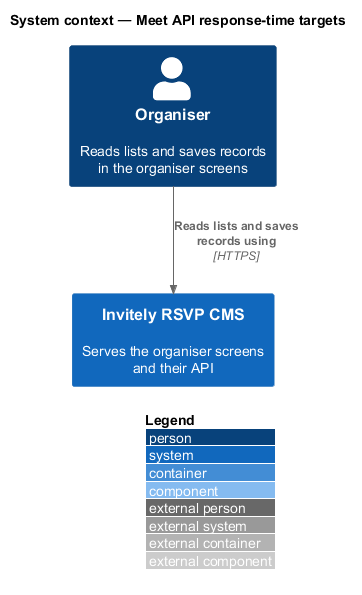
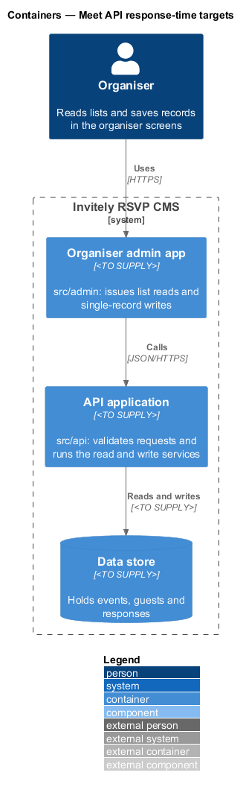
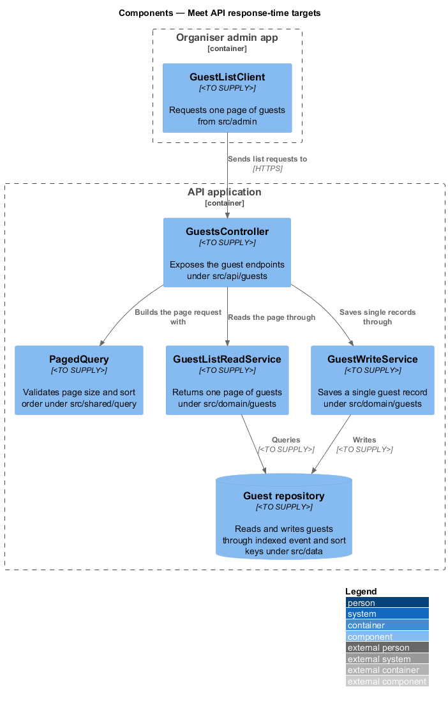
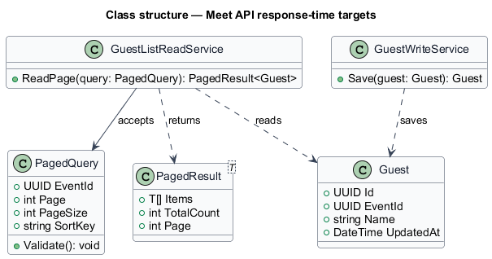
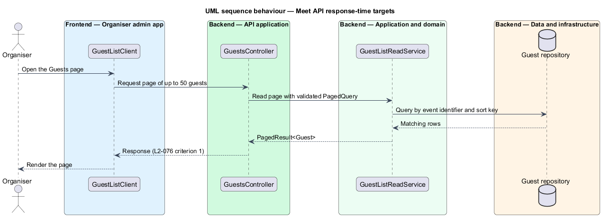

# Meet API response-time targets

## Overview

The **organiser API** is the set of endpoints that the organiser admin app calls to read lists and save records. A *list read* returns one page of rows for a screen such as Guests or Responses. A *single-record write* saves one guest, response or event. The feature defines how these calls meet their server-side response-time targets, so that organiser actions feel immediate.

Response time is measured at the server, from receipt of the request to the start of the response, for the same routes that the admin app calls. The feature sits in the `performance` subsystem. Its components live in `src/api`, the shared request and query helpers in `src/shared`, the read and write services in `src/domain` and the indexed repositories in `src/data`.

Two terms are used below. A *page request* is a read that asks for one bounded page of rows, and a *sort key* is the column that orders those rows.

## Description

The feature combines a bounded query model and indexed access paths.

- **`GuestsController`** — controller under `src/api/guests`. It exposes the guest read and write endpoints and passes validated queries to the domain services.
- **`PagedQuery`** — value object under `src/shared/query`. It holds the event identifier, page number, page size and sort key. It rejects a page size above 50 rows, so every list read stays within the bound in L2-076 criterion 1.
- **`PagedResult<T>`** — generic result holding one page of items and the total count.
- **`GuestListReadService`** — domain service under `src/domain/guests`. It returns one `PagedResult<Guest>` for a `PagedQuery`.
- **`GuestWriteService`** — domain service under `src/domain/guests`. It saves one `Guest` record and returns the stored record.
- **`GuestRepository`** — repository under `src/data`. It reads and writes guests through access paths indexed on the event identifier and each sort key. The index definitions are `<TO SUPPLY>`.
- **`Guest`** — entity holding the identifier, event identifier, name and last-updated time.

## Requirements

The feature realizes the following level-2 (L2) requirements. Each L2 requirement refines a level-1 (L1) requirement, cited by identifier.

| L2 ID | Refines (L1) | Requirement |
|-------|--------------|-------------|
| `L2-076` | `L1-013` | Organiser interactions must feel immediate. |

The L2-076 acceptance criteria set the targets this design uses:

1. A read request for a list page of up to 50 rows has a server-side 95th percentile of 300 ms or less.
2. A write request for a single record has a server-side 95th percentile of 500 ms or less.

## Diagrams

### System context

The organiser calls the system through the admin screens. The response-time targets apply to every such call.

### Containers

The admin app issues list reads and single-record writes to the API application, which reads and writes the data store.

### Components

`GuestsController` validates a `PagedQuery` and delegates list reads to `GuestListReadService` and single-record writes to `GuestWriteService`. Both services use `GuestRepository`, whose access paths are indexed.

### Class structure

`GuestListReadService` accepts a `PagedQuery` and returns a `PagedResult` of `Guest` items.

### Behaviour — list read of guests

The Guests page requests one page. The service reads one indexed page, and the response is bounded by the target in L2-076 criterion 1.

