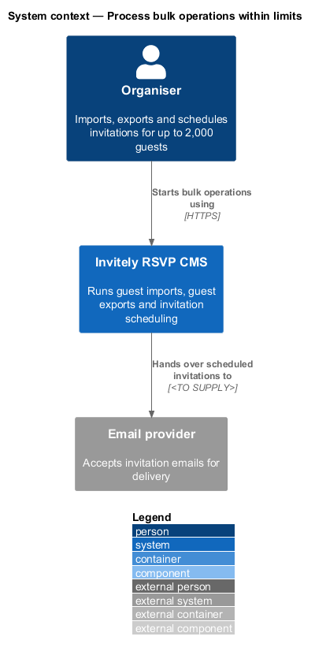
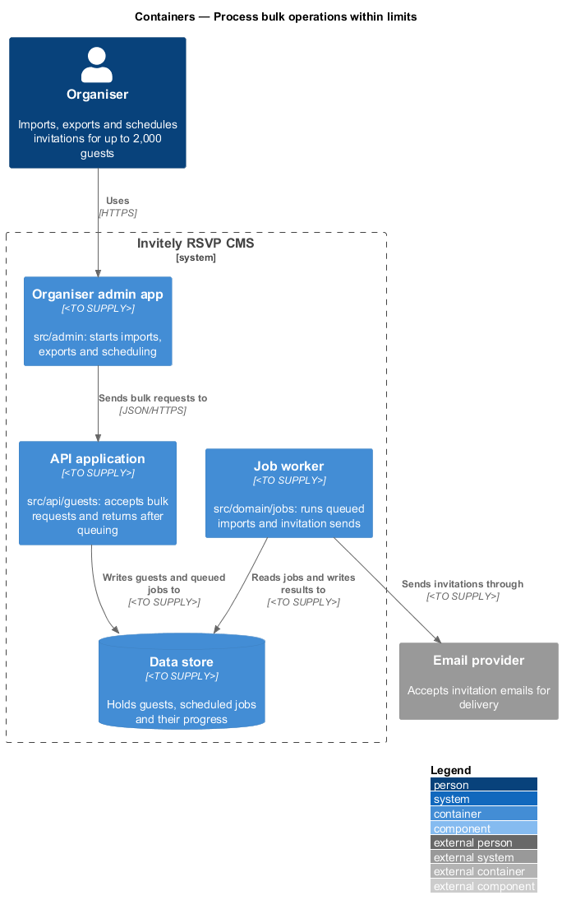
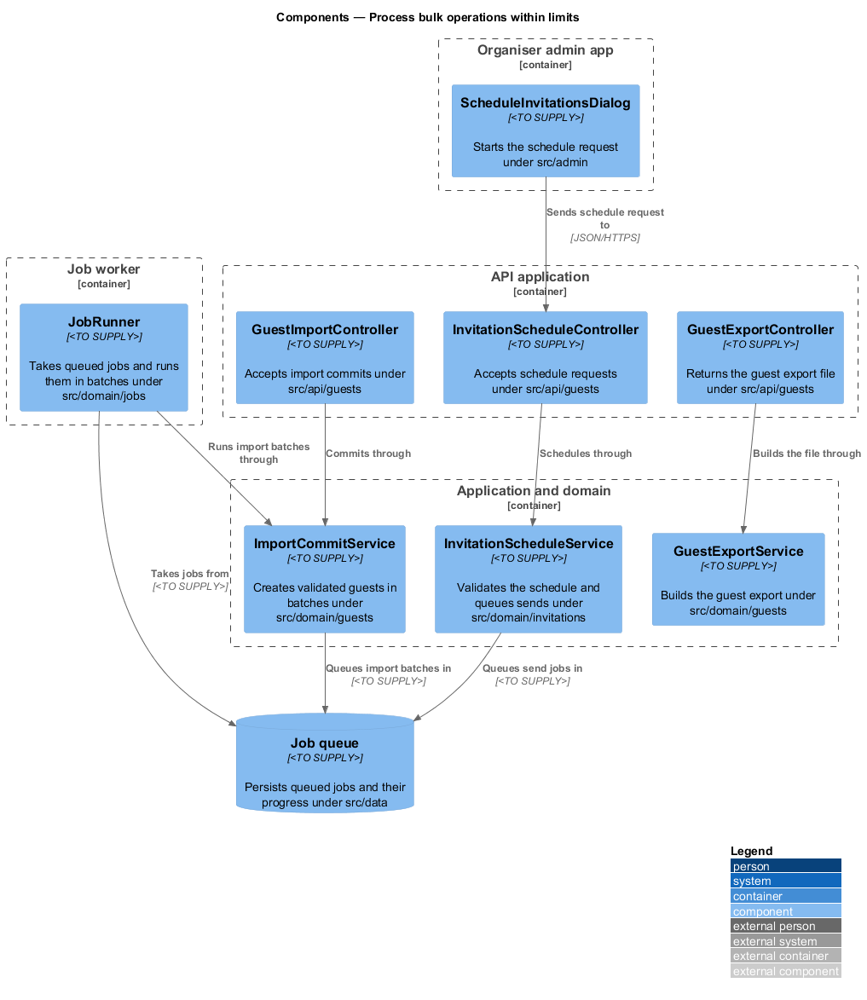
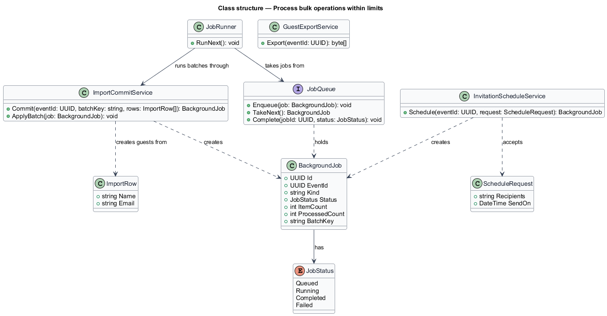
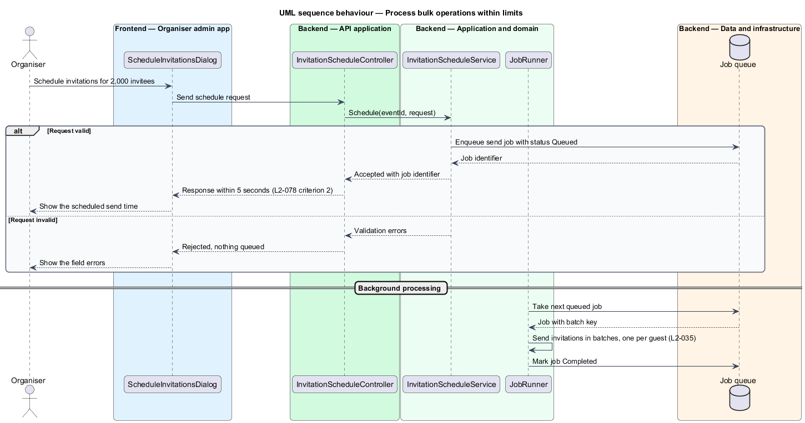

# Process bulk operations within limits

## Overview

A **bulk operation** is an action that touches many guests at once. The three bulk operations in the system are committing a guest CSV import, scheduling invitation emails for an event's invitees, and exporting the guest list. Each one shall complete within the time limits stated in L2-078, so that the organiser is not left waiting on a long request.

The design splits each bulk operation into two parts. The request path validates the input, records the work and returns. A background path then performs the work in batches. The import commit and export are bounded by the limits they shall meet, while invitation sends are processed after the scheduling request returns. The feature sits in the `performance` subsystem and spans the admin app in `src/admin`, the endpoints in `src/api/guests`, the services in `src/domain` and the queue in `src/data`.

A *job* is a unit of queued work with a status of `Queued`, `Running`, `Completed` or `Failed`. A *batch key* is a client-supplied key that identifies one import commit, so a retried commit does not run twice.

## Description

The feature adds a job queue and a worker to the request path that the bulk operations already use.

- **`ScheduleInvitationsDialog`** — component under `src/admin`. It sends the schedule request and shows the scheduled send time or the field errors.
- **`InvitationScheduleController`** — controller under `src/api/guests`. It accepts schedule requests and returns the job identifier after the job is queued.
- **`GuestImportController`** — controller under `src/api/guests`. It accepts the import commit and passes the validated rows to the import service.
- **`GuestExportController`** — controller under `src/api/guests`. It returns the guest export file.
- **`InvitationScheduleService`** — domain service under `src/domain/invitations`. It validates a `ScheduleRequest` and queues one send job per schedule.
- **`ImportCommitService`** — domain service under `src/domain/guests`. It creates guests from `ImportRow` items in batches and records progress on the job.
- **`GuestExportService`** — domain service under `src/domain/guests`. It builds the guest export file.
- **`JobRunner`** — worker component under `src/domain/jobs`. It takes queued jobs from `JobQueue` and runs them.
- **`JobQueue`** — persistence contract under `src/data`. Its implementation is `<TO SUPPLY>`. It stores `BackgroundJob` records and their status.
- **`BackgroundJob`** — entity holding the job identifier, event identifier, kind, `JobStatus`, item count, processed count and batch key.
- **`JobStatus`** — enumeration of the states a job holds: `Queued`, `Running`, `Completed` and `Failed`.

## Requirements

The feature realizes the following level-2 (L2) requirements. Each L2 requirement refines a level-1 (L1) requirement, cited by identifier.

| L2 ID | Refines (L1) | Requirement |
|-------|--------------|-------------|
| `L2-078` | `L1-013` | Bulk actions must complete within stated limits. |

The L2-078 acceptance criteria set the limits this design uses:

1. A CSV with 2,000 valid rows completes its import commit within 30 seconds.
2. Scheduling invitations for 2,000 invitees returns the scheduling request within 5 seconds, and the sends are processed in the background.
3. An export of 2,000 guests is ready within 5 seconds.

## Diagrams

### System context

The organiser starts bulk operations through the admin app. The system hands scheduled invitations to the external email provider.

### Containers

The admin app sends bulk requests to the API application. The job worker reads queued jobs from the data store and sends invitations through the email provider.

### Components

The controllers pass requests to the services, and the services queue jobs in `JobQueue`. `JobRunner` takes queued jobs and runs the import batches through `ImportCommitService`.

### Class structure

`BackgroundJob` holds the state of each queued operation, and `JobQueue` stores it. `InvitationScheduleService` and `ImportCommitService` create jobs, and `JobRunner` takes them from the queue.

### Behaviour — schedule invitations for an event

The request path validates the schedule, enqueues one job and returns the job identifier. The job runner then sends the invitations in the background, one per guest, under the sending rules in L2-035. The response is bounded by L2-078 criterion 2.

