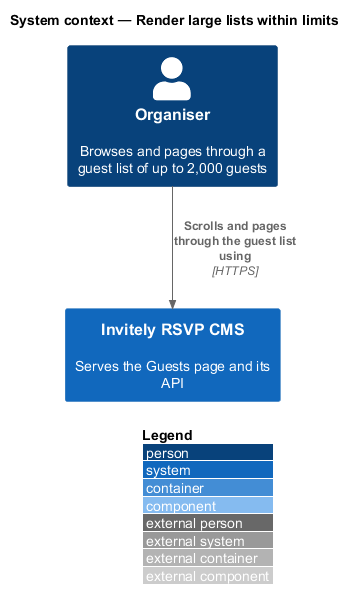
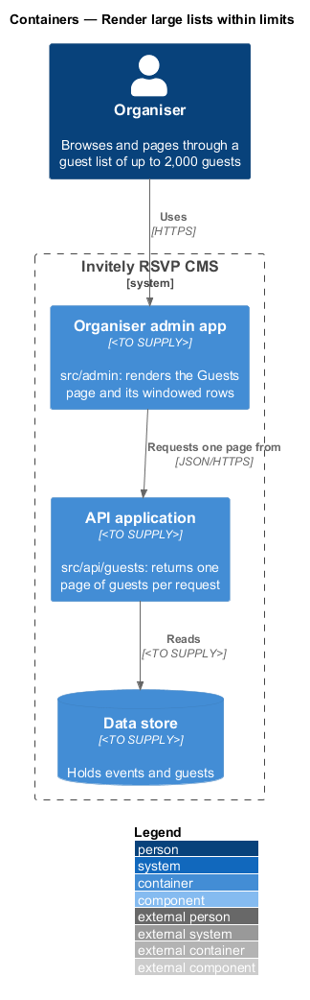
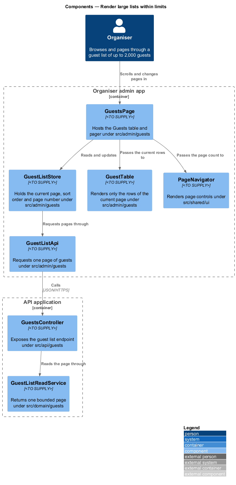
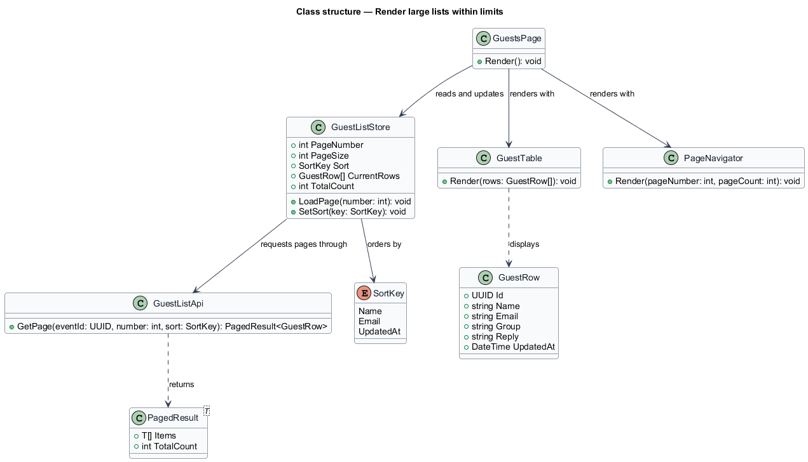
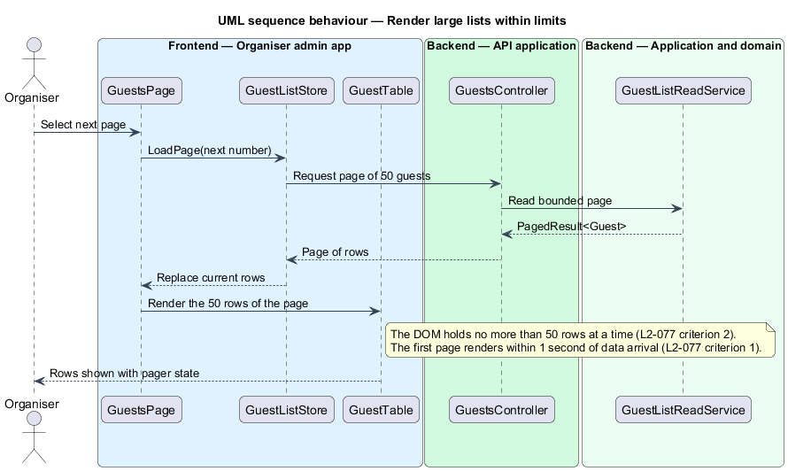

# Render large lists within limits

## Overview

A **large list** is a list that can hold thousands of rows for one event, such as the guest list of an event with 2,000 invitees. Rendering every row at once makes a page slow to appear and slow to scroll. This feature defines how the organiser admin app renders such lists, so that the first page appears promptly and the number of rows held in the page stays bounded.

The feature applies to the Guests list in the organiser admin app. It combines server-side paging, which returns one page per request, with client-side windowing, which keeps only the current page's rows in the document. The feature sits in the `performance` subsystem. Its screen components live in `src/admin/guests`, the shared pager in `src/shared/ui`, and the server-side page read in `src/api/guests` and `src/domain/guests`.

A *page* is a fixed set of up to 50 rows, and the *page number* identifies it. A *sort key* is the column that orders rows across all pages, so the server, not the page, decides row order.

## Description

The feature splits the list into a server side that returns pages and a client side that renders one page at a time.

- **`GuestsPage`** — screen component under `src/admin/guests`. It hosts the table and the pager and forwards user actions to the store.
- **`GuestListStore`** — client state under `src/admin/guests`. It holds the current page number, page size, sort key and current rows, and requests each page from the API.
- **`GuestListApi`** — typed client under `src/admin/guests`. It requests one page of guests for an event with a page number and sort key.
- **`GuestTable`** — component under `src/admin/guests`. It renders the rows of the current page only, so the document never holds more than one page of rows.
- **`PageNavigator`** — shared component under `src/shared/ui`. It renders the page controls from the page number and page count.
- **`GuestsController`** — controller under `src/api/guests`. It exposes the guest list endpoint.
- **`GuestListReadService`** — domain service under `src/domain/guests`. It returns one bounded page of guests in sort order.
- **`GuestRow`** — view model holding the fields a table row shows.
- **`SortKey`** — enumeration of the sort columns: `Name`, `Email` and `UpdatedAt`.

## Requirements

The feature realizes the following level-2 (L2) requirements. Each L2 requirement refines a level-1 (L1) requirement, cited by identifier.

| L2 ID | Refines (L1) | Requirement |
|-------|--------------|-------------|
| `L2-077` | `L1-013` | Lists must stay usable at large volumes. |

The L2-077 acceptance criteria set the limits this design uses:

1. With an event of 2,000 guests, the first page renders in 1 second or less after the data arrives.
2. With 2,000 guests, no more than 50 rows are rendered in the DOM at a time while the organiser scrolls or changes pages.

## Diagrams

### System context

The organiser browses the guest list through the admin app, which requests pages from the system.

### Containers

The admin app requests one page at a time from the API application, which reads the page from the data store.

### Components

`GuestsPage` coordinates `GuestListStore`, `GuestTable` and `PageNavigator`. The store requests each page through `GuestListApi`, and the API reads it through `GuestListReadService`.

### Class structure

`GuestListStore` holds the page state and orders rows by a `SortKey`. `GuestTable` displays `GuestRow` items from the current page only.

### Behaviour — page change on the Guests list

When the organiser selects the next page, the store requests that page and replaces the rows in the table. The previous page's rows leave the document, which keeps the row count at or below 50 as L2-077 criterion 2 requires.

