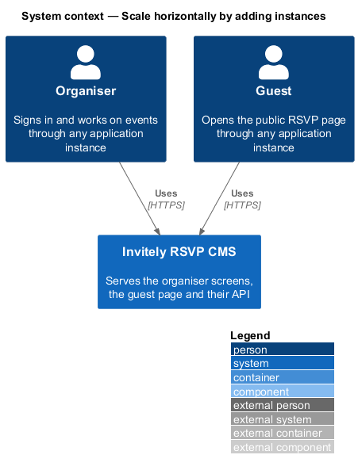
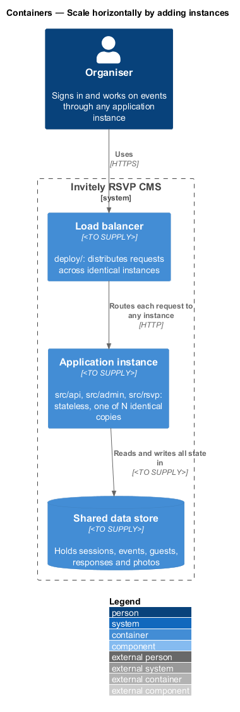
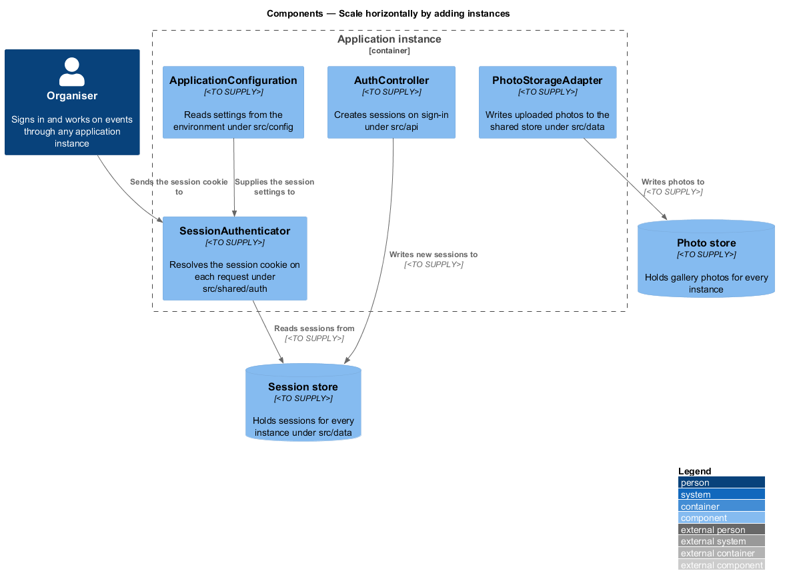
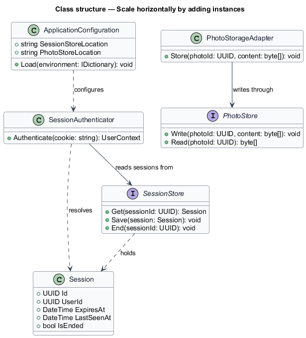
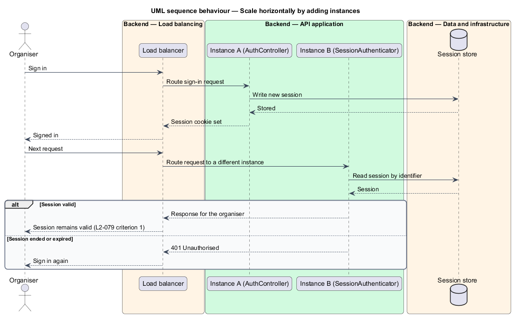

# Scale horizontally by adding instances

## Overview

**Horizontal scaling** is the practice of adding more copies of an application to handle more load, instead of making one copy larger. An *application instance* is one running copy of the system's API, organiser and guest code. A *load balancer* distributes incoming requests across the instances. For this to work, any instance shall be able to serve any request, so no instance shall hold state that another instance cannot see.

This feature defines how the system keeps its state outside the instances and how a new instance joins the group without changes to the others. The feature sits in the `performance` subsystem and spans the configuration in `src/config`, the session check in `src/shared/auth`, the shared-store adapters in `src/data` and the deployment description in `deploy/`.

A *session* is the server-side record that ties a session cookie to a signed-in organiser. A *shared store* is a data store that every instance reads and writes, so that an instance can resolve a session that another instance created.

## Description

The feature keeps every piece of mutable state in a shared store and gives each instance the same configuration.

- **`ApplicationConfiguration`** — component under `src/config`. It reads every setting from the environment, so each instance starts from the same inputs and no instance holds a setting that another does not.
- **`AuthController`** — controller under `src/api`. It creates a `Session` on sign-in and writes it to the shared session store.
- **`SessionAuthenticator`** — component under `src/shared/auth`. It resolves the session cookie on each request by reading the shared store, and it holds no session in memory.
- **`SessionStore`** — persistence contract under `src/data`. Its implementation is `<TO SUPPLY>` and is the same for every instance.
- **`Session`** — entity holding the session identifier, user identifier, expiry time, last-seen time and ended flag.
- **`PhotoStore`** — persistence contract under `src/data` for gallery photos.
- **`PhotoStorageAdapter`** — adapter under `src/data` that writes uploaded photos to the shared photo store, so no instance keeps photos on local disk.
- **Deployment descriptor** — the description under `deploy/` of the load balancer and the identical instance copies, with the shared store `<TO SUPPLY>`.

## Requirements

The feature realizes the following level-2 (L2) requirements. Each L2 requirement refines a level-1 (L1) requirement, cited by identifier.

| L2 ID | Refines (L1) | Requirement |
|-------|--------------|-------------|
| `L2-079` | `L1-013` | The application must scale by adding instances. |

The L2-079 acceptance criteria set the behaviour this design shall show:

1. With two application instances behind a load balancer, a user who signs in on one and makes requests through the other keeps a valid session.
2. When load increases and another instance is added, no configuration change is required on the other instances.

## Diagrams

### System context

Organisers and guests reach the system through any instance, so no client depends on a particular instance.

### Containers

The load balancer routes each request to any application instance. Every instance reads and writes its state in the shared data store.

### Components

`SessionAuthenticator` resolves each session from the shared `SessionStore`, and `PhotoStorageAdapter` writes photos to the shared `PhotoStore`. `ApplicationConfiguration` supplies the same settings to every instance.

### Class structure

`SessionAuthenticator` reads `Session` items through `SessionStore`. `PhotoStorageAdapter` writes through `PhotoStore`, and `ApplicationConfiguration` configures both stores.

### Behaviour — session across two instances

The user signs in through one instance, which writes the session to the shared store. A later request routed to a different instance reads the same session and remains valid, which is the outcome in L2-079 criterion 1.

