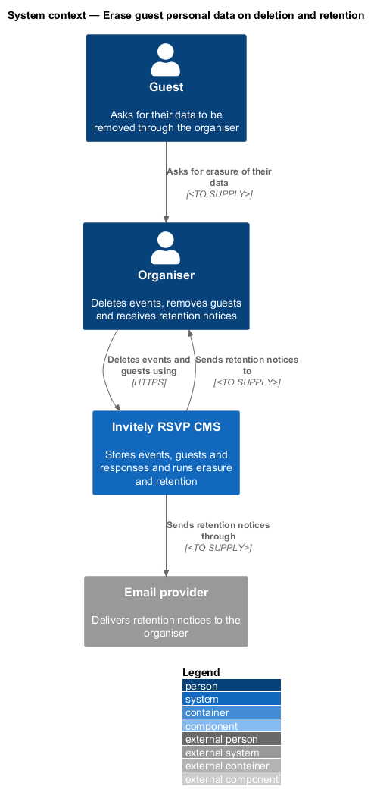
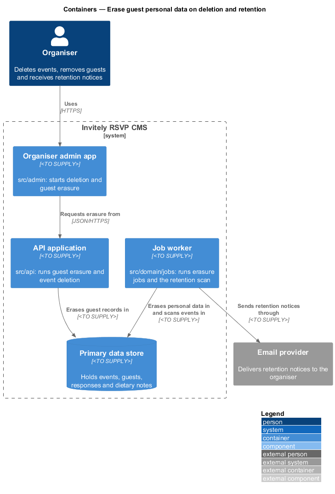
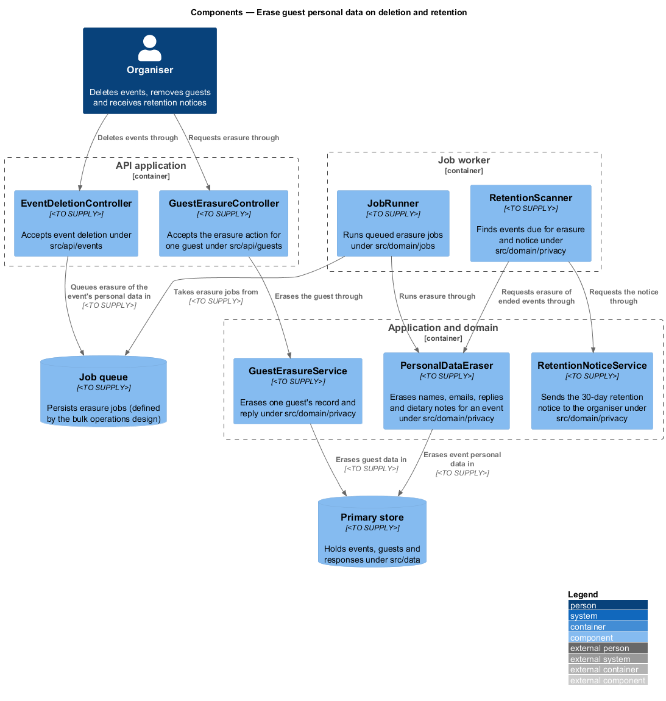
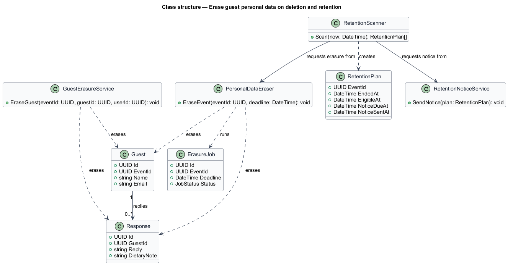
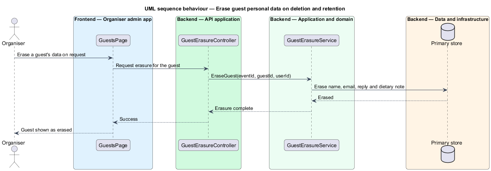
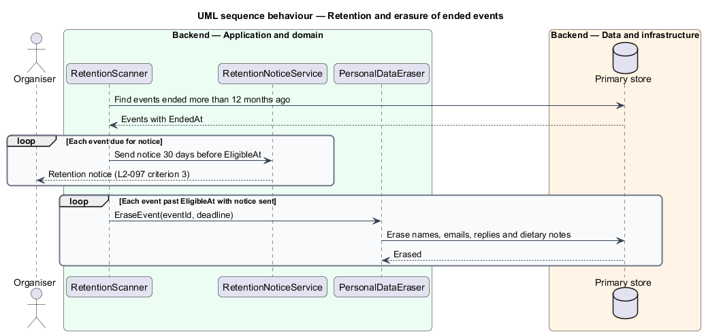

# Erase guest personal data on deletion and retention

## Overview

**Erasure** is the removal of personal data so that it can no longer be read from the system's stores. **Retention** is the rule that limits how long personal data is kept. Guest names, email addresses, replies and dietary notes are personal data, and they shall not be kept longer than the event needs them. This feature defines how the system erases that data when an organiser deletes an event, when a guest asks for their data to be removed, and when an event has ended for more than 12 months.

The feature sits in the `privacy` subsystem. It spans the erasure endpoints in `src/api`, the erasure and retention services in `src/domain/privacy`, the queued jobs run by the worker in `src/domain/jobs`, the primary store in `src/data`, and the scheduled scan in `deploy/` and `scripts/`.

Two terms are used below. The *primary store* is the database that serves the application. An *erasure job* is a queued unit of work that erases one event's personal data by a deadline.

## Description

The feature combines three paths: a direct guest erasure, an erasure job created when an event is deleted, and a retention scan that schedules erasure for old events.

- **`GuestErasureController`** — controller under `src/api/guests`. It accepts the erasure action that the organiser takes for one guest on a guest's request.
- **`EventDeletionController`** — controller under `src/api/events`. It accepts event deletion and queues the erasure of the event's personal data. Its deletion behaviour is defined by the event lifecycle design.
- **`GuestErasureService`** — domain service under `src/domain/privacy`. It erases one guest's record and reply from the primary store.
- **`PersonalDataEraser`** — domain service under `src/domain/privacy`. It erases names, email addresses, replies and dietary notes for an event from the primary store.
- **`ErasureJob`** — queued work item holding the event identifier and the deadline by which erasure completes. It is persisted through the job queue defined by the bulk operations design.
- **`JobRunner`** — worker component under `src/domain/jobs` that runs erasure jobs.
- **`RetentionScanner`** — domain component under `src/domain/privacy`. It finds events that have ended for more than 12 months, creates a `RetentionPlan` for each one and requests the notice and the erasure at the due times.
- **`RetentionPlan`** — entity holding the event identifier, end time, eligibility time, notice due time and notice sent time.
- **`RetentionNoticeService`** — domain service under `src/domain/privacy`. It sends the retention notice to the organiser 30 days before the eligibility time.

## Requirements

The feature realizes the following level-2 (L2) requirement. It refines a level-1 (L1) requirement, cited by identifier.

| L2 ID | Refines (L1) | Requirement |
|-------|--------------|-------------|
| `L2-097` | `L1-018` | Personal data must not be kept longer than needed. |

The L2-097 acceptance criteria set the outcomes this design shows:

1. When an event is deleted, guest names, emails, replies and dietary notes are erased from the primary store within 24 hours.
2. When a guest asks for their data to be removed and the organiser actions the request, the guest record and reply are erased.
3. When an event has ended for more than 12 months, the retention job erases its guest personal data, and the organiser is notified 30 days beforehand.

The third criterion states that notice comes 30 days before erasure. This design reads it as notice first and erasure on the eligibility date after notice has been sent. The wording does not say whether erasure waits for the notice to be acknowledged, and that point is `<TO SUPPLY>` for the requirement owner.

## Diagrams

### System context

The organiser deletes events and removes guests. The system sends retention notices to the organiser through the email provider.

### Containers

The admin app requests erasure from the API application. The job worker erases the primary store and sends the retention notices.

### Components

`GuestErasureService` handles the guest path directly. Event deletion queues an erasure job, `JobRunner` runs it through `PersonalDataEraser`, and `RetentionScanner` drives both the notice and the scheduled erasure.

### Class structure

`GuestErasureService` and `PersonalDataEraser` act on the `Guest` and `Response` records. `RetentionScanner` creates `RetentionPlan` items and requests the notice and the erasure.

### Behaviour — erasure of one guest on request

The organiser asks for erasure of one guest. The service erases the guest record and reply from the primary store, as criterion 2 requires.

### Behaviour — retention scan for ended events

The retention scan notifies the organiser for each event 30 days before its eligibility date. On the eligibility date the scan requests erasure, which removes the personal data from the primary store.

