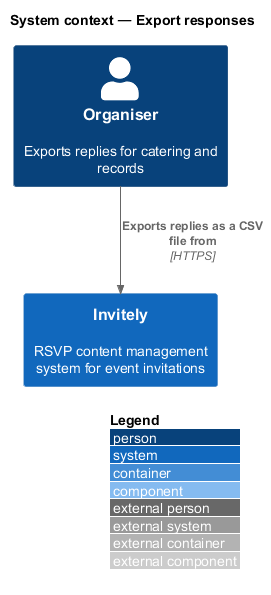
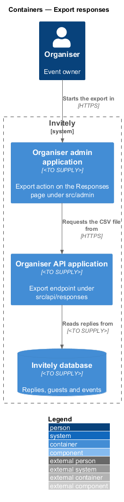
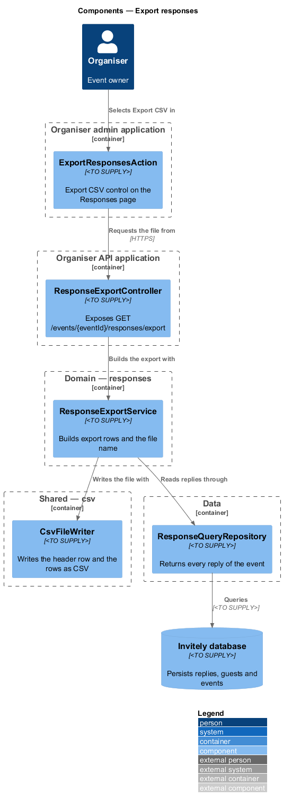
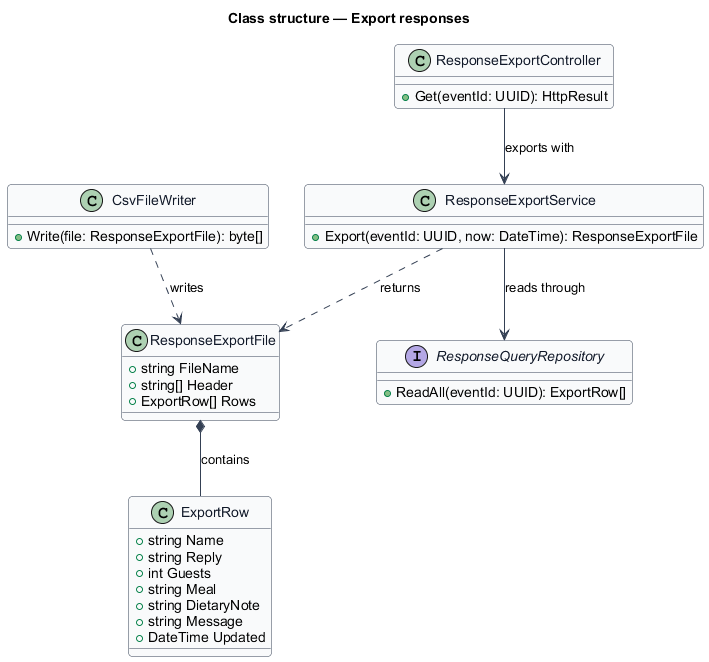
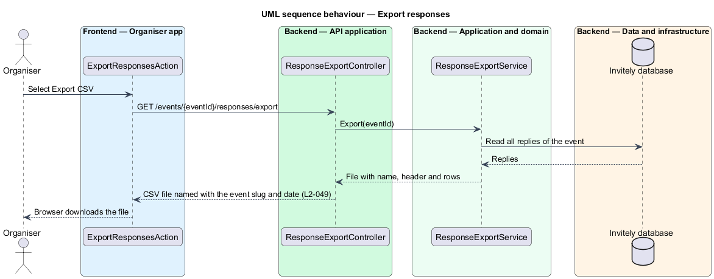

# Export responses

## Overview

Invitely is a content management system for running event RSVPs. Organisers use the replies of an event for catering and for their own records, so they need the replies in a file that a spreadsheet can open. This feature produces that file: a **CSV export** of every reply for one event, with one row per reply.

A **CSV file** is a plain-text table of comma-separated values. The export is built by the organiser API (`src/api/responses`) from the same replies that the Responses page shows. The CSV writing is a shared component in `src/shared/csv`.

## Description

The feature is a vertical slice from the export action on the Responses page to the reply store.

- **`ExportResponsesAction`** — control in the Responses page of `src/admin`. It sends the export request and starts the browser download.
- **`ResponseExportController`** — endpoint in `src/api/responses`. It exposes `GET /events/{eventId}/responses/export` and returns the CSV file.
- **`ResponseExportService`** — domain service in `src/domain/responses`. It reads every reply of the event, builds one `ExportRow` for each, and names the file.
- **`ResponseExportFile`** — value with the file name, the header row and the rows.
- **`ExportRow`** — value with the columns name, reply, guests, meal, dietary note, message and updated.
- **`CsvFileWriter`** — shared component in `src/shared/csv`. It writes the header row and the rows as CSV text encoded as UTF-8.
- **`ResponseQueryRepository`** — data component in `src/data`, shared with the Responses page. It returns every reply of an event. Its storage layout is `<TO SUPPLY>`.

The file name follows the pattern `<event slug>-responses-<date>.csv`. The date format is `<TO SUPPLY>`.

## Requirements

The feature realizes the following level-2 (L2) requirement. The requirement refines a level-1 (L1) requirement, cited by identifier.

| L2 ID | Refines (L1) | Requirement |
|-------|--------------|-------------|
| `L2-049` | `L1-007` | Organisers must export replies for catering and records. |

The acceptance criterion of `L2-049` fixes the columns and the file name, which carries the event slug and date.

## Diagrams

### System context

The organiser exports the replies from Invitely.

### Containers

The export action in the Organiser admin application requests the file from the Organiser API application, which reads the replies from the Invitely database.

### Components

`ResponseExportController` builds the file with `ResponseExportService`. The service reads replies through `ResponseQueryRepository` and writes the file with `CsvFileWriter`.

### Class structure

`ResponseExportService` returns a `ResponseExportFile` that contains `ExportRow` items. `ResponseExportController` depends on the service, and `CsvFileWriter` writes the file.

### Behaviour — export responses

The controller passes the request to the service, which reads every reply of the event and returns the file for download.

---
