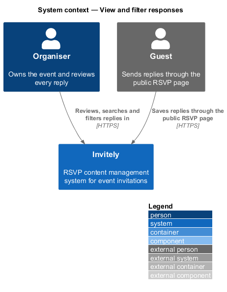
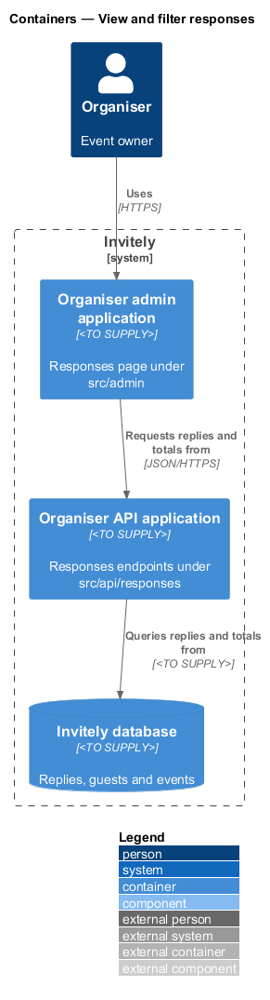
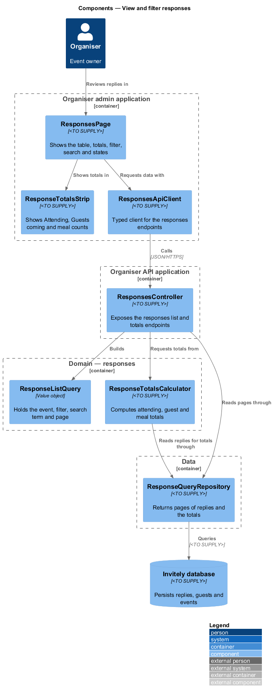
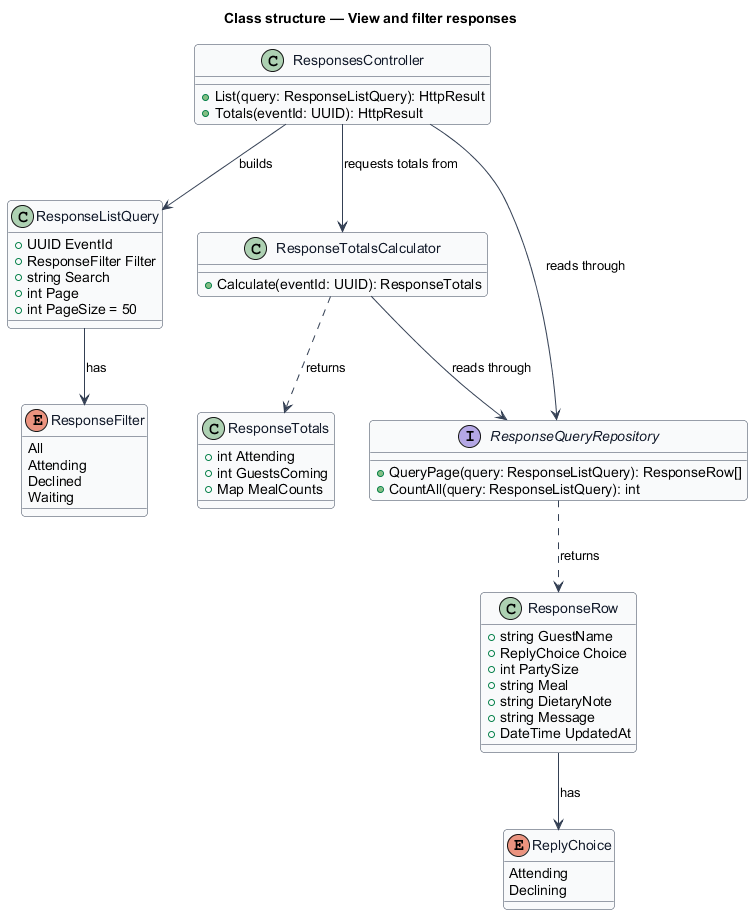
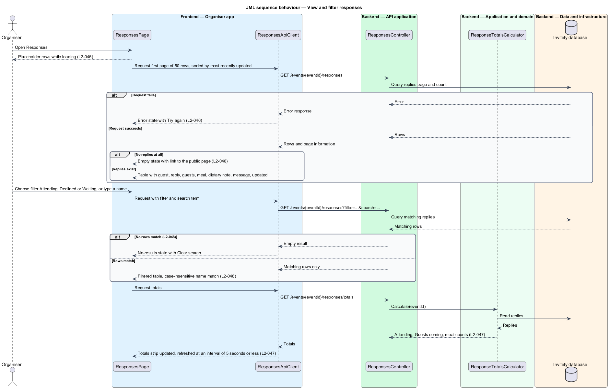

# View and filter responses

## Overview

Invitely is a content management system for running event RSVPs. Guests reply to an invitation, and the organiser reviews those replies on the **Responses** page of an event. The page lists every reply with the details needed for catering, shows totals that summarise the replies, and lets the organiser narrow the list by reply status or by guest name.

A **reply status** is one of three values for a guest: Attending when the guest answered yes, Declined when the guest answered no, and Waiting when the guest has not yet replied. A **response total** is a count derived from the saved replies. Attending counts the yes replies. Guests coming sums the party sizes of the yes replies. Meal counts give the number of attending guests who chose each meal.

The Responses page is part of the organiser admin application (`src/admin`). Its data comes from the organiser API (`src/api/responses`). Totals are computed from the stored replies on every request, so they match what is stored. The export of the same list is designed in [Export responses](../export-responses/README.md).

## Description

The feature is a vertical slice from the Responses page to the reply store.

- **`ResponsesPage`** — organiser-app page in `src/admin`. It shows the loading placeholder rows, the table, the empty state with a link to the public page, the error state with Try again, the no-results state with Clear search, and the filter and search controls.
- **`ResponseTotalsStrip`** — component in `src/admin`. It shows Attending, Guests coming and the meal counts, and it refreshes the totals at an interval of 5 seconds or less.
- **`ResponsesApiClient`** — typed client in `src/admin` for the list and totals endpoints.
- **`ResponsesController`** — endpoint in `src/api/responses`. It exposes `GET /events/{eventId}/responses` for the list and `GET /events/{eventId}/responses/totals` for the totals.
- **`ResponseListQuery`** — value object in `src/domain/responses` with the event identifier, the filter, the search term and the page. Its page size is fixed at 50 rows.
- **`ResponseRow`** — read model in `src/domain/responses` with the guest name, reply, guests count, meal, dietary note, message and update time. Rows are sorted by the update time, most recent first.
- **`ResponseTotalsCalculator`** — domain component in `src/domain/responses`. It computes the totals from the stored replies.
- **`ResponseQueryRepository`** — data component in `src/data`. It returns a page of rows that match a query, the count of matching rows, and the replies needed for totals. Its storage layout is `<TO SUPPLY>`.

## Requirements

The feature realizes the following level-2 (L2) requirements. Each L2 requirement refines a level-1 (L1) requirement, cited by identifier.

| L2 ID | Refines (L1) | Requirement |
|-------|--------------|-------------|
| `L2-046` | `L1-007` | The Responses page must list every reply with the details the organiser needs for catering. |
| `L2-047` | `L1-007` | Totals must match the replies stored. |
| `L2-048` | `L1-007` | Organisers must find replies by status or name. |

The acceptance criteria of `L2-046` fix the row fields, the 50 rows per page, the empty state and the error state. The criteria of `L2-047` fix the totals and the refresh within 5 seconds. The criteria of `L2-048` fix the status filter, the case-insensitive name search and the no-results state.

## Diagrams

### System context

The organiser reviews replies in Invitely. Guests save the replies that the page lists.

### Containers

The Organiser admin application requests replies and totals from the Organiser API application, which queries the Invitely database.

### Components

`ResponsesPage` requests the list and totals through `ResponsesApiClient`. `ResponsesController` builds a `ResponseListQuery`, and reads rows through `ResponseQueryRepository`. `ResponseTotalsCalculator` computes the totals from the same repository.

### Class structure

`ResponsesController` builds a `ResponseListQuery` that holds a `ResponseFilter`. The repository returns `ResponseRow` items, and the calculator returns a `ResponseTotals` value.

### Behaviour — load and filter the responses

The page requests the first 50 rows and the totals. An applied filter or search returns only matching rows, and the totals refresh on their own interval.

---
