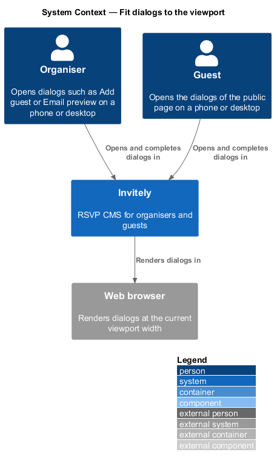
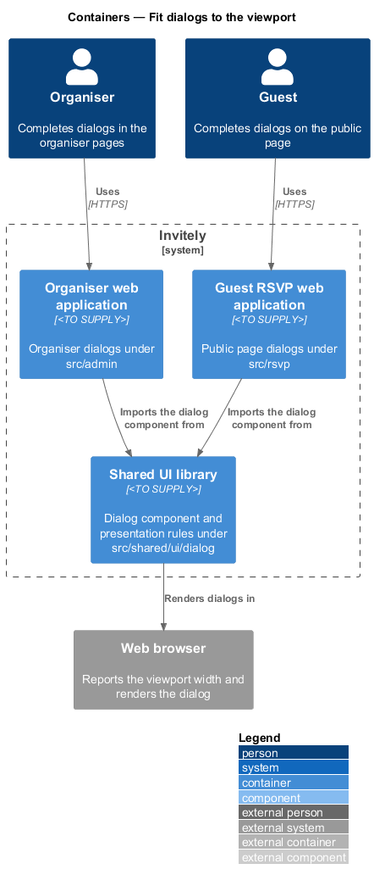
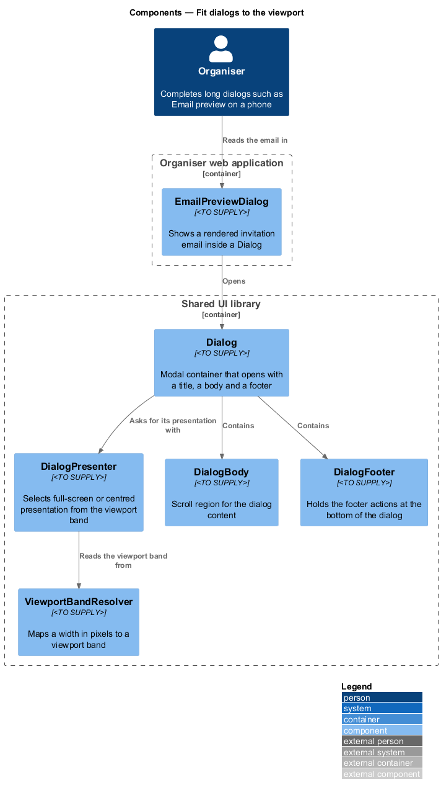
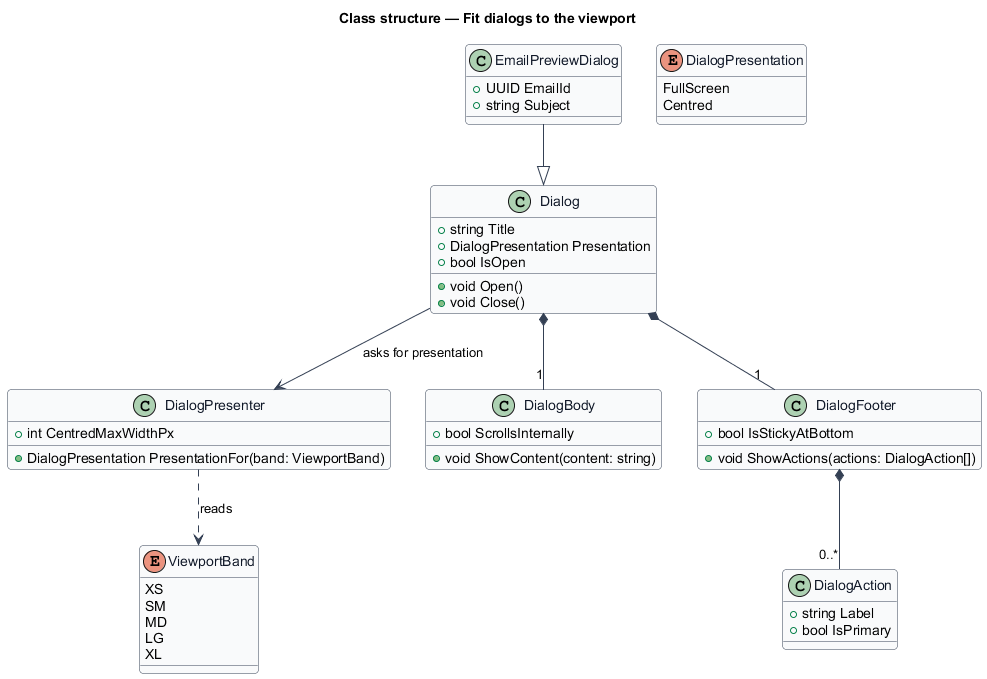
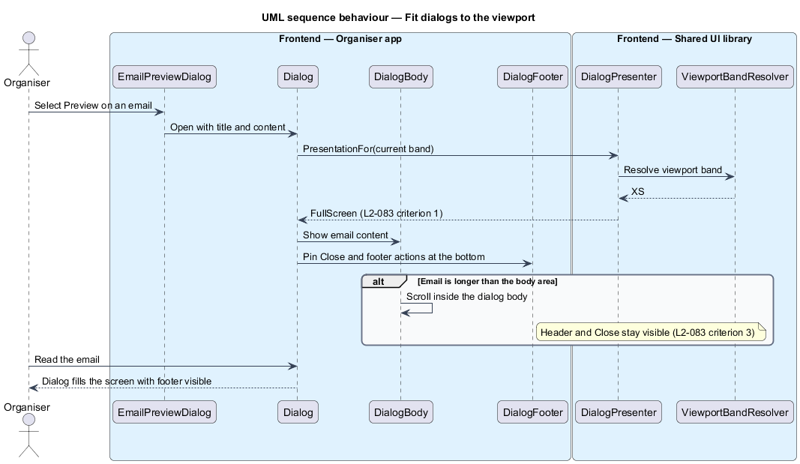

# Fit dialogs to the viewport

## Overview

A **dialog** is a modal container that opens over the current page to collect input or to show content that needs the user's full attention. The organiser web application and the guest RSVP web application both open dialogs, for example Add guest, Remove guests and the invitation email preview.

On a phone, a centred dialog leaves little room for its content, and its footer actions can fall outside the visible area. L2-083 requires each dialog to fit the screen it is shown on. A **presentation** is the way a dialog occupies the screen: either **full screen**, which fills the viewport, or **centred**, which sits in the middle of the page with a maximum width.

This feature defines the shared dialog component and the rule that selects its presentation from the viewport band defined in L1-014. The shared component lives in `src/shared/ui/dialog`, so that every dialog uses the same presentation and the same scroll behaviour. The focus, Escape and return-focus behaviour of a dialog is defined in [support-keyboard-operation](../../accessibility/support-keyboard-operation/README.md).

## Description

- `Dialog` — shared modal container in `src/shared/ui/dialog`. It holds a title, a `DialogBody` and a `DialogFooter`, and it takes its `DialogPresentation` from the presenter when it opens.
- `DialogPresenter` — maps the current `ViewportBand` to a `DialogPresentation`. It returns `FullScreen` below 576 px and `Centred` at 576 px and wider, and it limits a centred dialog to a maximum width of 560 px.
- `DialogBody` — scroll region for the dialog content. It scrolls inside the dialog so that the header and the close action remain visible.
- `DialogFooter` — holds the dialog actions and keeps them at the bottom of a full-screen dialog.
- `DialogAction` — one action in the footer, such as Cancel or Remove, with its label and whether it is the primary action.
- `EmailPreviewDialog` — organiser dialog in `src/admin` that shows a rendered invitation email. It is the long-content case that L2-083 criterion 3 covers.
- `ViewportBandResolver` — shared resolver in `src/shared/layout`, as defined in [adapt-organiser-layout](../adapt-organiser-layout/README.md).

## Requirements

The feature realizes the following level-2 (L2) requirement. The requirement refines a level-1 (L1) requirement, cited by identifier.

| L2 ID | Refines (L1) | Requirement |
|-------|--------------|-------------|
| `L2-083` | `L1-014` | Dialogs must fit the screen they are shown on. |

## Diagrams

### System context

Organisers and guests open dialogs in Invitely, and the browser renders each dialog at the current viewport width.

### Containers

The organiser and guest web applications both import the `Dialog` component from the shared UI library, so the presentation rules are defined once.

### Components

`Dialog` asks `DialogPresenter` for its presentation, and the presenter reads the band from `ViewportBandResolver`. `EmailPreviewDialog` opens a `Dialog` that contains a `DialogBody` and a `DialogFooter`.

### Class structure

`Dialog` composes exactly one `DialogBody` and one `DialogFooter`. `DialogPresenter` reads the `ViewportBand` to return a `DialogPresentation`, and `EmailPreviewDialog` specializes `Dialog`.

### Behaviour — open a dialog on a phone

On an XS viewport the presenter returns the full-screen presentation. The footer stays at the bottom, and a long email scrolls inside the body while the header and the close action remain visible.

