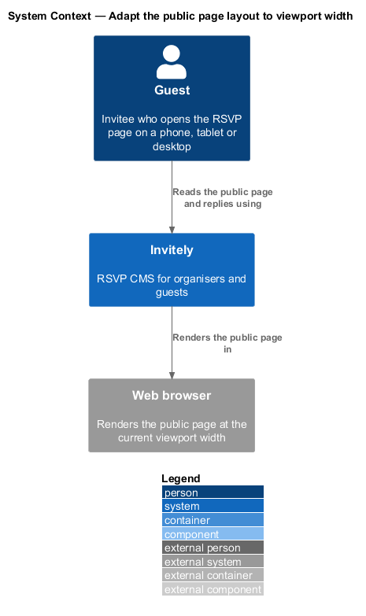
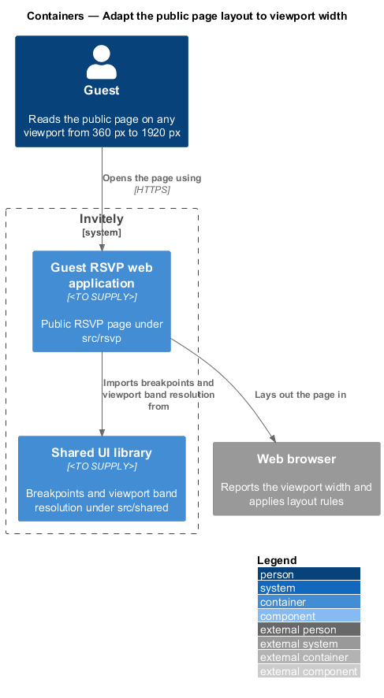
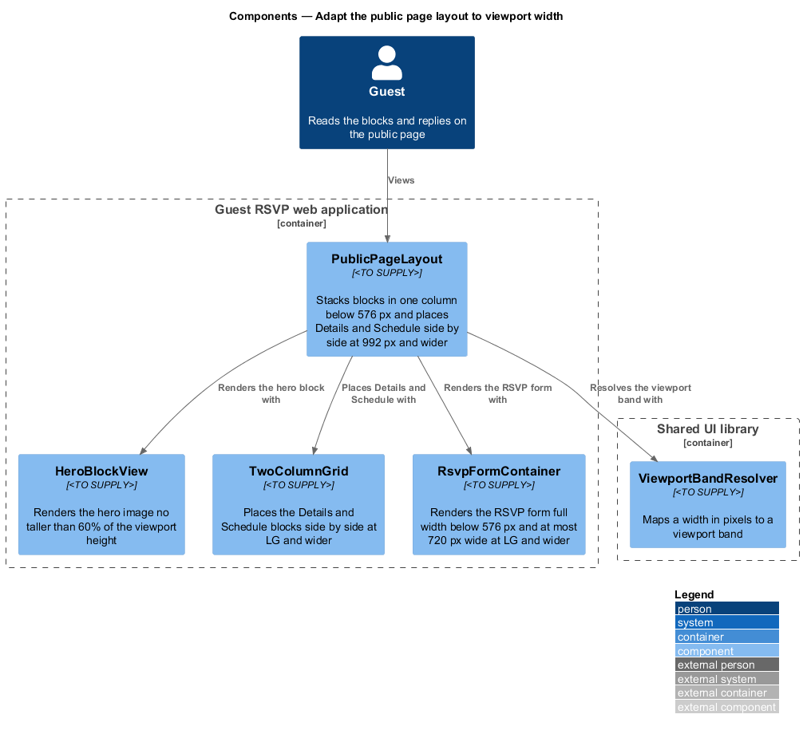
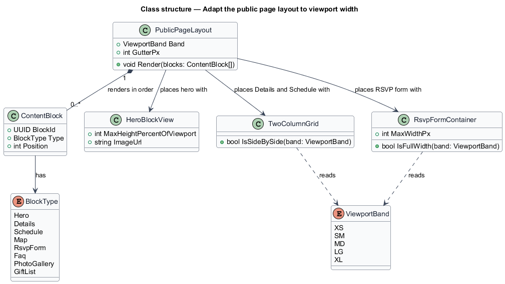
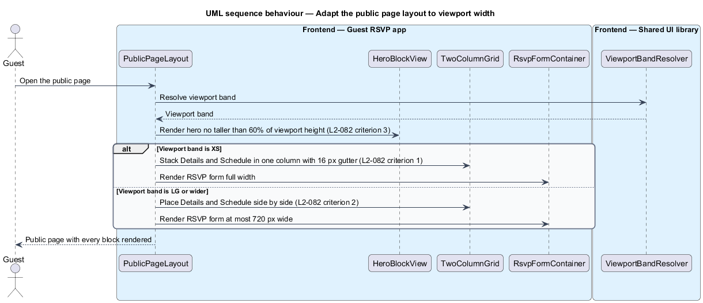

# Adapt the public page layout to viewport width

## Overview

The guest RSVP web application (`src/rsvp`) serves the public event page that an invitee opens from a personal link or an invitation code. The **public page** is the guest-facing page built from content blocks. A **content block** is one typed section of the public page, such as the hero, details, schedule, map, RSVP form, FAQ, photo gallery or gift list, as defined by L1-003.

Guests reach the page on phones more often than on desktops, so the layout of the public page shall adapt to every viewport. L1-014 defines the five **viewport bands** (XS, SM, MD, LG and XL) that the layout rules are written against. This feature defines how the public page places its content blocks, its hero image and its RSVP form in each band.

The public page is guest-only code and lives in `src/rsvp`. It shares the breakpoint definitions and the viewport band resolution with the organiser shell through `src/shared/layout`, as described in [adapt-organiser-layout](../adapt-organiser-layout/README.md). The organiser preview of the page (L2-017) uses the same block components, so the same rules apply to the preview.

## Description

- `PublicPageLayout` — page frame in `src/rsvp/layout`. It renders the content blocks in position order, stacks them in one column below 576 px with a 16 px gutter, and selects the two-column arrangement at 992 px and wider.
- `HeroBlockView` — component for the hero content block. It caps the height of the hero image at 60% of the viewport height.
- `TwoColumnGrid` — layout helper that places the Details and Schedule blocks side by side at LG and wider.
- `RsvpFormContainer` — wrapper for the RSVP form block. It renders full width below 576 px and at most 720 px wide at LG and wider.
- `ContentBlock` — typed record of one block with its `BlockId`, its `BlockType` and its `Position` on the page.
- `BlockType` — enumeration of the block types Hero, Details, Schedule, Map, RsvpForm, Faq, PhotoGallery and GiftList.
- `ViewportBandResolver` — shared resolver in `src/shared/layout` that maps the viewport width to a `ViewportBand`.

The layout of the page between 576 px and 991 px is `<TO SUPPLY>` because L2-082 states the rules only for XS and for LG and wider.

## Requirements

The feature realizes the following level-2 (L2) requirement. The requirement refines a level-1 (L1) requirement, cited by identifier.

| L2 ID | Refines (L1) | Requirement |
|-------|--------------|-------------|
| `L2-082` | `L1-014` | The guest page must work on every viewport. |

## Diagrams

### System context

The guest reads the public page through Invitely in a web browser, and the browser applies the layout at the current viewport width.

### Containers

The guest RSVP web application renders the public page in the browser and imports the breakpoint definitions from the shared UI library. The feature adds no server-side container.

### Components

`PublicPageLayout` resolves the viewport band and delegates the hero, the two-column arrangement and the RSVP form to their components. Each component reads the band and applies its own rule.

### Class structure

`PublicPageLayout` owns an ordered list of `ContentBlock` records, and each block has a `BlockType`. `TwoColumnGrid` and `RsvpFormContainer` both read the `ViewportBand` to decide their shape.

### Behaviour — render the public page

The page resolves the viewport band once, renders the hero within the 60% height limit, and then selects the XS or the LG arrangement for the Details, Schedule and RSVP form blocks.

