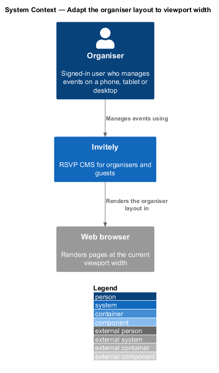
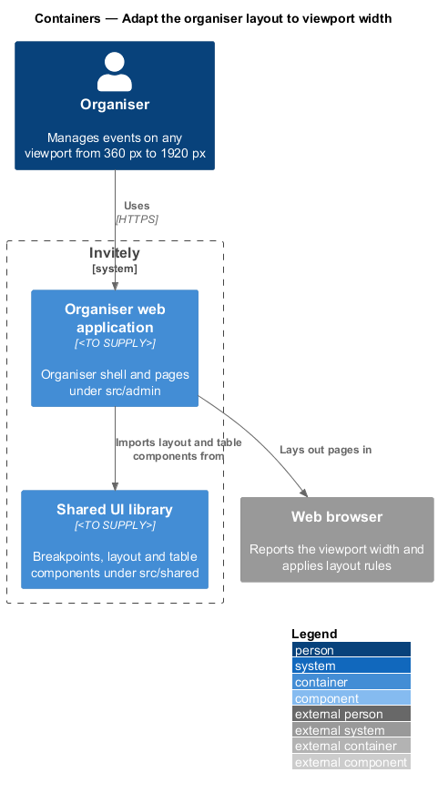
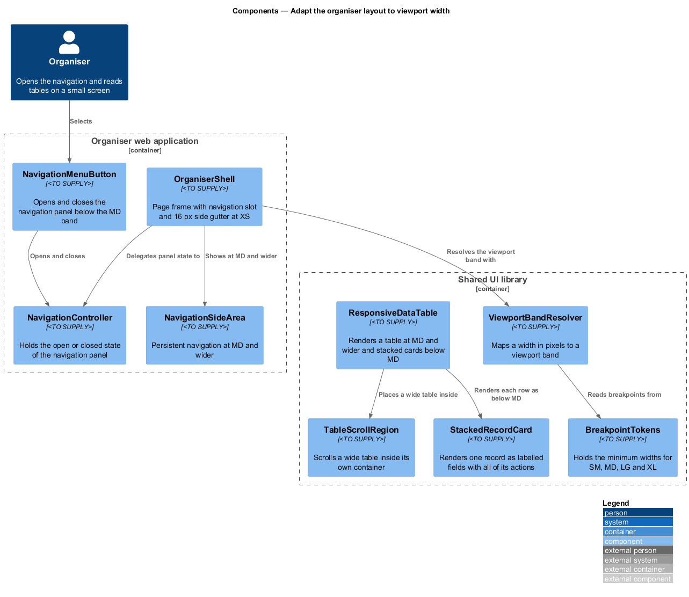
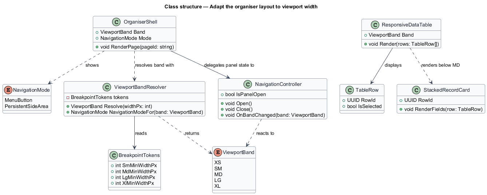
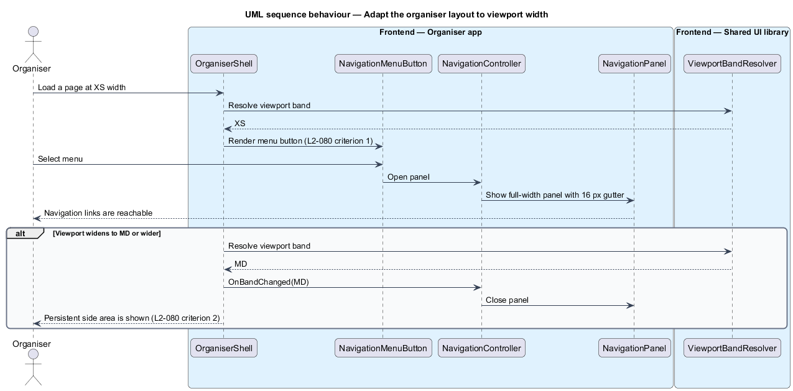

# Adapt the organiser layout to viewport width

## Overview

The organiser web application (`src/admin`) is the signed-in workspace in which organisers manage events, guests and responses. The **organiser shell** is the frame that every organiser page renders inside. It holds the navigation and the **page frame**, the padded content area that receives each page.

L1-014 requires every screen to work at five **viewport bands**. A viewport band is one of the width ranges XS (under 576 px), SM (576 px and up), MD (768 px and up), LG (992 px and up) and XL (1200 px and up). Layout rules are written against these bands, so each component selects its shape from the band that the current width falls in.

A **stacked card** is a record rendered as a vertical list of labelled fields. A **responsive data table** is a table component that renders as a table at MD and wider and as stacked cards below MD.

This feature covers the shell and the guest table on organiser pages. The shell is organiser-only and lives in `src/admin/shell`. The breakpoint definitions, the table component and its card and scroll parts are shared and live in `src/shared/layout` and `src/shared/ui/table`, so that other areas use the same rules. The guest page has its own layout rules, defined in [adapt-guest-page-layout](../adapt-guest-page-layout/README.md).

## Description

- `OrganiserShell` — frame component in `src/admin/shell`. It places the navigation and the page content slot, and it applies the 16 px side gutter at XS.
- `NavigationMenuButton` — control in `src/admin/shell/navigation`. It opens and closes the navigation panel in the bands below MD. The layout of navigation between 576 px and 767 px is `<TO SUPPLY>` because L2-080 does not state it.
- `NavigationController` — holds whether the navigation panel is open. It closes the panel when the viewport band changes to a band in which the persistent side area is shown.
- `NavigationSideArea` — persistent navigation shown at MD and wider, as required by L2-080 criterion 2.
- `ViewportBand` — enumeration of the five bands XS, SM, MD, LG and XL.
- `BreakpointTokens` — shared constants in `src/shared/layout` that hold the minimum widths for SM (576 px), MD (768 px), LG (992 px) and XL (1200 px).
- `ViewportBandResolver` — maps a viewport width in pixels to a `ViewportBand` using `BreakpointTokens`, and maps a band to a `NavigationMode`.
- `ResponsiveDataTable` — shared table in `src/shared/ui/table`. It renders column headers and sortable columns at MD and wider and renders stacked cards below MD.
- `StackedRecordCard` — shared card that shows one record as labelled fields with every action of that record available.
- `TableScrollRegion` — wrapper that scrolls a wide table horizontally inside its own container, so the page itself does not scroll sideways at SM.

## Requirements

The feature realizes the following level-2 (L2) requirements. Each L2 requirement refines a level-1 (L1) requirement, cited by identifier.

| L2 ID | Refines (L1) | Requirement |
|-------|--------------|-------------|
| `L2-080` | `L1-014` | The organiser navigation and page frame must adapt to each viewport. |
| `L2-081` | `L1-014` | Data tables must remain usable on small screens. |

## Diagrams

### System context

The organiser manages events through Invitely in a web browser, and the browser applies the layout rules at the current viewport width.

### Containers

The organiser web application imports the layout and table components from the shared UI library, and it renders pages in the browser. The feature adds no server-side container.

### Components

`OrganiserShell` resolves the viewport band through `ViewportBandResolver` and delegates the panel state to `NavigationController`. `ResponsiveDataTable` switches between a table and stacked cards, and it places wide tables inside `TableScrollRegion`.

### Class structure

`OrganiserShell` and `ResponsiveDataTable` both read a `ViewportBand`. `ViewportBandResolver` derives the band from the values in `BreakpointTokens`, and `NavigationController` reacts to band changes.

### Behaviour — open navigation on a small viewport

On an XS viewport the shell renders a menu button, and the organiser opens a full-width panel from it. When the viewport widens to MD or wider, the controller closes the panel and the persistent side area is shown.

