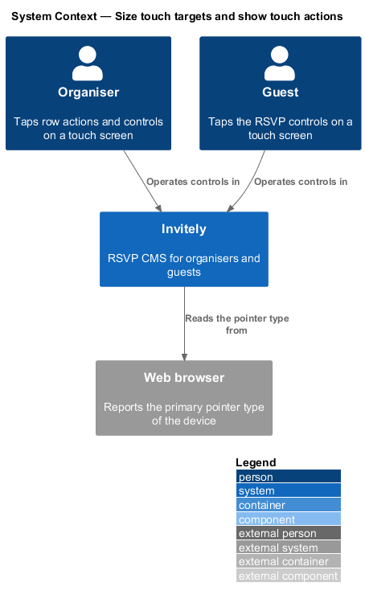
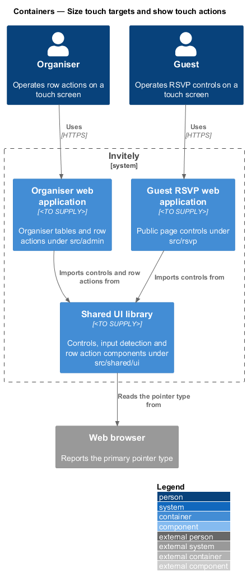
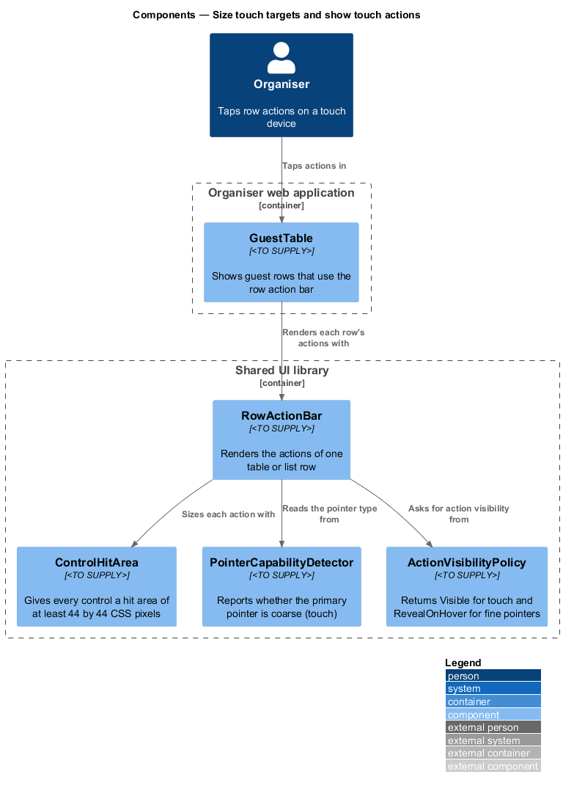
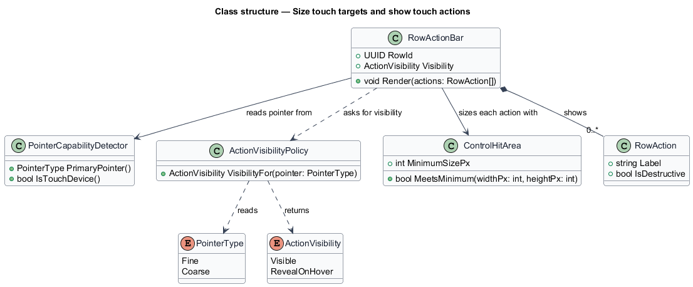
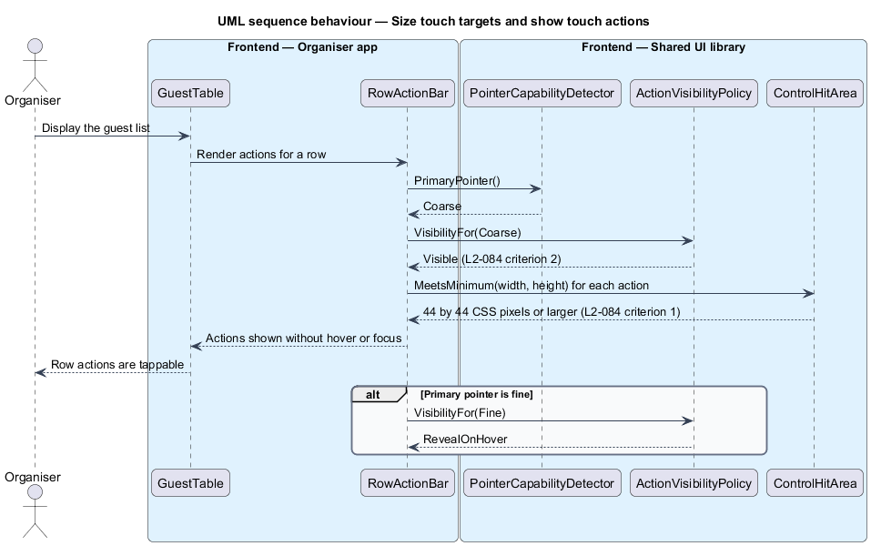

# Size touch targets and show touch actions

## Overview

A **touch target** is the area of a control that responds to a tap. A **hover-only action** is a control that appears only when the pointer moves over its row. On a touch device no pointer hovers, so a hover-only action stays hidden unless the design shows it another way.

L1-014 requires touch-friendly controls on every screen, and L2-084 turns that into two rules. Every button, link and control shall have a hit area of at least 44 by 44 CSS pixels on a touch device. A row with hover-only actions shall show those actions without hover on a touch device.

The feature introduces three shared parts: a sizing rule for controls, a detector for the primary pointer type of the device, and a row action bar that chooses between always-visible and hover-revealed actions. The shared parts live in `src/shared/ui`, so the organiser tables and the guest RSVP controls use one rule. The organiser table that uses the row action bar is `GuestTable` in `src/admin`.

## Description

- `ControlHitArea` — sizing rule in `src/shared/ui/controls`. It gives each control a hit area of at least 44 by 44 CSS pixels, including padding that extends the tappable region without changing the visible control.
- `PointerCapabilityDetector` — reader in `src/shared/ui/input`. It reports whether the primary pointer is `Coarse` (touch) or `Fine` (mouse or trackpad).
- `ActionVisibilityPolicy` — rule in `src/shared/ui/table`. It returns `Visible` for a coarse pointer and `RevealOnHover` for a fine pointer.
- `RowActionBar` — shared component in `src/shared/ui/table`. It renders the actions of one row, applies the visibility from the policy, and sizes each action with `ControlHitArea`.
- `RowAction` — one action of a row, with its label and whether it is destructive, such as Remove.
- `PointerType` and `ActionVisibility` — enumerations for the pointer type and the visibility outcome.
- `GuestTable` — organiser table in `src/admin/guests` that renders each guest row through `RowActionBar`.

The hit-area size of controls inside dense tables when the pointer is fine is `<TO SUPPLY>`, because L2-084 applies its rule to touch devices only.

## Requirements

The feature realizes the following level-2 (L2) requirement. The requirement refines a level-1 (L1) requirement, cited by identifier.

| L2 ID | Refines (L1) | Requirement |
|-------|--------------|-------------|
| `L2-084` | `L1-014` | Controls must be easy to hit on touch screens. |

## Diagrams

### System context

Organisers and guests operate controls in Invitely on a touch screen, and the browser reports the pointer type of the device.

### Containers

The organiser and guest web applications both import controls and row actions from the shared UI library. The shared library reads the pointer type from the browser.

### Components

`GuestTable` renders each row through `RowActionBar`. The bar reads the pointer type from `PointerCapabilityDetector`, asks `ActionVisibilityPolicy` for visibility, and sizes each action with `ControlHitArea`.

### Class structure

`RowActionBar` composes zero or more `RowAction` records and depends on the pointer detector, the visibility policy and the hit-area rule. The policy maps a `PointerType` to an `ActionVisibility`.

### Behaviour — show row actions on a touch device

On a coarse pointer the row action bar asks the policy for visibility and receives `Visible`, so the actions appear without hover. Each action is checked against the 44 by 44 CSS pixel minimum before the row is shown.

