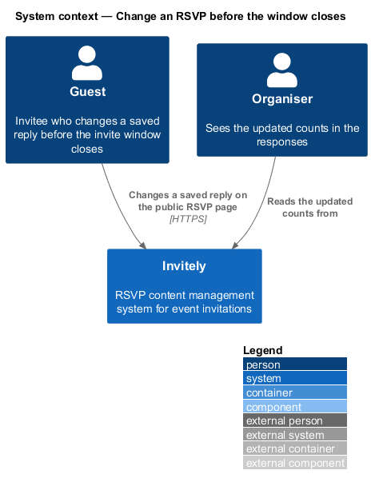
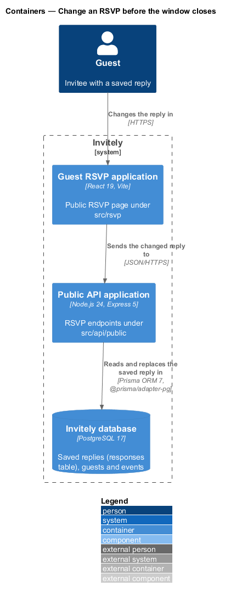
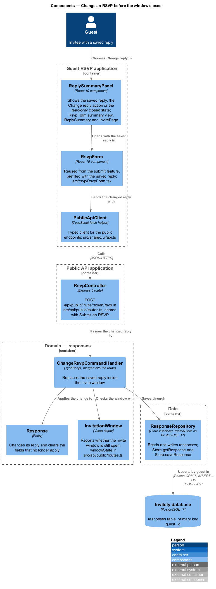
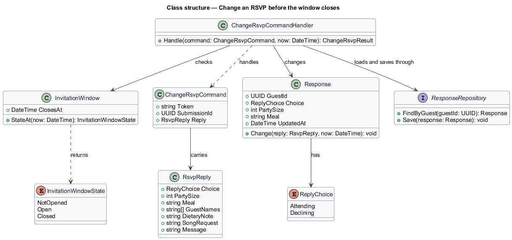
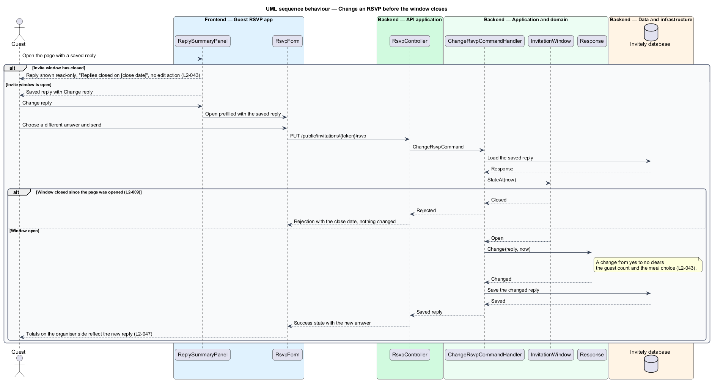

# Change an RSVP before the window closes

## Overview

Invitely is a content management system for running event RSVPs. A guest who has replied to an invitation may change that reply until the **invite window** closes. The invite window is the interval during which replies are accepted. A **saved reply** is the reply the system holds for one guest of one event.

Changing a reply replaces the saved reply. The guest never has two replies for the same invitation, so the organiser's totals count each guest once. When a guest changes from a yes to a no, the guest count and meal choice of the earlier yes no longer apply, so the system clears them. Once the window closes, the reply stays on the page as read-only text.

This feature lives in the guest-facing RSVP application (`src/rsvp`) and in the public API (`src/api/public`). It reuses the RSVP form and the reply model from [Submit an RSVP](../submit-rsvp/README.md), and it reuses the `InvitationWindow` value from [Open a personal invitation link](../open-personal-invitation/README.md) to decide whether the window is open.

## Description

The feature is a vertical slice from the reply summary on the guest page to the response store.

- **`ReplySummaryPanel`** — guest-page component in `src/rsvp`. It shows the saved reply with a Change reply action while the window is open, and shows the reply read-only with the text "Replies closed on [close date]" after the window has closed.
- **`RsvpForm`** — component in `src/rsvp`, reused from the submit feature. When the guest chooses Change reply, the form opens with the saved answers filled in.
- **`PublicApiClient`** — typed client in `src/rsvp` with a method that sends the changed reply.
- **`RsvpController`** — endpoint in `src/api/public`, shared with the submit feature. It exposes `PUT /public/invitations/{token}/rsvp` for a change and passes it to the change handler.
- **`ChangeRsvpCommandHandler`** — domain handler in `src/domain/responses`. It loads the saved reply, rejects the change when the invite window is closed, applies the change, and saves the result.
- **`InvitationWindow`** — value object in `src/domain/invitations`. Its `StateAt` operation tells the handler whether the window is open at the time of the request.
- **`Response`** — entity in `src/domain/responses`. Its `Change` operation replaces the reply and sets the update time. When the new choice is a decline, it clears the party size, the meal choice and the guest names.
- **`ResponseRepository`** — data component in `src/data`. It loads the saved reply of a guest and saves the changed reply. Totals are not stored separately, so the organiser's counts reflect the changed reply the next time they are read.

The organiser app (`src/admin`) and the guest app (`src/rsvp`) are React 19 applications built with Vite. The API application runs on Node.js 24 with Express 5 and exchanges JSON over HTTPS.

The code places each design component as follows.

| Design component | Where it lives |
|------------------|----------------|
| `ReplySummaryPanel` | Summary view of `RsvpForm` with `ReplySummary` in `src/rsvp/RsvpForm.tsx`; `InvitePage` renders the closed state |
| `RsvpForm` | `RsvpForm` in `src/rsvp/RsvpForm.tsx`, prefilled from the saved reply |
| `PublicApiClient` | The shared `post` helper in `src/shared/ui/api.ts` |
| `RsvpController` | A change uses the same `POST /api/public/invite/:token/rsvp` as the first reply (`src/api/public/routes.ts`), not a separate `PUT` |
| `ChangeRsvpCommandHandler` | Merged into that route; a closed window answers 403 "Replies closed on [date], 11:59 pm" |
| `InvitationWindow` | `windowState` in `src/api/public/routes.ts` |
| `Response` | `validateReply` in `src/domain/rsvp.ts` sets party size 0, no meal and no guest names for a decline, and `Store.saveResponse` replaces the row |
| `ResponseRepository` | `Store.getResponse` and `Store.saveResponse` |

Persistence goes through the `Store` interface in `src/data/store.ts`. The running app uses `PrismaStore` (`src/data/prismaStore.ts`), which reaches PostgreSQL 17 through Prisma ORM 7 with the `@prisma/adapter-pg` driver adapter. Every automated test and the Playwright e2e server use the in-memory `MemoryStore` (`src/data/memoryStore.ts`) instead. The schema and migrations are `src/data/prisma/schema.prisma` and `src/data/prisma/migrations/`.

## Requirements

The feature realizes the following level-2 (L2) requirement. The requirement refines a level-1 (L1) requirement, cited by identifier.

| L2 ID | Refines (L1) | Requirement |
|-------|--------------|-------------|
| `L2-043` | `L1-006` | Guests must be able to change their reply until the invite window closes. |

The acceptance criteria of `L2-043` fix three behaviours. A changed answer replaces the old one and updates the organiser's counts. After the window closes the reply is read-only with "Replies closed on [close date]". A change from yes to no clears the guest count and the meal choice.

The server-side rejection of a change after the window closes is stated by `L2-009`, which belongs to the invite window rules. This feature relies on that rule and does not restate it as a requirement.

## Diagrams

### System context

The guest changes the saved reply on the Invitely RSVP page. The organiser sees the updated counts in the same system.

### Containers

The Guest RSVP application sends the changed reply to the Public API application, which reads and replaces the saved reply in the Invitely database.

### Components

`ReplySummaryPanel` opens `RsvpForm` with the saved reply. `RsvpController` passes a `ChangeRsvpCommand` to `ChangeRsvpCommandHandler`, which checks `InvitationWindow`, applies the change to `Response`, and saves it through `ResponseRepository`.

### Class structure

`ChangeRsvpCommandHandler` handles a `ChangeRsvpCommand` that carries an `RsvpReply`, checks the window, and changes a `Response`. The `InvitationWindow` returns an `InvitationWindowState`.

### Behaviour — change a reply

The summary panel offers Change reply only while the window is open. The handler checks the window again on the server before it changes the saved reply, so a change made after the window closed is rejected.

---
