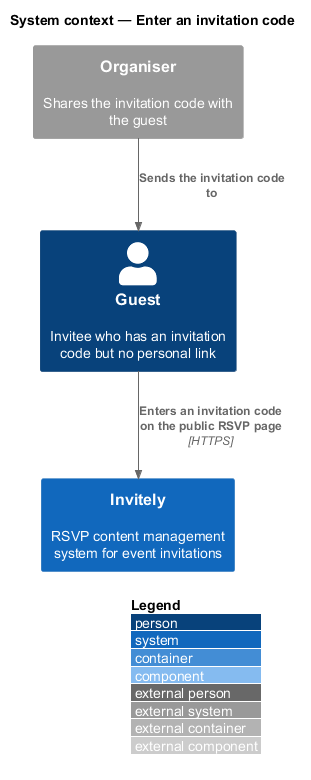
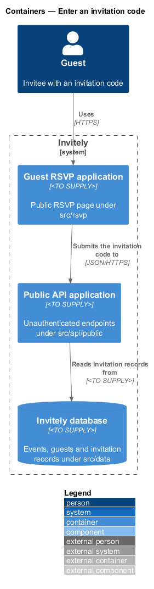
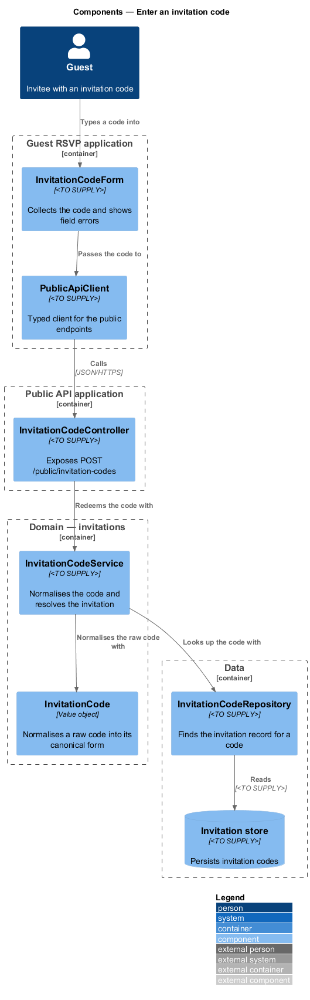
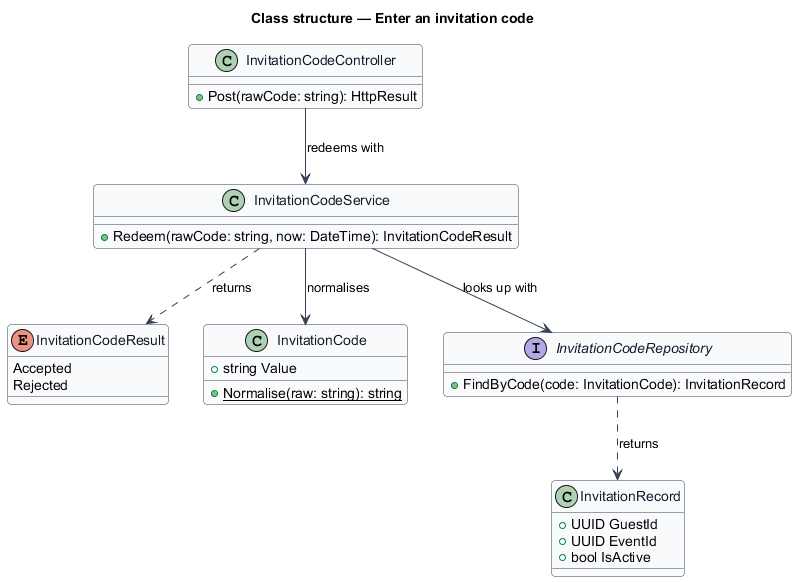
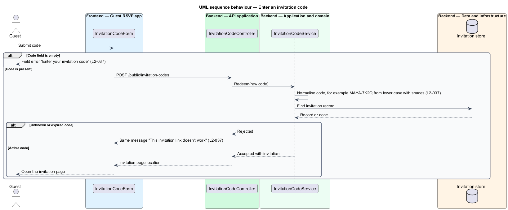

# Enter an invitation code

## Overview

Invitely is a content management system for running event RSVPs. An organiser creates an event, adds guests and sends each guest a personal invitation link. A guest who has lost that link can still reach their invitation by typing an **invitation code**, which is a short code issued for the guest and shown on the public RSVP page. This feature covers that entry path.

An **invitation code** is a human-typed credential that identifies one guest of one event without sign-in. It is weaker than a personal link because it is typed and shared, so the feature gives the same failure message for every reason a code can fail. The code entry sits in the guest-facing RSVP application (`src/rsvp`) and calls the public API (`src/api/public`) that resolves it.

The feature does not show the invitation itself. After a valid code is accepted, the guest is taken to the invitation page, which is designed in [Open a personal invitation link](../open-personal-invitation/README.md).

## Description

The feature is a vertical slice from the guest page through the public API to the invitation store.

- **`InvitationCodeForm`** — guest-page component in `src/rsvp`. It collects the code, shows the field error "Enter your invitation code" when the field is empty, and opens the invitation page after success.
- **`PublicApiClient`** — typed client in `src/rsvp` for the public endpoints. It sends the raw code and maps the response to a result the form can display.
- **`InvitationCodeController`** — endpoint in `src/api/public`. It exposes `POST /public/invitation-codes` and dispatches the redemption.
- **`InvitationCodeService`** — domain service in `src/domain/invitations`. It normalises the raw code, looks up the invitation, and returns the result without revealing the reason for a failure.
- **`InvitationCode`** — value object in `src/domain/invitations`. Its `Normalise` operation converts a raw code to upper case and removes spaces and separators, so `maya-7k2q` and `MAYA-7K2Q` resolve to the same invitation.
- **`InvitationCodeRepository`** — data component in `src/data`. It finds the invitation record that matches a normalised code and returns no record for an unknown or expired code. The storage form of the code is `<TO SUPPLY>`.

## Requirements

The feature realizes the following level-2 (L2) requirements. Each L2 requirement refines a level-1 (L1) requirement, cited by identifier.

| L2 ID | Refines (L1) | Requirement |
|-------|--------------|-------------|
| `L2-037` | `L1-006` | A guest without their personal link must be able to enter their invitation code. |

The acceptance criteria of `L2-037` fix three behaviours that the design depends on. A valid code typed in lower case with spaces is normalised and opens the invitation page. An unknown or expired code shows the same failure message for every reason. An empty code field shows a field error.

## Diagrams

### System context

The guest enters the invitation code on the RSVP page of Invitely. The organiser supplies the code to the guest outside the system.

### Containers

The guest uses the Guest RSVP application. That application calls the Public API application over HTTPS, and the Public API application reads invitation records from the Invitely database.

### Components

`InvitationCodeController` passes the code to `InvitationCodeService`. The service normalises the code with `InvitationCode` and looks it up through `InvitationCodeRepository`.

### Class structure

`InvitationCodeService` depends on `InvitationCode` and `InvitationCodeRepository`, and returns an `InvitationCodeResult`. The repository returns an `InvitationRecord` that identifies the guest and the event.

### Behaviour — enter an invitation code

The guest form rejects an empty code before any request is sent. A failed resolution returns the same message whatever the reason.

---
