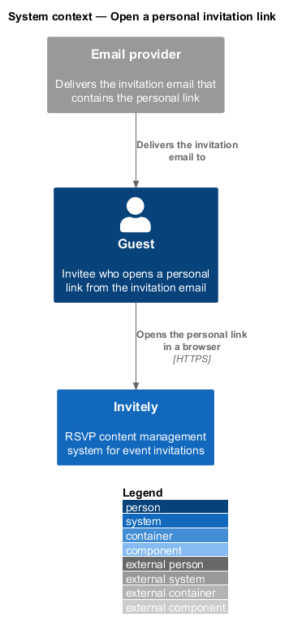
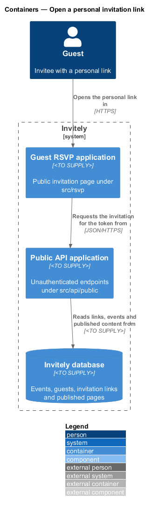
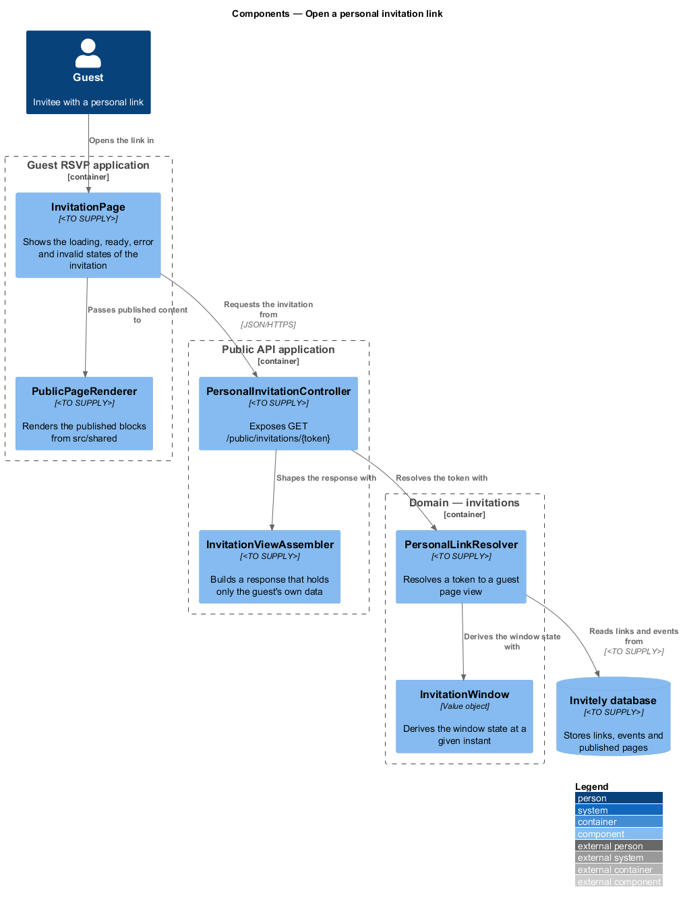
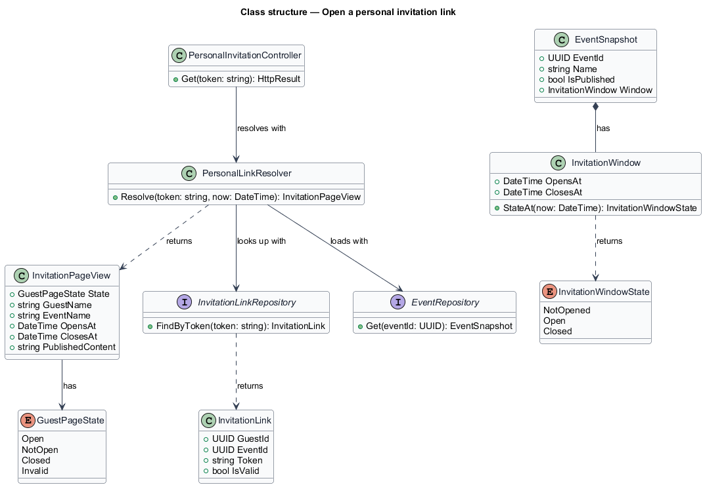
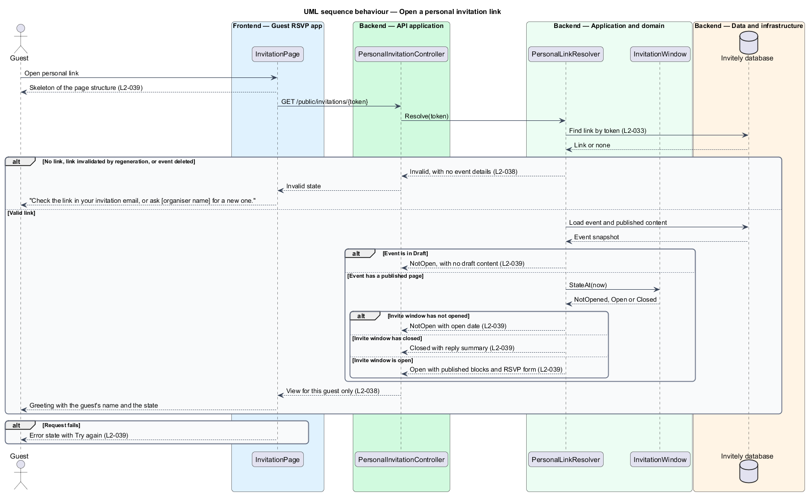

# Open a personal invitation link

## Overview

Invitely is a content management system for running event RSVPs. Each guest of an event receives a **personal invitation link**, which is a URL that carries a random token identifying one guest of one event. The guest opens the link without signing in, and the link shows the event's invitation page with the guest's name in the greeting.

A **published page** is the public event page that an organiser builds from content blocks and publishes. An **invite window** is the interval during which guests may reply. The invitation page shows one of four states that depend on the event: Open, NotOpen, Closed or Invalid. Open shows the published page and the RSVP form. NotOpen covers both an invite window that has not started and an event still in Draft. Closed shows the reply summary without a form. Invalid covers a link that cannot be resolved.

This feature sits in the guest-facing RSVP application (`src/rsvp`). Its server side is the public API (`src/api/public`), which resolves the token and returns only the data for that guest. The feature does not issue links. Link creation and regeneration are described in the invitation delivery subsystem.

## Description

The feature is a vertical slice from the guest page through the public API to the database.

- **`InvitationPage`** — guest-page component in `src/rsvp`. It requests the invitation for the token in the URL and renders the loading skeleton, the Open, NotOpen, Closed or Invalid state, and the error state with a Try again action.
- **`PublicPageRenderer`** — component in `src/shared`. It renders the published blocks for the Open state. The organiser preview reuses it so that the guest page and the preview show the same components.
- **`PersonalInvitationController`** — endpoint in `src/api/public`. It exposes `GET /public/invitations/{token}` and passes the token to the resolver.
- **`InvitationViewAssembler`** — component in `src/api/public`. It builds the response from the resolved view and includes no data about other guests.
- **`PersonalLinkResolver`** — domain service in `src/domain/invitations`. It finds the link for the token, loads the event, and returns an `InvitationPageView`. It returns the Invalid view for every failure so that the response does not reveal which condition applied.
- **`InvitationWindow`** — value object in `src/domain/invitations`. It holds the open and close instants, and its `StateAt` operation returns NotOpened, Open or Closed for the current instant.
- **`EventSnapshot`** — read model in `src/domain/invitations` with the event identifier, name, publication flag and `InvitationWindow`.
- **`InvitationLink`** — entity in `src/domain/invitations` linking one guest to one event by the token. Its `IsValid` flag is cleared when links are regenerated.
- **`InvitationPageView`** — domain result with `GuestPageState`, the guest name, the event name, the open and close instants, and the published content. Fields that do not apply to a state are empty.
- **`InvitationLinkRepository`** and **`EventRepository`** — data components in `src/data`. They read links by token and events by identifier. The storage layout is `<TO SUPPLY>`.

## Requirements

The feature realizes the following level-2 (L2) requirements. Each L2 requirement refines a level-1 (L1) requirement, cited by identifier.

| L2 ID | Refines (L1) | Requirement |
|-------|--------------|-------------|
| `L2-038` | `L1-006` | Personal links must open the correct invitation and fail safely otherwise. |
| `L2-039` | `L1-006` | The guest page must show a correct state for each event condition. |

`L2-038` is the requirement statement that the invalid and deleted-event paths implement. The acceptance criteria of `L2-038` state that the same invalid state is shown for a deleted event and that the response contains no data about other guests. The acceptance criteria of `L2-039` define the Open, NotOpen, Closed, Draft and error states and the loading skeleton.

## Diagrams

### System context

A guest receives the personal link by email and opens it in a browser on Invitely. The email provider delivers the message and does not take part in the request.

### Containers

The Guest RSVP application requests the invitation from the Public API application, which reads links, events and published content from the Invitely database.

### Components

`InvitationPage` passes the published content to `PublicPageRenderer`. `PersonalInvitationController` resolves the token through `PersonalLinkResolver`, which derives the window state with `InvitationWindow`.

### Class structure

`PersonalLinkResolver` depends on two repositories, and returns an `InvitationPageView` whose `GuestPageState` is one of four values. `EventSnapshot` composes an `InvitationWindow`.

### Behaviour — open a personal invitation link

The resolver returns the Invalid view for an unknown, invalidated or deleted link. For a valid link it chooses the state from the event status and the invite window, and the controller returns only that guest's view.

---
