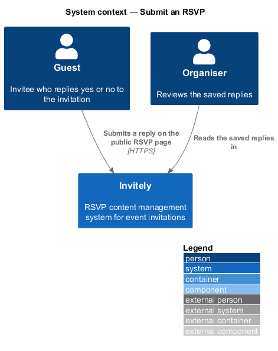
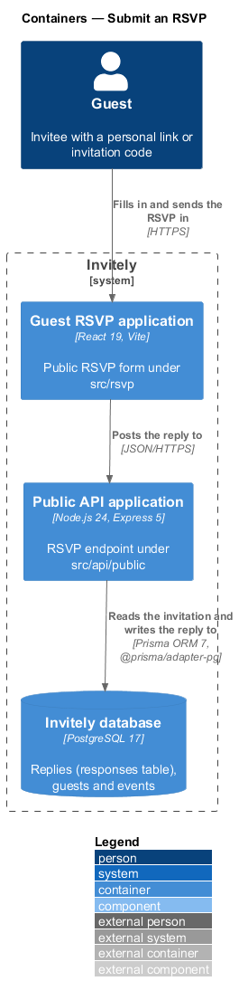
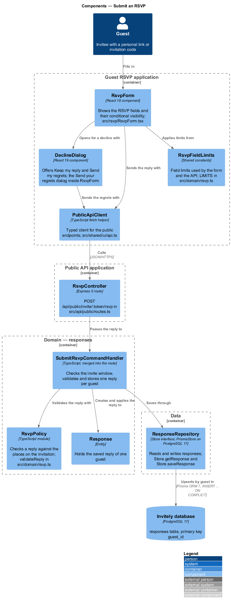
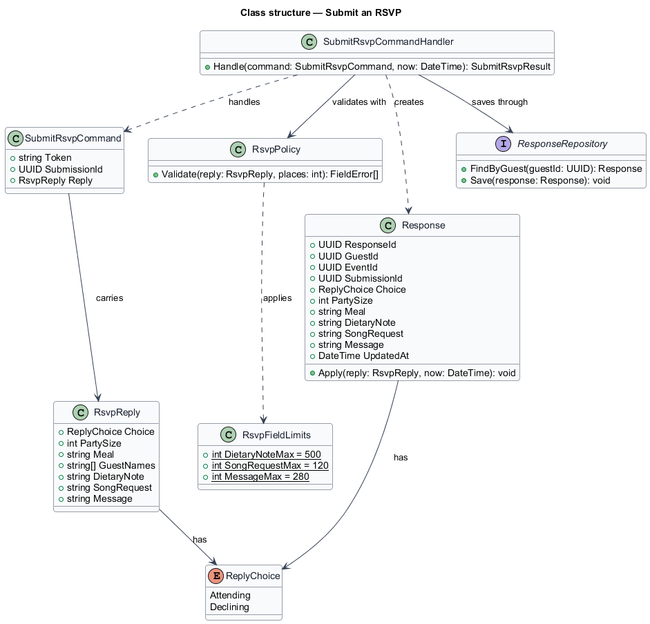
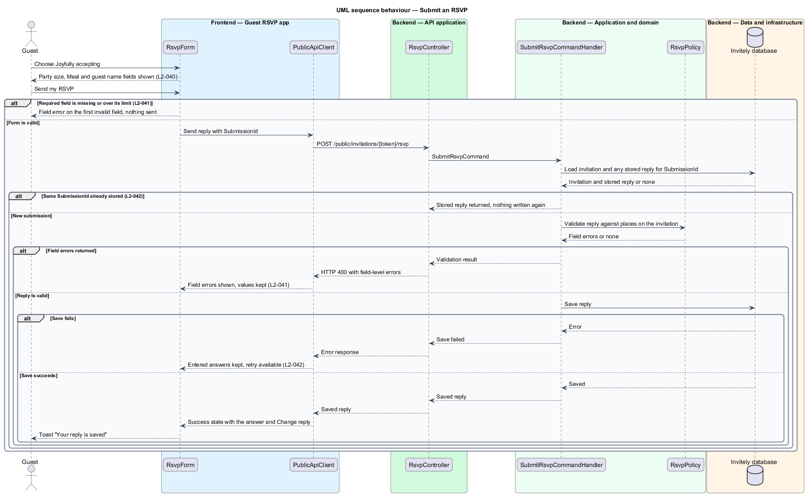
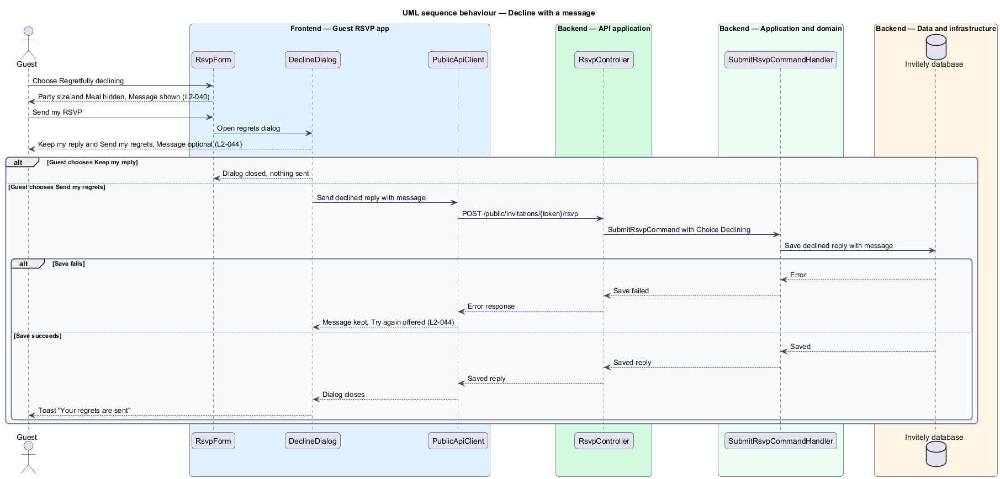

# Submit an RSVP

## Overview

Invitely is a content management system for running event RSVPs. A guest who has opened an invitation, through a personal link or an invitation code, replies to it on the public RSVP page. The reply is one **RSVP**: a yes or a no, with the details the organiser needs for catering and planning.

A **place** is one seat that the invitation allows. An invitation for two places lets the guest bring one other person, who is named as a **guest** on the form. A **meal choice** is the course the guest selects for each attending person. A **dietary note** is free text about dietary needs or allergies. A **song request** is a track the guest would like played.

This feature covers the first reply a guest sends and the regrets path, where a guest who cannot attend sends a declined reply with an optional message. The form shows only the fields that apply to the current answer. Once saved, a reply is stored once, even if the same submission is sent twice. Changing a saved reply is covered by [Change an RSVP before the window closes](../change-rsvp/README.md).

The feature lives in the guest-facing RSVP application (`src/rsvp`). Field limits are shared with the API through `src/shared`, so the form and the server apply the same limits.

## Description

The feature is a vertical slice from the RSVP form through the public API to the response store.

- **`RsvpForm`** — guest-page component in `src/rsvp`. It shows the Yes and No choice, the conditional Party size, Meal, guest name, Dietary needs, Song request and Message fields, and the Send my RSVP action with its busy state.
- **`DeclineDialog`** — component in `src/rsvp`. It opens when a guest chooses a decline and selects Send my RSVP. It offers Keep my reply and Send my regrets, and keeps its message when a request fails.
- **`PublicApiClient`** — typed client in `src/rsvp`. It sends the reply with a client-generated `SubmissionId` so that a repeated send can be recognised.
- **`RsvpFieldLimits`** — shared constants in `src/shared`. They hold the limits of 500 characters for dietary needs, 120 characters for the song request and 280 characters for the message.
- **`RsvpController`** — endpoint in `src/api/public`. It exposes `POST /public/invitations/{token}/rsvp`, resolves the guest from the token, and dispatches the command.
- **`SubmitRsvpCommandHandler`** — domain handler in `src/domain/responses`. It returns the stored reply when the `SubmissionId` is already known, otherwise validates the reply, applies it to the `Response`, and saves it.
- **`RsvpPolicy`** — domain policy in `src/domain/responses`. It returns field errors for a yes without a meal, a party size above the places on the invitation, a missing guest name, or a value over its limit.
- **`Response`** — entity in `src/domain/responses`. It holds the saved reply for one guest and its `Apply` operation sets the reply and the update time.
- **`RsvpReply`** — value carried by the command, with the choice, party size, meal, guest names, dietary note, song request and message.
- **`ResponseRepository`** — data component in `src/data`. It reads the reply of a guest and writes the reply once for each submission. It is realised by `getResponse` and `saveResponse` on the `Store` interface. Replies sit in the `responses` table, one row per guest with `guest_id` as the primary key. The columns are `attending`, `party_size`, `meal`, `guest_names` (jsonb), `dietary`, `song`, `message` and `updated_at`. `PrismaStore` saves with a native `INSERT ... ON CONFLICT`, so a double submit stores one row. The same transaction cancels the guest's pending deliveries of emails addressed to people who have not replied.

The organiser app (`src/admin`) and the guest app (`src/rsvp`) are React 19 applications built with Vite. The API application runs on Node.js 24 with Express 5 and exchanges JSON over HTTPS.

The code places each design component as follows.

| Design component | Where it lives |
|------------------|----------------|
| `RsvpForm` | `RsvpForm` in `src/rsvp/RsvpForm.tsx` |
| `DeclineDialog` | The "Send your regrets?" `Dialog` inside `RsvpForm` |
| `PublicApiClient` | The shared `post` helper in `src/shared/ui/api.ts` |
| `RsvpFieldLimits` | `LIMITS` and `MEALS` in `src/domain/rsvp.ts`, imported by the form and the API |
| `RsvpController` | `POST /api/public/invite/:token/rsvp` in `src/api/public/routes.ts` |
| `SubmitRsvpCommandHandler` | Merged into that route: window check, `validateReply`, then `Store.saveResponse` |
| `RsvpPolicy` | `validateReply` in `src/domain/rsvp.ts` |
| `Response`, `RsvpReply` | `Reply` in `src/domain/rsvp.ts` and `ResponseRecord` in `src/data/store.ts` |
| `SubmissionId` | Not used; the upsert keyed by guest makes a repeated send store one row |
| `ResponseRepository` | `Store.getResponse` and `Store.saveResponse` |

Persistence goes through the `Store` interface in `src/data/store.ts`. The running app uses `PrismaStore` (`src/data/prismaStore.ts`), which reaches PostgreSQL 17 through Prisma ORM 7 with the `@prisma/adapter-pg` driver adapter. Every automated test and the Playwright e2e server use the in-memory `MemoryStore` (`src/data/memoryStore.ts`) instead. The schema and migrations are `src/data/prisma/schema.prisma` and `src/data/prisma/migrations/`.

## Requirements

The feature realizes the following level-2 (L2) requirements. Each L2 requirement refines a level-1 (L1) requirement, cited by identifier.

| L2 ID | Refines (L1) | Requirement |
|-------|--------------|-------------|
| `L2-040` | `L1-006` | The RSVP form must collect the fields shown in the design, with conditional fields appearing only when relevant. |
| `L2-041` | `L1-006` | Invalid answers must be explained before anything is saved. |
| `L2-042` | `L1-006` | A valid reply must be stored once and confirmed to the guest. |
| `L2-044` | `L1-006` | A guest who cannot attend must be able to send regrets with an optional message. |

The sequence for an attending reply shows `L2-041` at the client and at the policy, and `L2-042` at the stored-submission check and the save. The decline sequence shows `L2-044` in the regrets dialog and its save path.

## Diagrams

### System context

The guest submits the reply on the Invitely RSVP page, and the organiser reads the saved replies in the same system.

### Containers

The Guest RSVP application posts the reply to the Public API application, which reads the invitation and writes the reply to the Invitely database.

### Components

`RsvpForm` applies `RsvpFieldLimits` and sends the reply through `PublicApiClient`. `RsvpController` passes a `SubmitRsvpCommand` to `SubmitRsvpCommandHandler`, which uses `RsvpPolicy` and saves a `Response` through `ResponseRepository`.

### Class structure

`SubmitRsvpCommandHandler` handles a `SubmitRsvpCommand` that carries an `RsvpReply`. The handler validates the reply with `RsvpPolicy` and creates or updates a `Response`, whose choice is a `ReplyChoice`.

### Behaviour — submit an attending reply

The form blocks the send when a required field is missing, and the handler returns the stored reply for a repeated `SubmissionId`. The save failure keeps the guest's answers on the form.

### Behaviour — decline with a message

The regrets dialog sends the declined reply with its optional message. A failed save keeps the message and offers Try again.

---
